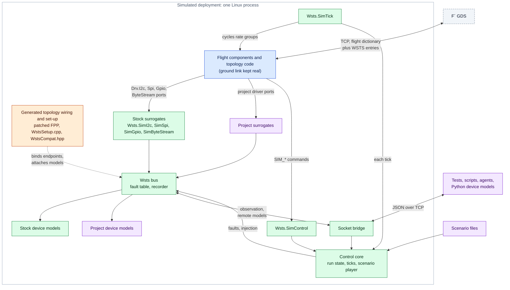
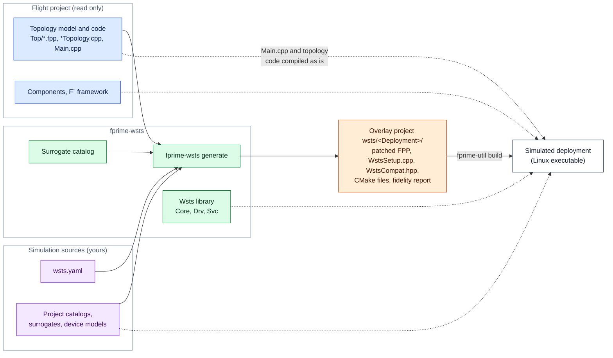

# F' Workstation Test Set (WSTS)

A Workstation Test Set (WSTS) toolkit for [F´](https://fprime.jpl.nasa.gov/): it runs
flight software on a developer workstation against simulated hardware. It takes an
existing F´ deployment and produces a new deployment that runs natively on a Linux host,
with the hardware-facing components replaced by simulation surrogates. The flight
deployment is not modified, and it does not have to target Linux: a VxWorks deployment
converts the same way.

The name comes from the Workstation Test Set used on the Mars Science Laboratory mission,
the software-only test environment that is the spiritual ancestor of this idea.

It is meant for integration testing in CI, closed-loop development by people or agents,
and systems and operations testing.

## How it fits together

Every piece of a simulated deployment comes from one of four places, and the diagrams in
these documents colour them the same way:

| | Comes from | Examples |
|---|---|---|
| 🟦 | **Flight software**, used unchanged | project components, `Main.cpp`, topology code, the F´ framework |
| 🟩 | **fprime-wsts**, the same for every project | stock surrogates, bus, control core, bridge, stock device models, the generator |
| 🟧 | **Generated** by `fprime-wsts generate` | patched topology model, `WstsSetup.cpp`, `WstsCompat.hpp`, build files, fidelity report |
| 🟪 | **Written by you** for your project | manifest, project surrogates and catalogs, device models, scenarios, tests |

A simulated deployment is one Linux process. Flight software runs as in flight down to
the driver ports; below them, surrogates hand each transaction to the WSTS bus, where
faults are applied, traffic is recorded and device models answer:



The simulated deployment is built from an overlay project that the generator writes next
to (or outside) the flight project. The flight project is only read:



Most projects write only the manifest and, where the stock models are not enough, a few
device models. [docs/design.md](docs/design.md) has more detailed diagrams of each part.

## What you get

- **Device simulators as F´ components**: simulators a project already has as components
  are added to the simulated topology from the manifest and put behind a bus endpoint with
  the `Wsts.BusByteStreamDevice` adapter, with their own commands, telemetry and scheduling.
- **Surrogate components** for the standard driver interfaces: `Wsts.SimByteStream` (UART),
  `Wsts.SimI2c`, `Wsts.SimSpi`, `Wsts.SimGpio`, `Wsts.SimTick`. They are ordinary F´ components,
  and projects write their own the same way.
- **`fprime-wsts generate`**: finds the hardware instances in a topology, retypes them to
  surrogates, wires in the WSTS control component, and writes a buildable overlay project.
  Hand-written topology code is reused unchanged.
- **Simulation control**: pause, resume and time scale; fault injection on any bus endpoint;
  direct input/output injection; scenario files; recording and replay. The same actions are
  available as F´ commands (`Wsts.SimControl`, with its own events and telemetry), over a
  socket bridge, and in scenario files.
- **A Python client and launcher** for tests and agents: `fprime-wsts run`, the `WstsBridge`
  class, and pytest fixtures.
- **Multi-computer systems**: several deployments run as one simulated system, with the
  UART or Ethernet links between them carried by WSTS, one GDS on a merged dictionary, and
  faults on the links. See [docs/systems.md](docs/systems.md).
- **A fidelity report** for every generated deployment, stating what was replaced and what
  the simulation does not reproduce.

## Quick start

Requirements: Linux, CMake, a C++ compiler, Python 3.9 or later.

```bash
git clone --recurse-submodules <this repository>
```

```bash
python3 -m venv venv && . venv/bin/activate
```

```bash
pip install -r lib/fprime/requirements.txt -e ./python
```

Convert the Linux example, build it and run it:

```bash
fprime-wsts generate examples/linux-demo/LinuxDemo/wsts.yaml
```

```bash
cd examples/linux-demo/wsts/LinuxDemo && fprime-util generate && fprime-util build
```

```bash
fprime-wsts run . --gds
```

`examples/linux-demo/LinuxDemo` is a flight deployment for a Linux single-board computer:
an IMU on I2C, a serial temperature sensor, a heater pin and an over-temperature switch.
Its manifest (`wsts.yaml`) names no drivers. The five hardware instances are found from the
surrogate catalog; the manifest only says which device models sit behind the buses.

`examples/vx-demo/VxDemo` targets VxWorks. It uses the `fprime-vxworks` UART driver and
watchdog timer and has no `main()`. `fprime-wsts generate examples/vx-demo/VxDemo/wsts.yaml`
produces a deployment that builds and runs on Linux with no VxWorks toolchain installed.

`examples/subtop-demo/SubtopDemo` is a VxWorks deployment assembled from subtopologies. Its
UART driver is not in the deployment at all: it is an instance of a subtopology in a
project library (`lib/sensor-lib`), opened and started by that subtopology's phase code,
and the project overrides configuration of the library and of the framework with
`CONFIGURATION_OVERRIDES`. The generator finds the driver as `SensorLink.uart`, patches a
copy of the subtopology and builds it in place of the original; the library is not
touched. See [Instances inside subtopologies](docs/design.md#instances-inside-subtopologies).

`examples/subtop-demo-sim` is a simulation project for that deployment in which the
device simulators are themselves F´ components: a queued `SerialSensorSim` with its own
command, parameter, event and telemetry, scheduled by a flight rate group and reached
through the `Wsts.BusByteStreamDevice` adapter on the UART's bus endpoint. A second
simulator is stepped at 125 Hz by a rate group of the simulation behind a `Wsts.SimCycle`
clock, although the flight tick is 10 Hz. The project also vendors a library of its own,
overrides configuration that the flight project overrides too, and replaces the flight
time source with a component that uses no bus endpoint. The flight project is not touched. See
[Device simulators as F´ components](docs/surrogate-guide.md#device-simulators-as-f-components).

`examples/linux-demo-sim` keeps the simulation out of the flight project altogether. Its
manifest names the flight project (`project: ../linux-demo`), and it holds its own
surrogate (a mirror of the GPIO driver) and device model (the IMU). The generated
deployment goes to `examples/linux-demo-sim/wsts/` and is not checked in. See
[Where simulation code lives](docs/surrogate-guide.md#where-simulation-code-lives).

`examples/hub-demo` is a flight system of two computers, `Cdh` and `Payload`, joined by an
F´ `GenericHub` over Ethernet. Its system manifest (`wsts-system.yaml`) names the two
deployments and the link between them:

```bash
fprime-wsts generate examples/hub-demo/wsts-system.yaml
```

```bash
for e in cdh payload; do (cd examples/hub-demo/wsts/HubDemo/$e && fprime-util generate && fprime-util build); done
```

```bash
fprime-wsts run examples/hub-demo/wsts/HubDemo --gds
```

Both deployments start, the hub link comes up, and one GDS commands either computer with
the merged dictionary.

## Driving a simulation

From Python (tests, scripts, agents):

```python
from fprime_wsts.bridge import WstsBridge

with WstsBridge("tcp:50100") as sim:
    sim.subscribe()
    sim.fault_set("imuBus", "error", arg=3, count=5)   # five failed I2C transactions
    sim.inject_text("sensorUart", "$TEMP,48.0\n")       # bytes "from the device"
    sim.gpio_force("switchPin", True)                   # drive an input pin
    sim.advance(20)                                     # wait 20 simulation ticks
    print(sim.gpio_get("heaterPin"), sim.status())
```

From the ground system, with the commands on the `wstsControl` instance: `SIM_PAUSE`,
`SIM_RESUME`, `SIM_SET_RATE`, `FAULT_SET`, `FAULT_CLEAR`, `INJECT_BYTES`, `INJECT_TEXT`,
`GPIO_FORCE`, `I2C_REG_SET`, `MODEL_SET`, `SCENARIO_LOAD`, `SCENARIO_START`,
`SCENARIO_STOP`, `RECORD_START`, `RECORD_STOP`.

From a scenario file, one action per line, keyed on simulation ticks:

```json
{"tick": 20, "op": "inject_bytes", "endpoint": "sensorUart", "text": "$TEMP,95.5\n"}
{"tick": 25, "op": "gpio_force", "endpoint": "switchPin", "level": true}
{"tick": 40, "op": "fault_set", "endpoint": "imuBus", "kind": "error", "arg": 3, "ticks": 30}
```

```bash
fprime-wsts run . --gds --scenario overtemp.jsonl --record run1.jsonl
```

A recording is itself a scenario: load it again to replay the run.

## Documentation

| | |
|---|---|
| [docs/design.md](docs/design.md) | Architecture, how the transform works, roadmap |
| [docs/reference.md](docs/reference.md) | Manifest, catalog, actions, faults, scenario and bridge formats, CLI |
| [docs/systems.md](docs/systems.md) | Systems of several compute elements: links, ID windows, running and controlling |
| [docs/fidelity.md](docs/fidelity.md) | What the simulation reproduces and what it does not |
| [docs/surrogate-guide.md](docs/surrogate-guide.md) | Writing surrogates and device models |
| [docs/vxworks-conversion.md](docs/vxworks-conversion.md) | Converting a non-Linux deployment |
| [AGENTS.md](AGENTS.md) | Working in this repository, and using the toolkit from an agent |

## Running the tests

```bash
pytest python/tests
```

```bash
fprime-util generate --ut && (cd Wsts/Core && fprime-util check)
```

End-to-end, after building a generated deployment (shown for LinuxDemo):

```bash
D=examples/linux-demo/wsts/LinuxDemo; pytest tests/e2e/test_linux_demo.py -p fprime_wsts.pytest_plugin --wsts-deployment $D --wsts-gds --dictionary $D/build-artifacts/Linux/LinuxDemo/dict/LinuxDemoTopologyDictionary.json
```

For SubtopDemo, whose driver is inside a library subtopology:

```bash
D=examples/subtop-demo/wsts/SubtopDemo; pytest tests/e2e/test_subtop_demo.py -p fprime_wsts.pytest_plugin --wsts-deployment $D --wsts-gds --dictionary $D/build-artifacts/Linux/SubtopDemo/dict/SubtopDemoTopologyDictionary.json
```

For the same deployment with the simulator component of `examples/subtop-demo-sim`:

```bash
D=examples/subtop-demo-sim/wsts/SubtopDemo; pytest tests/e2e/test_subtop_demo_sim.py -p fprime_wsts.pytest_plugin --wsts-deployment $D --wsts-gds --dictionary $D/build-artifacts/Linux/SubtopDemo/dict/SubtopDemoTopologyDictionary.json
```

For the two-computer system (the merged dictionary is written when the system starts):

```bash
D=examples/hub-demo/wsts/HubDemo; pytest tests/e2e/test_hub_demo.py -p fprime_wsts.pytest_plugin --wsts-system $D --wsts-gds --dictionary $D/wsts-logs/HubDemoDictionary.json
```

## Status

Built against F´ v4.4.2. Working today: the surrogates and transform above, real-time and
scaled simulation time, faults, scenarios, record/replay, the bridge, multi-element systems
with byte stream links, substituting instances defined inside subtopologies, the examples.
Designed but not built yet: deterministic stepped time (and with it lockstep across the
elements of a system), GPIO links between elements, a POSIX-backed VxWorks API shim,
file-system path remapping. See
[docs/design.md](docs/design.md#roadmap).
