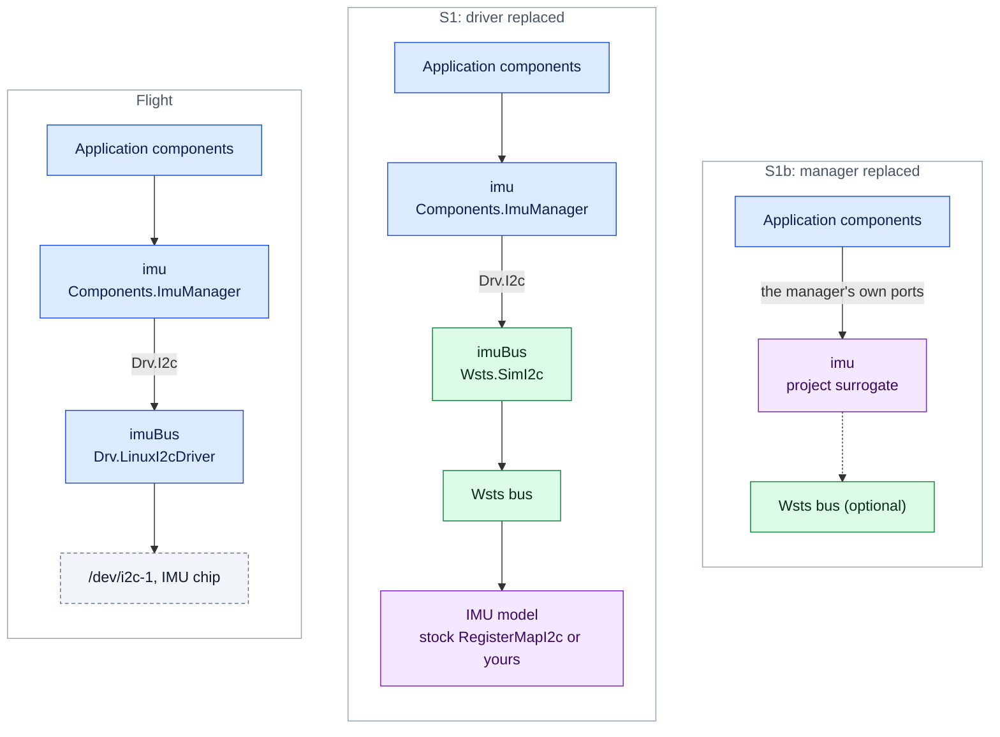
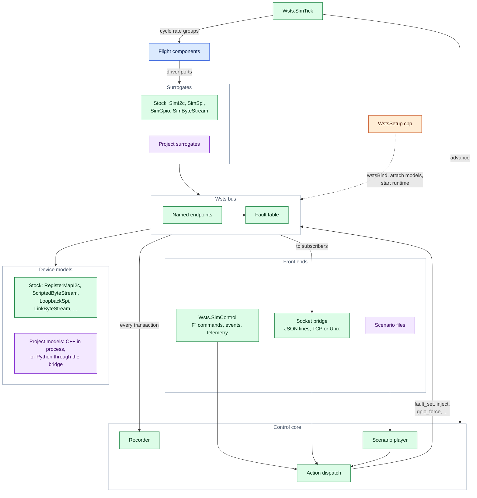
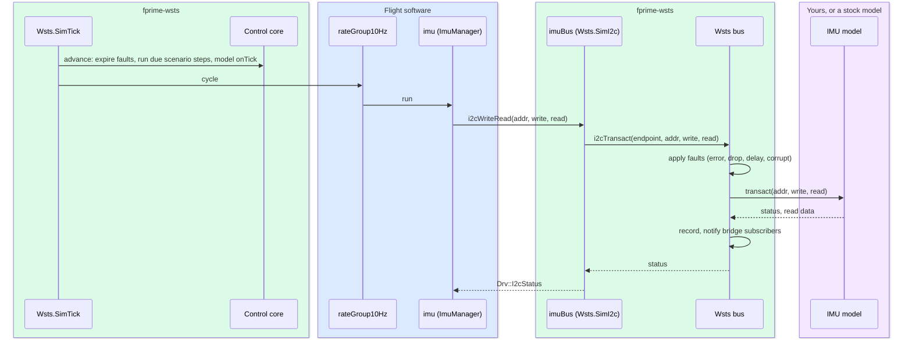
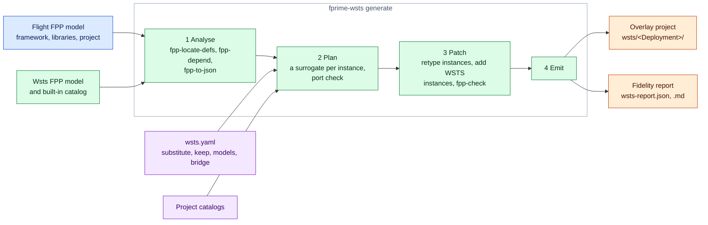
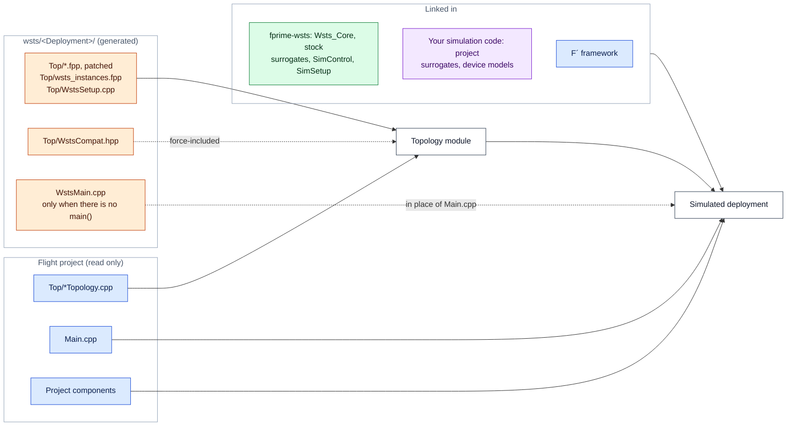
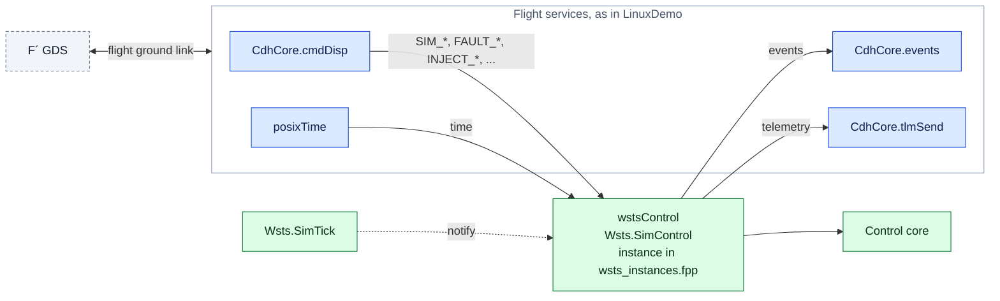

# Design

## Goals

1. Developers implement hardware simulation surrogates as ordinary F´ components.
2. A flight deployment is converted to a simulated one automatically, without editing it.
3. Deployments that target another operating system (VxWorks) convert too, with thin
   shims and stated fidelity trade-offs.
4. The result suits CI, closed-loop agentic development and operations testing: one
   command to run, scriptable control, repeatable scenarios, machine-readable output.

## Reading the diagrams

The diagrams colour each piece by where it comes from:

| | Comes from | What belongs here |
|---|---|---|
| 🟦 | **Flight software**, used unchanged | The F´ framework, project components, `Main.cpp`, hand-written topology code, the ground link driver |
| 🟩 | **fprime-wsts**, the same for every project | `Wsts/Core` (bus, control core, recorder, bridge, stock models, links), the stock surrogates in `Wsts/Drv` and `Wsts/Svc`, the built-in catalog, the generator and Python client |
| 🟧 | **Generated** by `fprime-wsts generate` | Everything under `wsts/<Deployment>/`: patched topology FPP, `wsts_instances.fpp`, `WstsSetup.cpp`, `WstsCompat.hpp`, `WstsMain.cpp`, build files, the fidelity report, `wsts-system.json` |
| 🟪 | **Written by you** for your project | `wsts.yaml` and `wsts-system.yaml`, project catalogs, project surrogates, device models (C++ or Python), scenarios, tests |
| ⬜ | Outside tools | The GDS, the host |

Generated files are never edited: change the manifest or the generator and regenerate.

## Where the simulation is cut in

F´ drivers are defined against FPP interfaces (`Drv.I2c`, `Drv.Spi`, `Drv.Gpio`,
`Drv.ByteStreamDriver`, `Drv.Tick`). A surrogate implements the same interface, so it can
take the place of a driver instance without any change to the components that use it.
There are three places a deployment can be cut, and they trade effort against fidelity:

| Seam | What is replaced | Flight code exercised | Status |
|---|---|---|---|
| S1 topology | A driver instance, retyped to a surrogate with the same ports | Everything above the driver | Built |
| S1b manager | A whole device-manager instance, replaced by a project surrogate | Everything above the manager | Built (same mechanism) |
| S2 OSAL | An `Os_*` implementation (time, files, queues) | All F´ code, including drivers | Platform swap built; sim-specific implementations planned |
| S3 OS API | The target OS's headers, implemented on POSIX | Project code that calls the OS directly | Planned |

The seam is chosen per instance. The default is S1 from the surrogate catalog.

The same I2C device in flight and at the two topology seams, using the LinuxDemo names:



Everything above the replaced instance is flight code, so the lower the seam, the more
flight code a test exercises.

## Runtime

**Bus** (`Wsts/Core/Bus`). An in-process backplane with named endpoints. Surrogates call it
from their port handlers; device models attach to it. Every transaction passes through the
fault table and is reported to the recorder and bridge. Because faults and recording sit
on the bus, they work the same whether a model is C++ in the process, Python on the other
end of the bridge, or absent.

**Control core** (`Wsts/Core/Control`). Owns run state, the tick count, the scenario player
and the recorder. It executes *actions*: small flat JSON objects such as
`{"op": "fault_set", "endpoint": "imuBus", "kind": "error"}`. Three front ends produce
actions, so they can all do the same things:

- `Wsts.SimControl`, an F´ component with commands, events and telemetry;
- the socket bridge (`Wsts/Core/Bridge`), newline-delimited JSON over TCP or a Unix socket;
- scenario files, one action per line with a tick.

**Surrogates** (`Wsts/Drv`, `Wsts/Svc`). Passive F´ components. Each is bound to one bus
endpoint by generated code calling `wstsBind(endpoint, options)`. The standard ones also
accept the calls flight topology code makes on the drivers they replace (`open`, `start`,
`startTimer`, ...), so that code compiles unchanged.

**Models** (`Wsts/Core/Models`). Plain C++ classes implementing `I2cDevice`, `SpiDevice`,
`ByteStreamDevice` or `GpioDevice`. They are not F´ components, so they add nothing to the
flight dictionary or connection graph.

**Time.** `Wsts.SimTick` replaces the deployment's tick source. Each tick it advances the
control core (fault expiry, scenario steps, model ticks) and then cycles the flight rate
groups. Ticks are paced by the wall clock divided by the time scale. Pausing stops the
ticks, so the flight rate groups stop too.

How the parts connect inside the process. The three front ends all reach the control
core, and everything that touches a device goes through the bus:



One tick of LinuxDemo, and the I2C transaction it causes:



In `responses` replay the bus answers from the recording and the model is not called.

## The transform

`fprime-wsts generate <manifest>` does the following.

1. **Analyse.** FPP files are found under the framework, the project's libraries, the
   project and this toolkit, then `fpp-locate-defs`, `fpp-depend` and `fpp-to-json` produce
   the model. Nothing is built, so a deployment whose build cannot even be configured on
   the host (VxWorks) is analysed like any other.
2. **Plan.** For each instance in the topology, in order: a `substitute` entry in the
   manifest; else the catalog entry that `replaces` its component; else, if the component's
   module is `restrict_platforms`-gated off Linux, the single catalog surrogate whose ports
   cover every port the topology connects (an error listing candidates if there is not
   exactly one). `keep` exempts an instance. The surrogate must serve every connected port
   with the same port type and direction.
3. **Patch.** The topology FPP files are copied and edited at positions taken from the FPP
   AST: the component name in each substituted instance definition is replaced (queue and
   task attributes are removed when a passive surrogate replaces an active component), and
   the WSTS instances are added to the topology. Base IDs do not move. The result is run
   through `fpp-check`.
4. **Emit** an overlay project (below) and the fidelity report.



### The overlay project

```
<output>/
  settings.ini, CMakeLists.txt     host toolchain; adds only the project modules the topology needs
  <Deployment>/CMakeLists.txt      reuses the flight Main.cpp, or WstsMain.cpp when there is no main()
  <Deployment>/Top/
    *.fpp                          patched copies of the topology model
    wsts_instances.fpp              the wstsSetup and wstsControl instances
    WstsSetup.cpp                   binds surrogates, builds and attaches models, starts the runtime
    WstsCompat.hpp                  force-included: aliases flight driver classes to their surrogates
  wsts-report.json, wsts-report.md   fidelity report
```

Three things make it work without touching the flight project:

- **Same names.** The overlay keeps the deployment's FPP module, topology name and
  directory name, so the generated `…TopologyAc.hpp`, the C++ namespace and the dictionary
  names are what the hand-written code and ground configuration expect.
- **Type aliases.** `WstsCompat.hpp` declares, for example,
  `namespace Drv { using LinuxGpioDriver = ::Wsts::SimGpio; }`. Flight code such as
  `pin.open("/dev/gpiochip0", 17, Drv::LinuxGpioDriver::GPIO_OUTPUT)` then compiles against
  the surrogate, which provides the same enumerators and an `open` that accepts them.
- **An anchor instance.** `wstsSetup` is an instance of `Wsts.SimSetup`, a component with no
  ports and no dictionary entries. The generator attaches topology phase code to it, which
  is how `WstsGenerated::setup()` runs inside the autocoded `configComponents()` without an
  edit to the flight topology code.

Project modules are added by path from the flight project (`add_fprime_subdirectory`), which
F´ allows because the flight project root is listed as a library location. A standalone
simulation project (a manifest with `project:`) is listed as a library location too: F´
includes its `library.cmake`, which builds its surrogates and models, and names their
modules relative to its root. The flight project is only read. Libraries the
simulated topology no longer references are dropped; build options that select the flight
toolchain or platform are not carried over. Both are listed in the report.

What the build of an overlay project compiles, and where each part comes from:



Only the topology module mixes sources: the flight topology code is compiled next to
generated files, against the surrogates that `WstsCompat.hpp` aliases in.

### WSTS control wiring

`wstsControl` (`Wsts.SimControl`) is given a base ID above every ID the flight topology
uses, so flight IDs are unchanged and the simulated dictionary is the flight dictionary
plus the WSTS entries. The topology's own pattern specifiers connect its command, event,
telemetry and time ports. If the topology defines telemetry packets, the WSTS channels are
added to the packet set's `omit` list. It is an active component with its own thread and
uses no flight rate-group port: the simulation tick notifies it.



The connections come from the topology's pattern specifiers, so they follow whatever the
flight topology names its services.

`control: none` in the manifest leaves it out. The bridge and scenarios still work.

## Systems of several elements

A flight system with more than one computer is one process per element, not one process
for all: an F´ deployment owns its process (topology globals, OSAL singletons), elements
may target different platforms, and each keeps its own dictionary and base IDs. The
system layer sits on top of the single-deployment transform and adds three things.

- **A system manifest** naming the elements (each an ordinary deployment manifest), the
  links between them, and the ID window routed to each. `generate` runs the transform
  once per element and writes `wsts-system.json`.
- **Links.** A link ends at a byte stream driver instance in each of two elements. Being
  the end of a link is a reason to substitute the instance, like a catalog entry. A
  `Wsts::LinkByteStream` model attached to each endpoint forwards what flight software
  sends over a Unix socket to its peer, which injects it on its own bus. Because the link
  is a model, faults and recording apply to it with no new mechanism, and everything
  above the driver (an F´ `GenericHub`, framing) runs as in flight.
- **One runner and one client.** `fprime-wsts run` starts every element, waits for the
  links, merges the dictionaries with F´'s own `fprime-merge-dictionary` and starts a
  single GDS on the ground element. `WstsSystem` holds a bridge per element.

Each element's `wstsControl` is placed inside the element's ID window, so the flight
routing (a command splitter and hub, say) delivers its commands and the merged dictionary
keeps the instances apart. Time remains per element: see [systems.md](systems.md).

## Dictionary fidelity

A general-purpose surrogate has no events or telemetry of its own, so when it replaces a
driver that does, those entries disappear from the simulated dictionary. The report lists
them. Where that matters, use a *mirror surrogate*: `fprime-wsts scaffold <Component>`
copies the component's model under a new name, giving a surrogate with identical ports
and dictionary entries.

## Record and replay

The recorder writes one JSON line per bus transaction and per executed action, with ticks
relative to the start of the recording. Because actions are recorded in the scenario
format, a recording loads as a scenario:

- **stimulus** mode re-applies the recorded actions against the live models;
- **responses** mode also replays what the devices answered (I2C/SPI read data, bytes
  received, GPIO input changes) with the models bypassed, reproducing a run without them.

Replay is repeatable to tick granularity. It is not cycle-exact: see
[fidelity.md](fidelity.md).

## Roadmap

1. **Stepped time.** A simulated `Os_RawTime` plus instrumented `Os_Queue`/`Os_Task`
   implementations that detect quiescence, selected per deployment with
   `CHOOSES_IMPLEMENTATIONS`. The bridge then steps the simulation tick by tick,
   deterministically and faster than real time.
2. **VxWorks API shim.** A POSIX-backed subset of `taskLib`, `semLib`, `msgQLib`, `wdLib`
   and `ioLib` so project components that include VxWorks headers compile unchanged.
3. **File-system remapping.** An `Os_File` implementation that maps target paths
   (`/ram0`, `/tffs0`) into a sandbox directory.
4. Substituting instances defined outside the deployment's `Top` directory (subtopologies).
5. 32-bit and big-endian build options; adapters to external dynamics simulators.
6. Systems: GPIO links, datagram and connection semantics for socket links, system-wide
   scenarios and merged recordings, and lockstep time across elements (after item 1).
