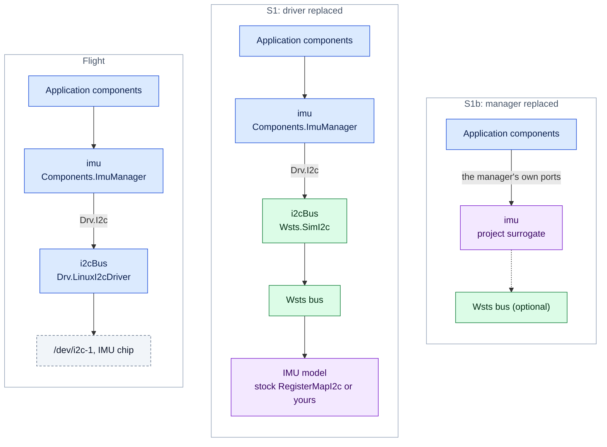
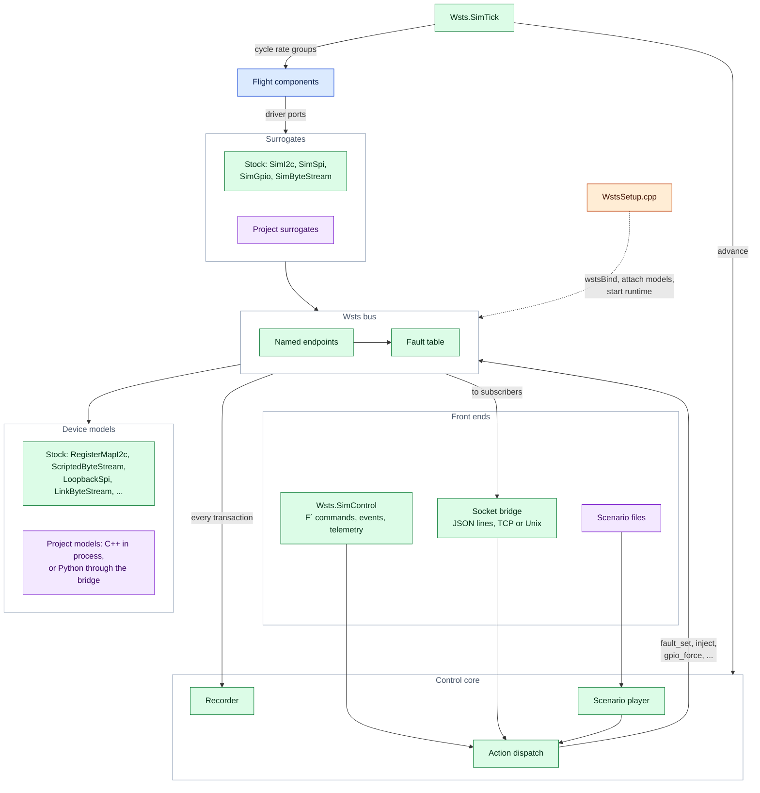
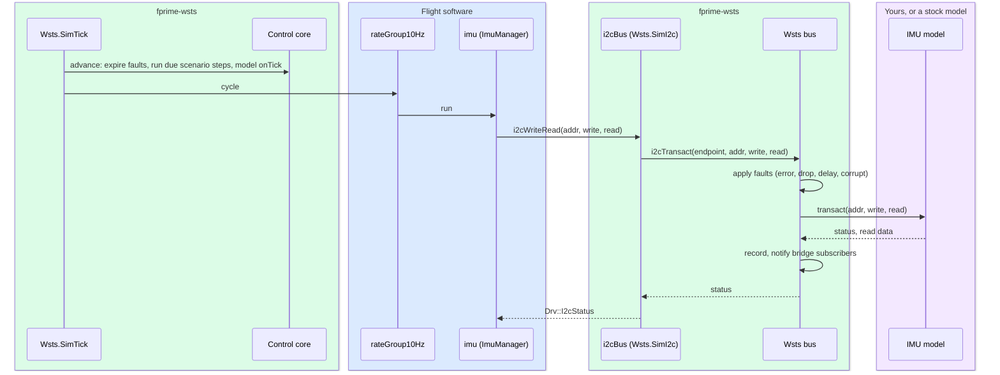
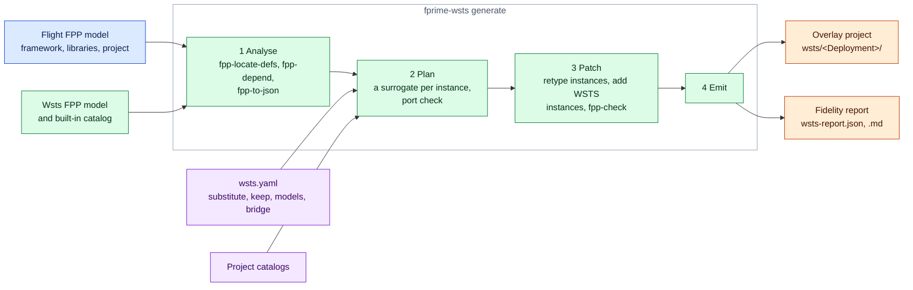
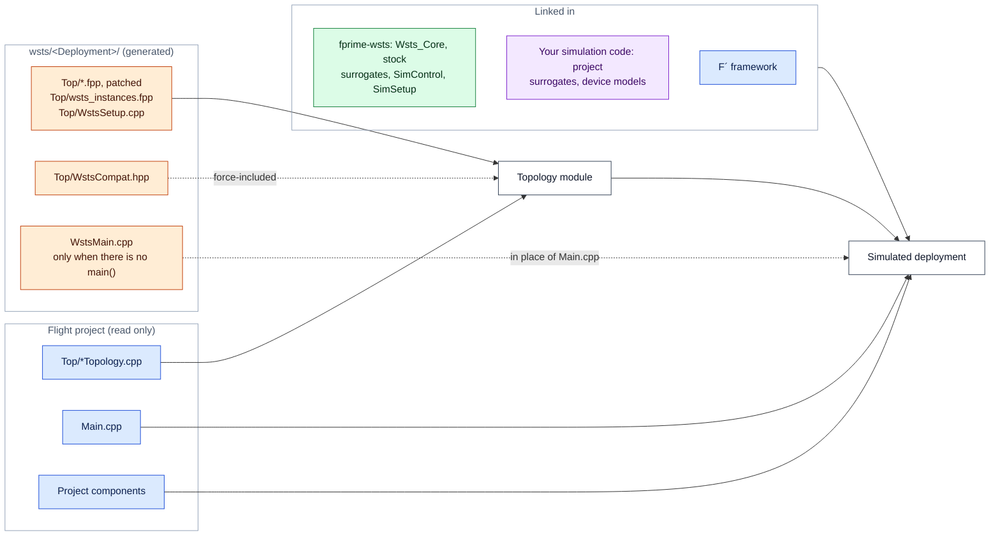
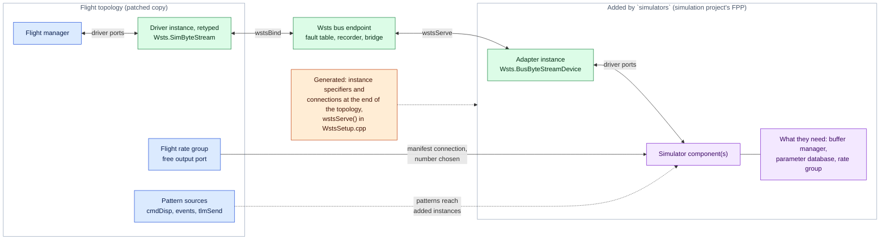
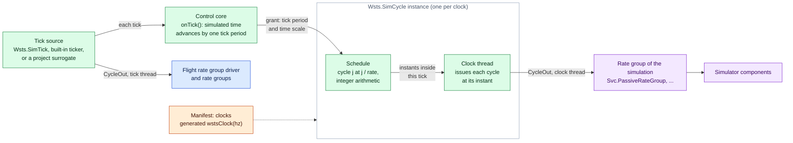
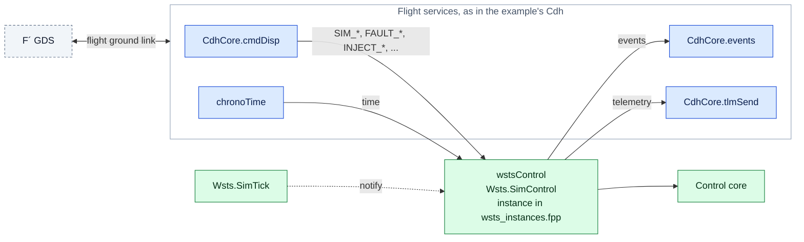

# Design

## Goals

1. Developers implement hardware simulation surrogates as ordinary F´ components.
2. A flight deployment is converted to a simulated one automatically, without editing it.
3. Deployments that target another operating system (VxWorks) convert too, with thin
   shims and stated fidelity trade-offs.
4. The result suits CI, closed-loop agentic development and operations testing: one
   command to run, scriptable control, repeatable scenarios, machine-readable output.

## Reading the diagrams

The diagrams colour each piece by where it comes from:

| | Comes from | What belongs here |
|---|---|---|
| 🟦 | **Flight software**, used unchanged | The F´ framework, project components, `Main.cpp`, hand-written topology code, the ground link driver |
| 🟩 | **fprime-wsts**, the same for every project | `Wsts/Core` (bus, control core, recorder, bridge, stock models, links), the stock surrogates in `Wsts/Drv` and `Wsts/Svc`, the built-in catalog, the generator and Python client |
| 🟧 | **Generated** by `fprime-wsts generate` | Everything under `wsts/<Deployment>/`: patched topology FPP, `wsts_instances.fpp`, `WstsSetup.cpp`, `WstsCompat.hpp`, `WstsMain.cpp`, build files, the fidelity report, `wsts-system.json` |
| 🟪 | **Written by you** for your project | `wsts.yaml` and `wsts-system.yaml`, project catalogs, project surrogates, device models (C++ or Python), scenarios, tests |
| ⬜ | Outside tools | The GDS, the host |

Generated files are never edited: change the manifest or the generator and regenerate.

## Where the simulation is cut in

F´ drivers are defined against FPP interfaces (`Drv.I2c`, `Drv.Spi`, `Drv.Gpio`,
`Drv.ByteStreamDriver`, `Drv.Tick`). A surrogate implements the same interface, so it can
take the place of a driver instance without any change to the components that use it.
There are three places a deployment can be cut, and they trade effort against fidelity:

| Seam | What is replaced | Flight code exercised | Status |
|---|---|---|---|
| S1 topology | A driver instance, retyped to a surrogate with the same ports | Everything above the driver | Built |
| S1b manager | A whole device-manager instance, replaced by a project surrogate | Everything above the manager | Built (same mechanism) |
| S2 OSAL | An `Os_*` implementation (time, files, queues) | All F´ code, including drivers | Platform swap built; sim-specific implementations planned |
| S3 OS API | The target OS's headers, implemented on POSIX | Project code that calls the OS directly | Planned |

The seam is chosen per instance. The default is S1 from the surrogate catalog.

The same I2C device in flight and at the two topology seams, using the names of the example's
`Payload` computer:



Everything above the replaced instance is flight code, so the lower the seam, the more
flight code a test exercises.

## Runtime

**Bus** (`Wsts/Core/Bus`). An in-process backplane with named endpoints. Surrogates call it
from their port handlers; device models attach to it. Every transaction passes through the
fault table and is reported to the recorder and bridge. Because faults and recording sit
on the bus, they work the same whether a model is C++ in the process, Python on the other
end of the bridge, or absent.

**Control core** (`Wsts/Core/Control`). Owns run state, the tick count, the scenario player
and the recorder. It executes *actions*: small flat JSON objects such as
`{"op": "fault_set", "endpoint": "i2cBus", "kind": "error"}`. Three front ends produce
actions, so they can all do the same things:

- `Wsts.SimControl`, an F´ component with commands, events and telemetry;
- the socket bridge (`Wsts/Core/Bridge`), newline-delimited JSON over TCP or a Unix socket;
- scenario files, one action per line with a tick.

**Device adapters** (`Wsts/Drv/BusByteStreamDevice`). The mirror image of a surrogate: an
F´ component that is the *device* on an endpoint, and offers the driver interface to a
simulator written as a component (see
[Simulator components](#simulator-components)).

**Surrogates** (`Wsts/Drv`, `Wsts/Svc`). Passive F´ components. Each is bound to one bus
endpoint by generated code calling `wstsBind(endpoint, options)`. The standard ones also
accept the calls flight topology code makes on the drivers they replace (`open`, `start`,
`startTimer`, ...), so that code compiles unchanged.

**Models** (`Wsts/Core/Models`). Plain C++ classes implementing `I2cDevice`, `SpiDevice`,
`ByteStreamDevice` or `GpioDevice`. They are not F´ components, so they add nothing to the
flight dictionary or connection graph.

**Time.** `Wsts.SimTick` replaces the deployment's tick source. Each tick it advances the
control core (fault expiry, scenario steps, model ticks) and then cycles the flight rate
groups. Ticks are paced by the wall clock divided by the time scale. Pausing stops the
ticks, so the flight rate groups stop too.

How the parts connect inside the process. The three front ends all reach the control
core, and everything that touches a device goes through the bus:



One tick of the example's `Payload` computer, and the I2C transaction it causes:



In `responses` replay the bus answers from the recording and the model is not called.

## The transform

`fprime-wsts generate <manifest>` does the following.

1. **Analyse.** FPP files are found under the framework, the project's libraries, the
   project and this toolkit, then `fpp-locate-defs`, `fpp-depend` and `fpp-to-json` produce
   the model. Nothing is built, so a deployment whose build cannot even be configured on
   the host (VxWorks) is analysed like any other. Configuration FPP is chosen as the build
   would choose it (see [Configuration overrides](#configuration-overrides)).
2. **Plan.** The topology's instances include those of every subtopology it imports,
   under their own qualified names (`SensorLink.uart`). For each instance, in order: a `substitute` entry in the
   manifest; else the catalog entry that `replaces` its component; else, if the component's
   module is `restrict_platforms`-gated off Linux, the single catalog surrogate whose ports
   cover every port the topology connects (an error listing candidates if there is not
   exactly one). `keep` exempts an instance. The surrogate must serve every connected port
   with the same port type and direction. The plan also looks at what cycles the flight
   rate groups and what supplies time: a kept project component in either role is
   reported, because on a workstation its interrupt or clock usually never arrives.
3. **Patch.** The FPP files that define the topology and the substituted instances are
   copied and edited at positions taken from the FPP AST: the component name in each
   substituted instance definition is replaced (queue and task attributes are removed when
   a passive surrogate replaces an active component), and the WSTS instances are added to
   the topology. Base IDs do not move. An instance defined outside the deployment's `Top`
   directory is patched in a copy of its own file (see
   [Instances inside subtopologies](#instances-inside-subtopologies)). The result is run
   through `fpp-check`, with the copies in place of the originals.
4. **Emit** an overlay project (below) and the fidelity report.



### The overlay project

```
<output>/
  settings.ini, CMakeLists.txt     host toolchain; adds only the project modules the topology needs
  <Deployment>/CMakeLists.txt      reuses the flight Main.cpp, or WstsMain.cpp when there is no main()
  <Deployment>/Top/
    *.fpp                          patched copies of the topology model
    wsts_instances.fpp              the wstsSetup and wstsControl instances
    WstsSetup.cpp                   binds surrogates, builds and attaches models, starts the runtime
    WstsCompat.hpp                  force-included: aliases flight driver classes to their surrogates
  <Lib>/<Sub>/                     only when a flight file outside Top needs an edit:
    <Sub>.fpp                      patched copy of the subtopology model
    CMakeLists.txt                 the original's, pointing back at the original for everything else
  wsts-report.json, wsts-report.md   fidelity report
```

Three things make it work without touching the flight project:

- **Same names.** The overlay keeps the deployment's FPP module, topology name and
  directory name, so the generated `…TopologyAc.hpp`, the C++ namespace and the dictionary
  names are what the hand-written code and ground configuration expect.
- **Type aliases.** `WstsCompat.hpp` declares, for example,
  `namespace Drv { using LinuxGpioDriver = ::Wsts::SimGpio; }`. Flight code such as
  `pin.open("/dev/gpiochip0", 17, Drv::LinuxGpioDriver::GPIO_OUTPUT)` then compiles against
  the surrogate, which provides the same enumerators and an `open` that accepts them.
- **An anchor instance.** `wstsSetup` is an instance of `Wsts.SimSetup`, a component with no
  ports and no dictionary entries. The generator attaches topology phase code to it, which
  is how `WstsGenerated::setup()` runs inside the autocoded `configComponents()` without an
  edit to the flight topology code.

Project modules are added by path from the flight project (`add_fprime_subdirectory`), which
F´ allows because the flight project root is listed as a library location. A standalone
simulation project (a manifest with `project:`) is listed as a library location too: F´
includes its `library.cmake`, which builds its surrogates and models, and names their
modules relative to its root. The flight project is only read. Libraries the
simulated topology no longer references are dropped; build options that select the flight
toolchain or platform are not carried over. Both are listed in the report.

What the build of an overlay project compiles, and where each part comes from:



Only the topology module mixes sources: the flight topology code is compiled next to
generated files, against the surrogates that `WstsCompat.hpp` aliases in.

### Instances inside subtopologies

A hardware driver is often not in the deployment's `Top` at all: it is an instance of a
subtopology that a library (or the framework, or the project) provides, and the deployment
imports the subtopology. The FPP analysis already flattens these, so planning treats
`SensorLink.uart` like any other instance. Patching is the same edit, made in a copy of
the subtopology's FPP file. What needs care is the build: a library is included whole
through its `library.cmake`, so the original subtopology module would be registered too,
and the FPP tools would see every definition of the subtopology twice.

The overlay therefore replaces **one module directory** of the library with its copy:

- The copy sits in the overlay at the path the original has below its root
  (`<output>/SensorLib/SensorLink/`). The overlay root is a build root like the library's,
  so everything F´ derives from the path (module name, include paths of generated headers)
  comes out the same as in the flight build.
- The copy's `CMakeLists.txt` is the original's with paths redirected: the patched FPP
  comes from the copy; headers such as `SubtopologyTopologyDefs.hpp`, and child modules
  such as `<Name>Config/`, are still the library's. The module of a flight driver that no
  instance uses any more is taken out of its `DEPENDS`, and a `restrict_platforms()` line
  is dropped.
- The overlay's root `CMakeLists.txt` sets `FPRIME_INCLUDE_FRAMEWORK_CODE` to `OFF`,
  defines its own `add_fprime_subdirectory()` that hands the replaced directory's copy to
  CMake under the original's module name and build directory and passes every other call
  through, and only then calls `fprime_setup_included_code()`, which reads the framework
  and the libraries.

The library stays in `library_locations`: its other modules build from it, its include
root resolves `<Lib>/<Sub>/SubtopologyTopologyDefs.hpp`, and its `library.cmake` runs with
whatever conditions it contains. Phase code attached to the instance is emitted into the
deployment's `TopologyAc.cpp`, which is in the topology module, so `WstsCompat.hpp` covers
it exactly as it covers hand-written topology code.

The same redirection serves a subtopology in the flight project (the generator adds
project modules itself, and the call is redirected like any other) and one in the
framework (`Svc/Subtopologies/…`, which the framework adds with the same function).

Alternatives that were rejected:

- **Shadowing the library**: leave it out of `library_locations` and add its modules one
  by one. F´ names a module, and finds its generated headers, by its path below the
  nearest build root; outside `library_locations` the library is not a build root, so
  every one of its modules would be renamed, and its include root, its `cmake/` module
  path and anything else its `library.cmake` does would have to be rebuilt by hand.
- **A generated wrapper library** whose `library.cmake` adds every original module except
  the patched one. It must re-create the library's own decisions (conditions around
  `add_fprime_subdirectory`, modules added from nested `CMakeLists.txt` files), which the
  generator can only guess from text, and it has the same build-root problem unless the
  original library also stays listed.
- **Leaving the original registered** and correcting it afterwards. F´ collects a
  module's FPP files for the location index while the module is being registered; there
  is no later point at which one can be taken out.

The cost of the chosen approach is that it overrides a CMake command, which CMake allows
once (the previous definition stays reachable under a leading underscore). The generated
file stops with a clear message if `add_fprime_subdirectory` has been overridden already.

Not supported: an instance defined in a file that belongs to no module directory, and two
replaced modules whose paths below their roots coincide.

### Simulator components

A device simulator may be an F´ component rather than a C++ model. It is not a
surrogate: the flight driver instance is still retyped to the stock surrogate, and the
link still runs over the bus. The simulator is behind the endpoint, where a model would
be, reached through an adapter instance:



**Where the adapter sits.** `Wsts.BusByteStreamDevice` implements the bus's
`ByteStreamDevice` interface and is attached with `Bus::attachByteStream`, exactly as a
C++ model is. So it receives what flight software sent after the fault table has been
applied, and its replies go through `byteStreamInject` with source `model`: faults in
both directions, recording, replay of recorded responses and bridge injection all behave
as with a model. It holds no lock while delivering, so a simulator with a synchronous
receive port may reply from inside the call. The other bus kinds would follow the same
shape (an `I2cDevice` that calls out on a `Drv.I2c` output port); only the byte stream
one is built.

**How instances get into the topology.** The simulation project's FPP defines the
instances, with their phase code, and usually a subtopology of them with its internal
connections. That FPP names nothing of the flight deployment. The manifest lists what to
add (`simulators.topologies`, `simulators.instances`) and the connections between added
and flight instances (`simulators.connections`). The generator writes both at the end of
the patched topology's body: instance specifiers, then one `connections WstsSimulators`
block.

Connections to flight are in the manifest, not in the simulation's FPP, for three reasons:

- They are specific to one deployment (which rate group has room, what the UART endpoint
  is called), as the rest of the manifest is. The simulator's FPP stays usable with
  another deployment, or in the project's existing test deployment.
- The generator has to see them. It chooses the port number on a rate group, refuses
  when none is free, and checks the result against the flight model. Connections buried
  in an imported topology would be numbered by FPP, after the fact.
- An FPP topology that named flight instances would have to be written against the flight
  module names and could not be checked on its own.

Connections among the added instances stay in FPP, where they belong to the simulator.

**Keeping flight as it is.** Three things could disturb the flight topology, and each is
handled and then verified:

- *Port numbers on port arrays.* A manifest connection that leaves a port array gets an
  explicit number: the lowest one free in the model FPP resolved for the flight topology.
  Flight connections, numbered or not, are never rewritten.
- *Health ping ports.* FPP numbers them by instance name over every instance the health
  pattern reaches, so an added instance with ping ports would shift flight ones, and the
  flight ping table is indexed by port number. When an added instance has ping ports, the
  flight pattern is given its current targets explicitly. Placing added instances last in
  the topology does not help: the order of instance specifiers does not enter into it.
- *IDs.* Added instances keep the base IDs of their definitions; overlaps are errors. The
  WSTS instances move above them.

After patching, the generator analyses the patched model and compares it with the flight
one: every explicit flight connection and every health connection must have the port
numbers it had. Command, event and telemetry pattern connections are exempt: their
registration port numbers follow the instance list, and nothing is indexed by them.

**Retyping to a different shape.** A simulator that replaces a driver outright (rather
than sitting behind the stock surrogate) may be of another kind and name its ports
differently. `ports` and the attribute keys on a `substitute` or catalog entry cover that:
connections are renamed or commented out at the positions the FPP model gives, in the
deployment's files or in copies of subtopology files (the mechanism of
[Instances inside subtopologies](#instances-inside-subtopologies) extends to any flight
file that needs an edit), and queue attributes are inserted in the order FPP requires.

### Clocks of the simulation

A simulator may need a rate that flight has no rate group for: faster than the flight
tick, or not a multiple of it. The tick surrogate cannot serve it (its cycle output
drives the flight rate group driver, and an output drives one input), and the rate must
not depend on which tick source a deployment has. So the mechanism is in the control
core, and `Wsts.SimCycle` is a thin component on top of it.



Two designs were possible.

- **(a) Free-running**: each cycle source has a thread paced by the wall clock, scaled by
  the time scale and gated by the pause flag. Simple, and independent of the tick source.
  But its time is the host's, not the simulation's: its count against the flight tick
  drifts with every scheduling delay, and it has nothing to follow once simulated time is
  stepped (roadmap 1), when the wall clock stops meaning anything.
- **(b) Driven by the core**: the core keeps simulated time and each cycle source fires as
  that time crosses its period.

(b) was chosen, in a form that avoids its usual drawback of firing in a burst at each
tick. The core does not issue the cycles; it *grants* them. On every tick it tells each
clock how much simulated time the tick covers and the current time scale. The clock's
schedule (integer arithmetic on nanoseconds and milli-hertz) yields the cycles whose
instants lie in that interval, with their offsets, and the clock's own thread issues
each at its offset, divided by the time scale, from the moment the tick arrived. So:

- the count is exact in simulated time and cannot drift: 64 ticks of a 64 Hz source carry
  exactly 1000 cycles of a 1000 Hz clock, in grants of 15 and 16;
- cycles are evenly spaced, and cycle 0 coincides with the first tick, which fixes the
  phase;
- no ticks, no grants: pause, resume and the time scale need no code of their own, and
  work for any tick source. Cycles already granted when a pause arrives are held and keep
  their spacing afterwards;
- the flight cycle is never delayed by a simulator: handlers run on the clock's thread.
  A clock that cannot keep up drops cycles beyond a few ticks' worth and says so, rather
  than growing a backlog;
- under stepped time the same grants apply; only the pacing inside a tick changes, from
  the wall clock to the stepper.

The one thing the core needs that it did not have is the simulated duration of a tick.
Tick sources declare it (`Control::setTickPeriod`; `Wsts.SimTick` and the built-in ticker
do). For a project tick surrogate that only calls `onTick()`, the core measures the
interval between ticks and uses that, which is as exact as the measurement. `tick` keeps
its meaning everywhere: it counts flight ticks.

### Configuration overrides

F´ 4.4 lets a configuration module replace files of earlier configuration modules:
`register_fprime_config(CONFIGURATION_OVERRIDES …)` matches a file to the one it replaces
by file name only, in the order platform, framework defaults, libraries, project, and the
last registration wins. The build applies this by copying files into the build cache, but
the generator's analysis reads source files, so it applies the same rule itself: it reads
the `register_fprime_config` calls under the framework, the libraries and the project,
and of the configuration files with an overridden name only the winner goes to
`fpp-locate-defs`. The report lists what was applied. The CMake files are read as text:
an override listed through a variable is not seen, and a call inside `if()` is taken to
apply. For projects that override by convention alone, a file in a directory called
`config` still replaces `default/config/<same name>`.

**The simulation's overrides come last.** A simulation that adds instances often has to
raise a limit that the flight project itself overrides (rate group ports, the opcode
table). Its configuration module must therefore register after the flight project's. But
the simulation is a library of the overlay, and libraries are read before the overlay's
own `CMakeLists.txt` adds the flight modules: left alone, the flight override would win
in the build while the analysis, which orders roots framework, libraries, flight project,
simulation, said the simulation's had won. The overlay closes the gap with the mechanism
of [Instances inside subtopologies](#instances-inside-subtopologies): its
`add_fprime_subdirectory()` skips the simulation's override modules while the libraries
are read, and the root `CMakeLists.txt` adds them after the flight modules. Because the
flight modules are registered by then, a file that only the flight project supplies can
be overridden too. Further libraries of the simulation (`libraries.sim`) are roots in
their own right, in the analysis and in the build, so a library vendored inside the
simulation project keeps its own module names.

### WSTS control wiring

`wstsControl` (`Wsts.SimControl`) is given a base ID above every ID the flight topology
uses, so flight IDs are unchanged and the simulated dictionary is the flight dictionary
plus the WSTS entries. The topology's own pattern specifiers connect its command, event,
telemetry and time ports. If the topology defines telemetry packets, the WSTS channels are
added to the packet set's `omit` list. It is an active component with its own thread and
uses no flight rate-group port: the simulation tick notifies it.



The connections come from the topology's pattern specifiers, so they follow whatever the
flight topology names its services.

`control: none` in the manifest leaves it out. The bridge and scenarios still work.

## Systems of several elements

A flight system with more than one computer is one process per element, not one process
for all: an F´ deployment owns its process (topology globals, OSAL singletons), elements
may target different platforms, and each keeps its own dictionary and base IDs. The
system layer sits on top of the single-deployment transform and adds three things.

- **A system manifest** naming the elements (each an ordinary deployment manifest), the
  links between them, and the ID window routed to each. `generate` runs the transform
  once per element and writes `wsts-system.json`.
- **Links.** A link ends at a byte stream driver instance in each of two elements. Being
  the end of a link is a reason to substitute the instance, like a catalog entry. A
  `Wsts::LinkByteStream` model attached to each endpoint forwards what flight software
  sends over a Unix socket to its peer, which injects it on its own bus. Because the link
  is a model, faults and recording apply to it with no new mechanism, and everything
  above the driver (an F´ `GenericHub`, framing) runs as in flight.
- **One runner and one client.** `fprime-wsts run` starts every element, waits for the
  links, merges the dictionaries with F´'s own `fprime-merge-dictionary` and starts a
  single GDS on the ground element. `WstsSystem` holds a bridge per element.

Each element's `wstsControl` is placed inside the element's ID window, so the flight
routing (a command splitter and hub, say) delivers its commands and the merged dictionary
keeps the instances apart. Time remains per element: see [systems.md](systems.md).

## Dictionary fidelity

A general-purpose surrogate has no events or telemetry of its own, so when it replaces a
driver that does, those entries disappear from the simulated dictionary. The report lists
them. Where that matters, use a *mirror surrogate*: `fprime-wsts scaffold <Component>`
copies the component's model under a new name, giving a surrogate with identical ports
and dictionary entries.

## Record and replay

The recorder writes one JSON line per bus transaction and per executed action, with ticks
relative to the start of the recording. Because actions are recorded in the scenario
format, a recording loads as a scenario:

- **stimulus** mode re-applies the recorded actions against the live models;
- **responses** mode also replays what the devices answered (I2C/SPI read data, bytes
  received, GPIO input changes) with the models bypassed, reproducing a run without them.

Replay is repeatable to tick granularity. It is not cycle-exact: see
[fidelity.md](fidelity.md).

## Roadmap

1. **Stepped time.** A simulated `Os_RawTime` plus instrumented `Os_Queue`/`Os_Task`
   implementations that detect quiescence, selected per deployment with
   `CHOOSES_IMPLEMENTATIONS`. The bridge then steps the simulation tick by tick,
   deterministically and faster than real time.
2. **VxWorks API shim.** A POSIX-backed subset of `taskLib`, `semLib`, `msgQLib`, `wdLib`
   and `ioLib` so project components that include VxWorks headers compile unchanged.
3. **File-system remapping.** An `Os_File` implementation that maps target paths
   (`/ram0`, `/tffs0`) into a sandbox directory.
4. 32-bit and big-endian build options; adapters to external dynamics simulators.
5. Systems: GPIO links, datagram and connection semantics for socket links, system-wide
   scenarios and merged recordings, and lockstep time across elements (after item 1).
