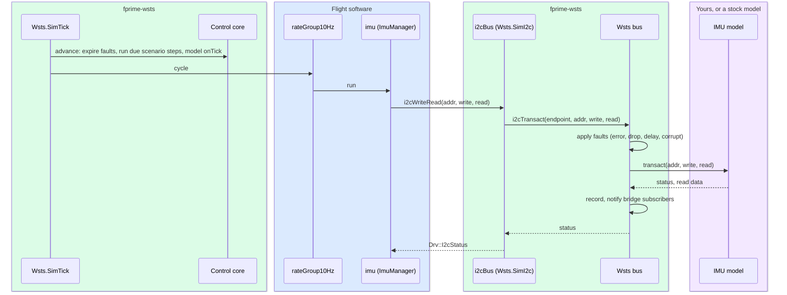

# Core Concepts

A handful of ideas carry the whole toolkit. This page introduces each one; the user guide
then shows how to use them.

## Where each piece comes from

Every piece of a simulated deployment comes from one of four places, and the diagrams on
this site colour them the same way:

Flight software, used unchanged
fprime-wsts, the same for every project
Generated by fprime-wsts generate
Written by you for your project

| | Comes from | Examples |
|---|---|---|
| 🟦 | **Flight software** | Project components, `Main.cpp`, hand-written topology code, the F´ framework, the ground link driver |
| 🟩 | **fprime-wsts** | Stock surrogates, the bus, the control core, the bridge, stock device models, the generator and Python client |
| 🟧 | **Generated** | Everything under `wsts/<Deployment>/`: patched topology FPP, `WstsSetup.cpp`, `WstsCompat.hpp`, build files, the fidelity report |
| 🟪 | **Yours** | Manifests, project surrogates and catalogs, device models, scenarios, tests |

Most projects write only a manifest and, where the stock models are not enough, a few
device models.

## The pieces

### Flight project and simulation project

The **flight project** is your existing F´ project. `fprime-wsts` only ever reads it.

The **simulation project** is where everything you write for simulation lives: the
manifest, device models, surrogates, scenarios. It is usually a sibling directory (or its
own repository) that names the flight project with `project: ../my-mission`, and it is
itself an F´ library, so its modules build alongside the flight modules.
[Create one](../user-guide/simulation-project.md).

### Manifest

A YAML file, `wsts.yaml`, that names the deployment to simulate and says what cannot be
inferred from its topology: which instances to keep real, which device models sit behind
which buses, how to start a deployment that has no `main()`. Only `deployment` is
required. A **system manifest**, `wsts-system.yaml`, joins several deployment manifests
into one [multi-computer system](../user-guide/systems.md).

### Surrogate

An ordinary F´ component that takes the place of a flight instance in the simulated
topology. It has the same ports as what it replaces, so the components connected to it
cannot tell the difference. The toolkit ships surrogates for the standard F´ driver
interfaces:

| Surrogate | Stands in for |
|---|---|
| `Wsts.SimByteStream` | UART drivers; socket drivers at the end of a system link |
| `Wsts.SimI2c` | `Drv.LinuxI2cDriver` |
| `Wsts.SimSpi` | `Drv.LinuxSpiDriver` |
| `Wsts.SimGpio` | `Drv.LinuxGpioDriver` (one pin per instance) |
| `Wsts.SimTick` | `Svc.LinuxTimer`, `VxWorksSvc.VxWatchDogTimer` |
| `Wsts.SimRegister` | A project's *register interface component*, named in the manifest |

A **catalog** (`wsts-catalog.yaml`) lists which flight components each surrogate replaces,
so the generator substitutes them without being asked. Your project can add its own
surrogates and its own catalog. A **mirror surrogate** is a copy of a flight component's
model, so the simulated dictionary keeps that component's commands, events and telemetry.

### Bus and endpoints

The **bus** is an in-process backplane that every surrogate calls from its port handlers.
Each substituted instance is bound to a named **endpoint**, by default the instance's
name: `i2cBus`, `sensorUart`, `heaterPin`. The bus carries five kinds of traffic: byte
streams, I2C, SPI, GPIO and memory-mapped registers.

Every transaction passes through the **fault table** and is reported to the **recorder**
and the bridge. Because faults and recording sit on the bus, they work the same whatever
answers behind it.

### Device model

What answers on an endpoint. A model is usually a plain C++ class that implements one of
the bus's device interfaces (`I2cDevice`, `SpiDevice`, `ByteStreamDevice`, `GpioDevice`,
`RegisterDevice`). It is not an F´ component, so it adds nothing to the dictionary.
Models can also be written in Python and served over the bridge, or be existing F´
simulator components put on the bus with an adapter. [Write one](../user-guide/device-models.md).

### Seam

Where the deployment is cut. The lower the seam, the more flight code runs:

| Seam | What is replaced | Flight code exercised |
|---|---|---|
| Driver (the default) | A driver instance | Everything above the driver |
| Register interface | The component drivers read and write registers through | Everything above it, the device drivers included |
| Device manager | A whole manager | Everything above the manager |

The seam is chosen per instance.

### Overlay project

`fprime-wsts generate` writes a buildable F´ project, by default at
`wsts/<Deployment>/` in the simulation project. It contains a patched copy of the topology
model with the substituted instances retyped, the WSTS instances added, generated set-up
code, and build files that point back at the flight sources. **Generated files are never
edited**: change the manifest and regenerate.

### Control: actions, `SimControl`, the bridge and scenarios

The **control core** owns run state, the tick count, the scenario player and the
recorder. It executes **actions**: small JSON objects such as
`{"op": "fault_set", "endpoint": "i2cBus", "kind": "error"}`. Three front ends produce the
same actions:

- **`wstsControl`**, an instance of `Wsts.SimControl` added to every simulated deployment,
  with F´ commands, events and telemetry, so an operator can drive the simulation from the
  GDS;
- the **bridge**, newline-delimited JSON over TCP or a Unix socket, which the Python
  `WstsBridge` client and the pytest fixtures use;
- **scenario files**, one action per line, keyed on simulation ticks.

### Ticks and simulated time

`Wsts.SimTick` replaces the deployment's tick source. Each tick it advances the control
core (fault expiry, scenario steps, model ticks) and then cycles the flight rate groups.
Ticks are paced by the wall clock divided by the **time scale**, so `set_rate 2.0` runs
twice as fast. **Pausing stops the ticks**, and with them the flight rate groups.

### Fidelity report

Every generated deployment carries `wsts-report.md` (and `.json`): what was replaced and
by what, which dictionary entries changed, what was carried over from the flight build
and what was not, and what the simulation does not reproduce. Read it after every
generate. The general picture is on the [Fidelity](../fidelity.md) page.

## Inside one tick

One tick of the example's Payload computer, and the I2C transaction it causes:

The [Design](../design.md) page has the full architecture.
