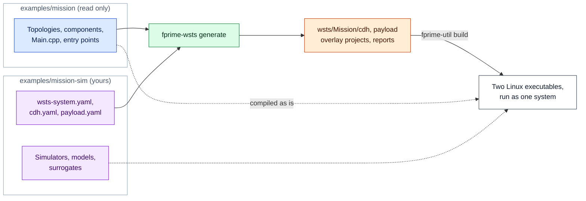

# Your First Simulation

The repository has one example, *Mission*, and it uses every part of the toolkit. In this
tutorial you generate, build and run it, then command it from the ground system and from
Python, inject a fault, and watch the flight software respond.

!!! abstract "What you will do"

    - [x] Generate the simulated system from its manifests
    - [x] Check the host and build both flight computers
    - [x] Run the system with a GDS in your browser
    - [x] Command flight software, drive simulated hardware and inject a fault

    Allow about 15 minutes, most of it for the first build.

## The example spacecraft

Mission has two flight computers joined by an F´ `GenericHub` over Ethernet:

```
ground  <--TCP-->  Cdh (VxWorks)  <==hub over Ethernet==>  Payload (Linux)
```

**Cdh** is the command and data handling computer: a VxWorks downloadable kernel module
with no `main()`, driven by a watchdog timer. It talks to the ground and forwards commands
from opcode `0x20000000` up through the hub to the payload computer.

**Payload** is a Linux single-board computer with no ground link of its own. It has an IMU
and a power monitor on one I2C bus, a converter on SPI, a serial temperature sensor, a
heater pin and an over-temperature switch, an FPGA block behind memory-mapped registers,
and a camera.

The example is split the way your own project will be:

| Directory | What it is |
|---|---|
| `examples/mission/` | The **flight project**: an ordinary F´ project that knows nothing about simulation. Neither computer could be built on a workstation |
| `examples/mission-sim/` | The **simulation project**: a manifest per computer (`cdh.yaml`, `payload.yaml`), the system manifest (`wsts-system.yaml`) and the simulation code |

## Step 1: Generate

From the root of the `fprime-wsts` checkout, with the virtual environment active:

```bash
fprime-wsts generate examples/mission-sim/wsts-system.yaml
```

This reads both flight deployments with the FPP tools (nothing is built yet), chooses a
surrogate for every hardware-facing instance, and writes one overlay project per computer
under `examples/mission-sim/wsts/Mission/`:

```
examples/mission-sim/wsts/Mission/
  cdh/                  # overlay project for Cdh
    wsts-report.md      # what was replaced, and what that costs in fidelity
  payload/              # overlay project for Payload
  wsts-system.json      # the system, for the runner and the Python client
```

Open `payload/wsts-report.md` and look at the *Substituted instances* table: the Linux
timer, the I2C, SPI, UART and GPIO drivers, the Ethernet driver to Cdh and the FPGA's
register interface have all been swapped for surrogates, each on a named bus **endpoint**.

## Step 2: Check the host and build

```bash
fprime-wsts check-host examples/mission-sim/wsts/Mission
```

`check-host` lists anything the build needs from this machine that the flight toolchain's
sysroot would have provided (headers, libraries, packages, SDK files) before anything is
compiled. For the example it should report nothing missing.

Each computer is a separate F´ build:

```bash
for e in cdh payload; do (cd examples/mission-sim/wsts/Mission/$e && fprime-util generate && fprime-util build); done
```

No VxWorks toolchain is involved: Cdh is built with the host compiler against the F´
Linux OS layer.

## Step 3: Run it with a GDS

```bash
fprime-wsts run examples/mission-sim/wsts/Mission --gds-gui
```

Both computers start, the hub link comes up, and one GDS connects to Cdh with the merged
dictionary of both computers. The command prints the GUI's address, by default
`http://127.0.0.1:5000/`. Open it.

In the GDS you should see:

- **Events** from both computers: `Cdh.*` arrives directly, `Payload.*` through the hub.
- **Channels** whose values come from device models: `Payload.power.BusVoltage` is 14.0 V
  and `Payload.sensor.Temperature` is 21.5 °C, because that is what the models in
  `payload.yaml` are set to.
- A new component on each computer, **`wstsControl`**, with commands such as `SIM_PAUSE`
  and `FAULT_SET`, and telemetry such as `SimTicks` and `BusTransactions`.

!!! note "Telemetry is downlinked about once a second"

    Channels carry the latest value only. When you change something, give it a second or
    two to appear.

## Step 4: Drive it

### From the ground system

Send flight commands as you would in operations:

- `Payload.heater.HEATER_SET` with `ON` turns on the heater pin. The heater's GPIO output is
  now high in the simulation.
- `Payload.sensor.SEND_QUERY` with `STATUS?` makes the flight sensor manager write to its
  UART. The bytes land on the `sensorUart` endpoint, where a test can read them.

Then use the simulation's own commands, on `Payload.wstsControl`:

- `SIM_PAUSE` stops Payload's rate groups (its tick count stops), and `SIM_RESUME`
  restarts them. Cdh keeps running throughout.
- `FAULT_SET` with `i2cBus`, `STUCK`, `TO_FLIGHT`, `0x7F`, `0`, `0` jams every byte read
  on the I2C bus at `0x7F`: `Payload.imu.AccelX` becomes `0x7F7F`. `FAULT_CLEAR` with `*`
  restores it.

### From Python

Every computer also has a **bridge**, a JSON socket for tests and scripts. Payload's is
`tcp:50101`. With the system still running, in a second terminal:

```python
from fprime_wsts.bridge import WstsBridge

with WstsBridge("tcp:50101") as payload:                   # the Payload computer
    payload.model_set("tempSensor", "period", 0)            # silence the free-running sensor model
    payload.fault_set("i2cBus", "error", arg=3, count=5)    # five failed I2C reads
    payload.inject_text("sensorUart", "$TEMP,48.0\n")       # bytes "from the sensor"
    payload.gpio_force("switchPin", True)                   # trip the over-temperature switch
    payload.advance(20)                                     # one second at 20 Hz
    print(payload.gpio_get("heaterPin"), payload.status()["tick"])
```

Watch the GDS while it runs:

| You did | Flight software did |
|---|---|
| Five I2C transactions fail with a read error | `Payload.imu.ImuReadError`, then `ImuRecovered` once the fault expires; `wstsControl` reports `FaultTriggered` and `FaultExpired` |
| A line arrives on the sensor's UART | `Payload.sensor.Temperature` reads 48.0 |
| The switch input rises (with the heater on) | `Payload.heater.OverTemperature`, and the heater pin goes low: `gpio_get` prints `False` |

The first line stops the example's scripted sensor model, which otherwise sends
`$TEMP,21.5` every second and would overwrite the injected reading before it is
downlinked. Turn it back on with `payload.model_set("tempSensor", "period", 20)`.

None of that flight code knows it is simulated. The IMU manager's error handling, the
sensor's parser and the heater's interrupt handler are the flight components, running
unchanged.

## Step 5: Run it the way CI does

Stop the GUI run with ++ctrl+c++. For scripts and agents, run for a fixed time and get a
summary instead:

```bash
fprime-wsts run examples/mission-sim/wsts/Mission --gds --duration 30 --json
```

The JSON summary has the exit code, the final tick, the bus counters and the log
directory (`wsts-logs/<element>/sim.log`). And the repository's end-to-end tests run
against the same system:

```bash
D=examples/mission-sim/wsts/Mission; pytest tests/e2e -p fprime_wsts.pytest_plugin --wsts-system $D --wsts-gds --dictionary $D/wsts-logs/MissionDictionary.json
```

## What just happened



The [example's README](https://github.com/vincewoo/fprime-wsts/blob/main/examples/README.md)
maps every feature of the toolkit to the place in the example that uses it and the
end-to-end test that checks it. It is a good place to look when the guide says "the
example does this".

## Next

Read [Core Concepts](concepts.md) for the vocabulary, then start
[Simulating Your Deployment](../user-guide/survey.md).
