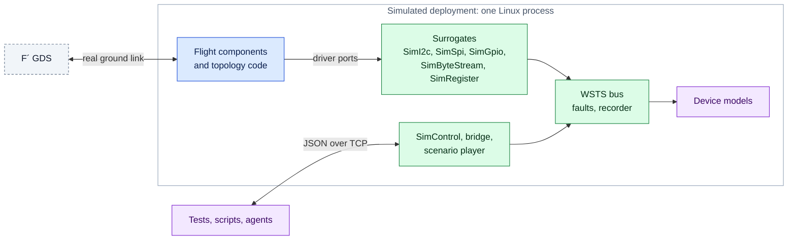

<div class="wsts-hero" markdown>

# F´ Workstation Test Set

Run your F´ flight software on a Linux workstation against simulated hardware. `fprime-wsts`
reads an existing deployment, replaces the components that touch hardware with
simulation surrogates, and writes a new deployment that builds and runs natively, with
the flight deployment left untouched. A VxWorks deployment converts the same way.

[Get started](getting-started/index.md){ .md-button .md-button--primary }
[User guide](user-guide/index.md){ .md-button }
[GitHub](https://github.com/vincewoo/fprime-wsts){ .md-button }

</div>

## What it is for

<div class="grid cards wsts-2col" markdown>

-   :material-source-branch-check:{ .lg .middle } **Integration testing in CI**

    ---

    Build the real flight code on a stock Linux runner, command it through the F´ GDS, and
    assert on its events and telemetry with pytest.

    [:octicons-arrow-right-24: Testing with pytest](user-guide/testing.md)

-   :material-robot-outline:{ .lg .middle } **Closed-loop development**

    ---

    One command runs the deployment for a set time and prints a JSON summary, so a person
    or an agent can change code, run, read the result and try again.

    [:octicons-arrow-right-24: Run the simulation](user-guide/run.md)

-   :material-satellite-variant:{ .lg .middle } **Systems and operations testing**

    ---

    Run several flight computers as one system with the links between them simulated,
    one GDS on a merged dictionary, and faults on any bus or link.

    [:octicons-arrow-right-24: Multi-computer systems](user-guide/systems.md)

-   :material-flash-alert-outline:{ .lg .middle } **Off-nominal behaviour on demand**

    ---

    Drop, corrupt, delay or jam any bus transaction, inject bytes and pin levels, and
    replay a recorded run, from the GDS, from Python or from a scenario file.

    [:octicons-arrow-right-24: Control and fault injection](user-guide/control.md)

</div>

## How it works

A simulated deployment is one Linux process. The flight software runs unchanged down to
the driver ports. Below them, **surrogates** pass each transaction to the WSTS **bus**,
where faults are applied, traffic is recorded and **device models** answer.

<div class="wsts-legend" markdown>
<span class="flight">Flight software, unchanged</span>
<span class="toolkit">fprime-wsts</span>
<span class="generated">Generated</span>
<span class="user">Written by you</span>
</div>



You write a short YAML **manifest** that names your deployment. `fprime-wsts generate`
finds the hardware instances in its topology, retypes them to surrogates, wires in the
simulation control component, and writes an **overlay project** that `fprime-util`
builds. The hand-written topology code and `Main.cpp` compile unchanged.

```bash
fprime-wsts generate my-mission-sim/wsts.yaml          # write the overlay project
cd my-mission-sim/wsts/MyDeployment
fprime-util generate && fprime-util build              # build it with the host toolchain
fprime-wsts run . --gds-gui                            # run it, with the GDS in a browser
```

## Explore the guide

<div class="grid cards wsts-2col" markdown>

-   :material-download:{ .lg .middle } **Getting Started**

    ---

    Install the toolkit, run the example spacecraft, and learn the vocabulary.

    [:octicons-arrow-right-24: Installation](getting-started/installation.md) ·
    [First simulation](getting-started/first-simulation.md) ·
    [Concepts](getting-started/concepts.md)

-   :material-map-marker-path:{ .lg .middle } **Simulate your deployment**

    ---

    A step-by-step walkthrough from an untouched flight project to a running simulation.

    [:octicons-arrow-right-24: Start the walkthrough](user-guide/survey.md)

-   :material-chip:{ .lg .middle } **Simulate the hardware**

    ---

    Stock and project device models, FPGA register blocks with interrupts, simulators
    written as F´ components, and your own surrogates.

    [:octicons-arrow-right-24: Device models](user-guide/device-models.md)

-   :material-book-open-variant:{ .lg .middle } **Reference**

    ---

    Every manifest key, CLI option, action, fault kind and file format, and the design
    behind them.

    [:octicons-arrow-right-24: Reference](reference/index.md)

</div>

!!! info "Where the name comes from"

    The Workstation Test Set was the software-only test environment of the Mars Science
    Laboratory mission, and the spiritual ancestor of this toolkit.
