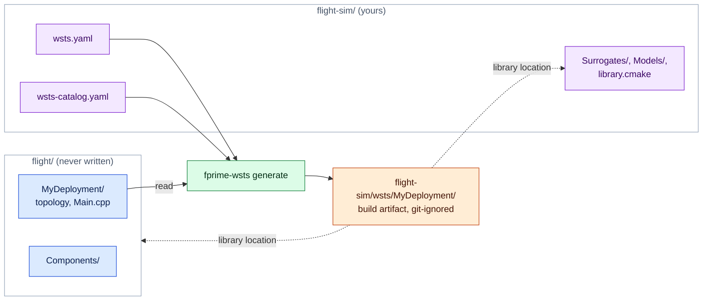
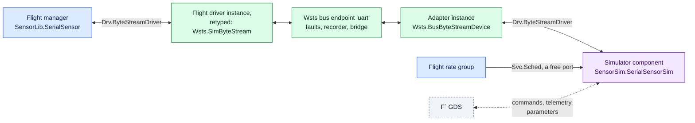

# Writing surrogates and device models

There are two things you might write, and most projects need only the second.

- A **surrogate** is an F´ component that takes the place of a flight component in the
  simulated topology. The toolkit ships surrogates for the standard driver interfaces.
  Write one when a project driver has its own port interface, when you want to replace a
  whole device manager, or when you need a flight-identical dictionary (a mirror).
- A **device model** is a plain C++ class that sits on the simulation bus behind a
  surrogate and behaves like the hardware. Models can also live in another process.

## Where simulation code lives

The generated deployment (`wsts/<Deployment>/`) is a build artifact. What you write (the
manifest, project surrogates, device models, catalogs, scenarios) is source code, and it
can live in its own **simulation project** next to the flight project rather than in it:

```
flight/                       # the flight project, never written by fprime-wsts
  settings.ini
  Components/ ...
  MyDeployment/
flight-sim/                   # the simulation project: its own repository or directory
  wsts.yaml                   # project: ../flight
  wsts-catalog.yaml           # project surrogates
  library.cmake               # builds the modules below
  Surrogates/SimFpga/         # project surrogates (F´ components)
  Models/                     # device models (plain C++)
  .gitignore                  # /wsts/
```

```bash
fprime-wsts generate flight-sim/wsts.yaml       # writes flight-sim/wsts/MyDeployment
```



Colours as in [design.md](design.md#reading-the-diagrams): 🟦 flight software, 🟩
fprime-wsts, 🟧 generated, 🟪 yours.

`project` in the manifest names the flight project, relative to the manifest. The
simulation project is then an F´ library of its own:

- The generated deployment lists it under `library_locations`. F´ includes its
  `library.cmake`, which calls `add_fprime_subdirectory()` for each of its modules.
- Its modules are named, and its headers included, relative to its root:
  `Surrogates/SimFpga` is the module `Surrogates_SimFpga` with header
  `Surrogates/SimFpga/SimFpga.hpp`.
- `catalogs` and `output` are relative to the manifest; flight paths (`deployment`,
  `sources`, ...) stay relative to the flight project.

[`examples/mission-sim`](../examples/mission-sim) is a complete one for the flight project
`examples/mission`: among other things a mirror surrogate for the GPIO driver and a device
model for the IMU. Simulation code can also live inside the flight project, with the
manifest next to the deployment (no `project` key); then it is built like any other project
module, and the generated deployment goes to `wsts/<deployment>` in the flight project.

## Device models

Implement one of the interfaces in `Wsts/Core/Bus.hpp`. Derive from `Wsts::Model` as well if
the model takes parameters or needs to act on every tick.

```cpp
#include <Wsts/Core/Bus.hpp>
#include <Wsts/Core/Control.hpp>

class Thermometer : public Wsts::Model, public Wsts::I2cDevice {
  public:
    // Return 0, or a Drv::I2cStatus value. `read` arrives sized to the requested length.
    int transact(std::uint32_t addr, const Wsts::Bytes& write, Wsts::Bytes& read) override {
        for (auto& byte : read) byte = m_raw;
        return 0;
    }
    // Reached by the manifest's `params`, by model_set and by the MODEL_SET command
    bool set(const std::string& key, const std::string& value) override {
        if (key != "raw") return false;
        m_raw = static_cast<std::uint8_t>(std::stoi(value, nullptr, 0));
        return true;
    }
    void onTick(std::uint64_t tick) override {}  // once per simulation tick
  private:
    std::uint8_t m_raw = 0;
};
```

Put it in a module that is built (in a simulation project, one its `library.cmake` adds),
and name it in the manifest:

```yaml
models:
  - {name: thermo, class: Thermometer, header: Models/Thermometer.hpp, endpoint: thermoBus, kind: i2c, address: 0x48}
cmake:
  depends: [Models]
```

A model module inside the flight project that nothing in the flight build references also
needs `cmake.extra_subdirectories: [Models]`.

Notes:

- Model methods are called from flight threads (inside the port call), from the tick thread
  and from bridge threads. Guard shared state.
- The interfaces are `ByteStreamDevice`, `I2cDevice`, `SpiDevice`, `GpioDevice` and
  `RegisterDevice` (memory-mapped registers, see [A register block](#a-register-block)).
  The stock models are in `Wsts/Core/Models.hpp`.
- A byte stream model replies through the `ByteSink` it is handed, or at any time with
  `Wsts::Bus::get().byteStreamInject(endpoint, bytes)`. It is told its endpoint through
  `set("endpoint", …)` at start-up.
- Do not block in a model for long: the flight thread that made the port call is waiting.

### Models in Python

```python
from fprime_wsts.bridge import WstsBridge

sim = WstsBridge("tcp:50100")
sim.serve_i2c("thermoBus", 0x48, lambda write, length: (0, bytes([42] * length)))
```

The handler runs for each transaction; if it does not answer within two seconds flight
software gets an error status. When the client disconnects the device disappears from the
bus (I2C then reports an address error).

A register block is served the same way, and its interrupts are raised with `raise_irq`:

```python
registers = {0x00: 0xF00D0001, 0x0C: 215}
sim.serve_register("fpgaRegs",
                   lambda offset, width: registers.get(offset, (1, 0)),      # a value, or (status, value)
                   lambda offset, width, value: registers.update({offset: value}))
sim.raise_irq("fpgaRegs", 1)
```

When this client disconnects, the model that was on the endpoint before answers again.

## Device simulators as F´ components

A device simulator can also be an ordinary F´ component: active or queued, scheduled by
a rate group, with commands, events, telemetry and parameters of its own. Many projects
have such simulators already, written for hand-built test deployments where a loopback
component stood in for the driver. They go into a generated deployment unchanged, behind
the stock surrogate:



**When to use one rather than a C++ model.** Use a component when the simulator exists
already as one, when operators should command and observe it through the ground system
with its own dictionary entries, when it needs parameters, or when it is several
components wired together. Use a C++ model ([Device models](#device-models)) when the
device is simple and nothing but tests talks to it: a model costs no IDs, no command
dispatcher or rate group capacity, and no topology changes. Both sit behind the same bus
endpoint, so faults, recording, replay and the bridge work the same either way.

**What you write.** In the simulation project:

1. The simulator component, a client of the driver interface. For a serial device that
   is the four ports of `Drv.ByteStreamDriverClient` (`drvConnected`, `drvReceiveIn`,
   `drvReceiveReturnOut`, `drvSendOut`), under any names.
2. FPP with the instances: the simulator, whatever it needs (a `Svc.BufferManager` for
   its transmit buffers), and one `Wsts.BusByteStreamDevice` adapter per bus endpoint.
   Phase code configures them, as in any topology. A subtopology keeps it together and
   keeps flight names out of it:

   ```fpp
   module SensorSim {
     instance sensorSim: SensorSim.SerialSensorSim base id 0x70000000 queue size 10
     instance sensorPort: Wsts.BusByteStreamDevice base id 0x70002000

     topology Simulator {
       instance sensorSim
       instance sensorPort
       connections Device {
         sensorPort.ready              -> sensorSim.drvConnected
         sensorPort.$recv              -> sensorSim.drvReceiveIn
         sensorSim.drvReceiveReturnOut -> sensorPort.recvReturnIn
         sensorSim.drvSendOut          -> sensorPort.$send
       }
       port schedIn = sensorSim.schedIn
     }
   }
   ```

3. In the manifest, what joins it to this deployment:

   ```yaml
   simulators:
     topologies: [SensorSim.Simulator]
     headers: [SensorSim/Top/SubtopologyTopologyDefs.hpp]    # for the phase code
     connections:
       - rateGroup1Hz.RateGroupMemberOut -> SensorSim.Simulator.schedIn
   devices:
     - {instance: SensorSim.sensorPort, endpoint: uart}
   ```

[`examples/mission-sim`](../examples/mission-sim) has a complete one, for the `Cdh`
element of the flight project `examples/mission` (`cdh.yaml`, `SensorSim/`). The keys are
described in [reference.md](reference.md#simulator-components).

**Base IDs.** Give the simulator instances a block of IDs that the flight software does
not use and is unlikely to grow into. Flight IDs never move; a collision is an error.

**Threading.** The adapter delivers what flight software sent from inside the flight
driver's `send` call, on the thread of the flight component that sent it.

- If the simulator's receive port is `async` (a queued or active simulator), delivery
  only queues the data. The simulator handles it on its own thread, or for a queued
  component when its rate group calls it. This is the arrangement to prefer.
- If the receive port is `sync`, the simulator's handler runs on the flight thread, inside
  the flight component's send. It may reply at once: the adapter holds no lock while it
  calls the simulator. Keep such handlers short, and do not have the simulator and the
  flight manager both reply synchronously to each other without end.
- `ready` reaches the simulator on the simulation's tick thread, on the first tick after
  the flight side of the endpoint is bound.
- The simulator's sends go to flight software on the simulator's own thread, through the
  fault table, and are recorded as `model` traffic, like a C++ model's replies.

**Buffer ownership.** As with a real byte stream driver:

- Data to the simulator arrives in a buffer the adapter obtained from its `allocate` port
  (or allocated itself when that port is unconnected). The simulator must return it on
  the adapter's `recvReturnIn`, as it would to a UART driver. Connect `allocate` and
  `deallocate` to a buffer manager when you want exhaustion to behave as on the target:
  with no buffer left the data is dropped.
- For a send, the simulator keeps its buffer: `send` is synchronous and copies. Return
  the buffer to its own manager after the call.

**Scheduling and pause.** A simulator connected to a flight rate group runs at that
group's rate and stops with it when the simulation is paused, since the same tick drives
both. While paused, `inject_bytes` from the bridge still reaches flight software.

**A rate of its own.** A simulator that has to run faster than any flight rate group, at
a rate that is not a multiple of the flight tick, or simply at a rate flight has no free
ports for, gets a clock from the simulation: an instance of `Wsts.SimCycle`. Its
`CycleOut` (`Svc.Cycle`) drives a `Svc.RateGroupDriver`, `Svc.PassiveRateGroup` or
`Svc.ActiveRateGroup` that the simulation defines, and the manifest gives its rate:

```fpp
instance simClock: Wsts.SimCycle base id 0x70004000
instance fastGroup: Svc.PassiveRateGroup base id 0x70005000 { ... }   # configure() in phase code

topology Simulator {
  instance simClock
  instance fastGroup
  instance gyroSim
  connections FastRateGroup {
    simClock.CycleOut -> fastGroup.CycleIn
    fastGroup.RateGroupMemberOut[0] -> gyroSim.schedIn
  }
}
```

```yaml
clocks:
  - {instance: SensorSim.simClock, hz: 125}
```

One clock with a rate group driver behind it serves several rates (dividers of the clock's
rate); several clocks may run side by side. What a clock guarantees:

- **It follows simulation time, not the wall clock.** On every simulation tick the
  control core tells each clock how much simulated time the tick covers, and the clock
  issues the cycles that fall in it. So `pause` stops it with the flight rate groups,
  `resume` restarts it, and `set_rate` scales it exactly as it scales flight. This works
  with any tick source: `Wsts.SimTick` in either mode, the built-in ticker, or a project
  surrogate that calls `Control::onTick()`.
- **The count does not drift.** Cycle *j* is at *j*/rate seconds of simulated time after
  the clock's first tick, computed in integers. At 1000 Hz on a 64 Hz tick each tick
  carries 15 or 16 cycles and 64 ticks carry exactly 1000.
- **Spacing and phase.** Within a tick the cycles are issued at their own instants, not
  in a burst: 8 ms apart for 125 Hz on a 10 Hz tick, whatever the tick rate. Cycle 0
  coincides with the first tick after start-up, so a clock whose rate divides the tick
  rate stays in phase with it. Measured on a development host: gaps of 8.00 ms median,
  95% within 0.1 ms of that, with an occasional gap off by a few milliseconds when the
  host schedules late; the first cycle about 0.2 ms after its tick. The host is not a
  real-time system, and neither is this.
- **Its own thread.** `CycleOut` is called on a thread belonging to the clock, not on the
  tick thread: a passive rate group and its members run there. A slow handler delays
  that clock only, never the flight cycle. If the handlers cannot keep up, cycles beyond
  a few ticks' worth are dropped, a message is printed once, and the count is no longer
  exact. After a pause the cycles that were already granted come out with their spacing
  kept, not at once.
- **`tick` still means the flight tick** everywhere: scenarios, recordings, fault
  durations and `SimTicks`.

A tick source should say how much simulated time one tick is
(`Control::setTickPeriod()`, which `Wsts.SimTick` and the built-in ticker do). If none
does, the core measures the interval between ticks, and the long-run count is then as
good as that measurement. A clock is one simulated deployment's: the elements of a system
each have their own.

**Run-time inputs.** A simulator often needs something the flight `main()` has no option
for: a data file, a seed. Take it from the environment in the instance's phase code, with
a fallback, so that nothing in flight changes:

```fpp
instance starSim: Sim.StarSim base id 0x70010000 {
  phase Fpp.ToCpp.Phases.configComponents """
  // Unset: the simulator uses its built-in catalogue
  Sim::starSim.configure(std::getenv("SIM_STAR_CATALOGUE"));
  """
}
```

```yaml
run:
  env:
    SIM_STAR_CATALOGUE: ./data/stars.bin     # ./ or ../ : a path relative to the manifest
    SIM_SEED: 42
```

`fprime-wsts run` and the pytest plugin set these for the deployment; `--env NAME=VALUE`
on the command line (`--wsts-env` in pytest) adds to them or replaces them for one run.
For files that belong to a run rather than to the project, `WSTS_DIR` is already set to
the run's files directory (`--files-dir`, by default the log directory). Include
`<cstdlib>` through one of the `simulators.headers`.

**Parameters and health.** If the flight topology has a parameter database, the
simulator's parameters are loaded from it. If it has none, add a `Svc.PrmDb` to the
simulator's subtopology and connect the parameter ports to it there. Simulator instances
are not pinged by the flight health component.

**Other buses.** Only the byte stream adapter exists. For I2C, SPI and GPIO endpoints
use a C++ model, which can forward to whatever you need.

## Surrogates

A surrogate is a normal F´ component with three conventions.

1. **Same ports as what it replaces.** For every port the topology connects on the flight
   instance, the surrogate must have a port with the same name, port type and direction.
   Implementing the same FPP interface (`import Drv.I2c`) gives you that. The generator
   checks it and reports the ports that do not match.
2. **A binding hook**, called by generated code during `configComponents`:

   ```cpp
   void wstsBind(const char* endpoint, const char* options = "");
   ```

3. **The methods flight topology code calls** on the flight class, if that code is to
   compile unchanged. The generator aliases the flight class name to the surrogate, so
   `uart.open("/dev/ttyS1", Drv::PosixUartDriver::BAUD_115K, …)` resolves against your
   class: provide `open` and the enumerators. A variadic template is enough when the
   arguments do not matter:

   ```cpp
   template <typename... Args> bool open(Args&&...) { return true; }
   ```

   A stand-in may only be empty when the real method has nothing to do in simulation.
   If flight teardown calls `camera.stopCapture()` to end a thread before the components
   are deinitialised, and your replacement runs such a thread, its `stopCapture()` must
   stop it: the flight topology code is the only place that call is made.

   Flight code can also use `#ifdef WSTS_SIM`, which is defined in every simulated build.

   The same holds for **phase code in a flight subtopology**. A subtopology that defines
   the driver instance usually configures it there
   (`phase Fpp.ToCpp.Phases.configComponents """ Lib::driver.setup(regBase, irq); """`).
   That code is emitted into the deployment's topology module and compiled against your
   surrogate, so the surrogate needs a `setup` that accepts those arguments. Type names
   used in it resolve through the alias as well.

   **Includes of the flight driver's header are handled.** Flight code may include the
   header of the driver you replace (`#include <Proj/Drv/FpgaDriver/FpgaDriver.hpp>`):
   a subtopology's `SubtopologyTopologyDefs.hpp` does when its state has a field of one of
   the driver's types, and `Main.cpp` then includes it through the `TopologyDefs`. The
   generator writes a header at that include path which includes your surrogate's header
   and declares the alias, and puts it first on the include path of every module
   ([design](design.md#headers-of-replaced-drivers)). Nothing is needed from you except
   that the surrogate's header is at `<directory of its .fpp>/<Name>.hpp`, as usual. A type
   used in a `TopologyDefs` header, such as

   ```cpp
   Proj::FpgaDriver::ClockRate rate = Proj::FpgaDriver::RATE_50MHZ;
   ```

   resolves through the alias to `Proj::SimFpga::ClockRate`, so the surrogate must declare
   that enumeration with the enumerators the flight code names, exactly as for arguments of
   `open`. An include of `FpgaDriverComponentAc.hpp` is covered too, but only the include:
   code that names the autocoded base class `FpgaDriverComponentBase` does not compile.
   None of this applies while another instance still uses the flight component: its module
   stays in the build, and the real header is used.

Port handlers forward to the bus:

```cpp
Drv::I2cStatus SimI2c::writeRead_handler(FwIndexType, U32 addr, Fw::Buffer& w, Fw::Buffer& r) {
    Wsts::Bytes write(w.getData(), w.getData() + w.getSize());
    Wsts::Bytes read(r.getSize(), 0);
    const int status = Wsts::Bus::get().i2cTransact(m_endpoint, addr, write, read);
    std::memcpy(r.getData(), read.data(), read.size());
    return static_cast<Drv::I2cStatus::T>(status);
}
```

`Wsts/Drv/SimByteStream` is the fullest example (receive path, buffer ownership, the ready
signal). Going through the bus is what gives a surrogate fault injection, recording and
bridge access for free. A surrogate for a device manager may skip the bus and produce its
outputs directly; it then has none of those.

Register the surrogate in a catalog so it is chosen automatically:

```yaml
# wsts-catalog.yaml, named under `catalogs:` in the manifest
surrogates:
  - surrogate: Proj.SimFpga
    replaces: [Proj.FpgaDriver]
```

A surrogate may declare its own commands, events and telemetry. They appear in the
simulated dictionary under the replaced instance's base ID, and the report lists the
difference from flight.

### A surrogate that does not use the bus

A replacement that talks to the flight components directly over F´ ports (a simulator
that takes a driver's place, a mirror of a camera component, a time source) has no bus
endpoint, and needs no `wstsBind`. Say so where it is substituted, or in the catalog entry:

```yaml
substitute:
  - {instance: chronoTime, with: SensorSim.SimTime, endpoint: none}
```

No bind call is generated and there is no endpoint of that name: a model, a device or a
system link there is an error. The report marks the substitution "no bus endpoint", and
notes that faults, recording, replay and the bridge do not reach that link. If you want
those, put the stock surrogate in the driver's place and the simulator behind the bus.

### A surrogate that is not shaped like the driver

A simulator's replacement for a driver is often not a drop-in: it is queued where the
driver is passive, its ports have other names, and it lacks ports the driver has (a
register interface to hardware that is not there). The manifest, or a catalog entry, can
say so:

```yaml
substitute:
  - instance: Payload.fpgaDriver
    with: PayloadSim.FpgaSim
    queue_size: 20                 # the flight definition has none: the driver is passive
    ports:
      runIn: schedIn               # same port type, another name
      resetIn: deviceResetIn
      regReadOut:                  # no counterpart: these flight connections are dropped
      regWriteOut:
```

Renamed ports are renamed wherever the flight model connects them, including inside
subtopologies and where a subtopology exports them. Dropped connections are commented out
and listed in the report. If that leaves a flight instance with no connections (the
register component the driver talked to), the generator says so; it is still built.
Further simulator components behind the replacement are added with `simulators`, and
connect to the replacement's own ports by its instance name.

The alternative needs no mapping: a thin wrapper component in the simulation project
with exactly the flight driver's port names and kind, which forwards each port to the
simulator.

```fpp
passive component FpgaDriverShim {
  sync input port runIn: Svc.Sched          # the flight names
  output port schedOut: Svc.Sched           # to the simulator's schedIn
  output port regReadOut: Proj.RegRead      # left unconnected, or answered by the shim
  ...
}
```

Substitute the driver with the shim, add the simulator with `simulators`, and connect
shim to simulator in the simulation's FPP. Use this when the mapping is not one port to
one port.

### A project timer

On many flight computers one project component is both the clock and the tick: a "time
unit" driver whose interrupt cycles `Svc.RateGroupDriver` and which is also the
`time connections` instance. Such a component usually builds on Linux (it talks to a
register interface that has a stub), so nothing forces a substitution, and the simulated
deployment starts and then does nothing: no interrupt, no cycle, no telemetry.
`fprime-wsts generate` warns when the source of the rate group cycles, or the time source,
is a project component it is keeping.

`Wsts.SimTick` replaces timers whose ports are those of `Drv.Tick`. A project timer has
its own port names, so it needs its own surrogate. Give it the ports the topology
connects, with the flight names and types, and drive the cycle output from the WSTS tick:

```fpp
module Fc {
  @ Stands in for Fc.TimeUnit in simulation
  passive component SimTimeUnit {
    @ Same name and type as the flight component's cycle output
    output port tickOut: Svc.Cycle
    @ Time for the rest of the topology, if the flight component supplies it
    sync input port timeGetPort: Fw.Time
    @ Ping ports, if the flight component has them: same names, answered at once
    sync input port PingIn: Svc.Ping
    output port PingOut: Svc.Ping
  }
}
```

Keep the flight component's `Svc.Ping` ports if the health component pings it. The
flight ping table has an entry for the instance, and ping ports are numbered over the
instances that have them: without them every later instance's number would shift away
from its table entry. The generator does not let that happen: a surrogate that lacks a
connected port of the flight component is refused, with the ports named. Answering is one
line:

```cpp
void SimTimeUnit::PingIn_handler(FwIndexType, U32 key) { this->PingOut_out(0, key); }
```

```cpp
SimTimeUnit::SimTimeUnit(const char* name) : SimTimeUnitComponentBase(name) {
    // Before the runtime starts: no internal ticker is needed
    Wsts::Control::get().registerTickSource();
}

void SimTimeUnit::wstsBind(const char* endpoint, const char* options) { /* read tick_hz=... */ }

// What flight code calls to enable the interrupt
void SimTimeUnit::enable() {
    // How much simulated time a tick is: cycle sources of the simulation are fed from it
    Wsts::Control::get().setTickPeriod(periodNanoseconds);
    m_thread = std::thread([this]() {
        Wsts::Control& control = Wsts::Control::get();
        while (!m_quit) {
            std::this_thread::sleep_for(period / control.rate());
            if (control.paused()) {
                control.onIdle();      // bridge and scenario listeners keep running
                continue;
            }
            control.onTick();          // simulation time first: models, scenarios, faults, clocks
            Os::RawTime start;
            (void)start.now();
            this->tickOut_out(0, start);  // then one flight cycle
        }
    });
}

void SimTimeUnit::timeGetPort_handler(FwIndexType, Fw::Time& time) { /* host clock, or tick count */ }
```

`Wsts/Svc/SimTick/SimTick.cpp` is the complete version of that loop, including the rate
scaling that does not burst after a pause. Calling `Control::onTick()` from the surrogate
makes it the simulation's tick source, so pause, resume and the time scale act on the
flight rate groups. Then map it:

```yaml
substitute:
  - {instance: timeUnit, with: Fc.SimTimeUnit}
```

If the time unit driver reaches its hardware through a register interface component, a
narrower cut keeps the driver itself: replace the register interface, and model the time
unit's registers and interrupt ([A time unit](#a-time-unit), below). The driver then runs
as in flight, and no surrogate for it is written.

### A register block

On many flight computers the devices are FPGA blocks or SoC peripherals. Their drivers
are project components that read and write 32-bit registers through one **register
interface component**, which also delivers the hardware's interrupts. Off the target that
component is usually a stub already: its registers are an array that nothing fills, and
no interrupt arrives. The drivers above it then read zeros, and either do nothing or
assert.

Do not replace those drivers. Replace the register interface component, and put a model
of the register block behind it: the drivers then run as in flight, with their register
sequences, their interrupt handling and their own events.

```yaml
substitute:
  - component: Board.RegisterInterface   # a component of the project or one of its libraries
    with: Wsts.SimRegister
models:
  - name: fpga
    class: Sim::FpgaModel                # or the stock Wsts::RegisterFile, with params
    header: Models/FpgaModel.hpp
    endpoint: fpgaRegs                   # the instance's base name
    kind: register
```

`Wsts.SimRegister` is written for the named component with its own port names and port
types: nothing has to be mapped
([reference](reference.md#register-blocks) has the port shapes it recognises). Each
instance of the component is one endpoint with one block behind it.

**The model** implements `Wsts::RegisterDevice`. Start from `Wsts::RegisterFile`, which
has the common register behaviour, and add what the block does:

```cpp
#include <Wsts/Core/Models.hpp>

class FpgaModel : public Wsts::RegisterFile {
  public:
    enum : std::uint64_t { ID = 0x00, STATUS = 0x04, CONTROL = 0x08, COUNT = 0x0C };

    FpgaModel() {
        this->define(ID, 0xF00D0001, 0);                              // read only
        this->define(STATUS, 0, 0xFFFFFFFF, WRITE_1_TO_CLEAR);
        this->define(CONTROL, 0);
        this->define(COUNT, 0, 0);
        // Runs after flight software wrote the register, outside the model's lock
        this->onWrite(CONTROL, [this](std::uint64_t, std::uint32_t value) {
            if (value & 0x1) {                                        // "start"
                this->setBits(STATUS, 0x1);                           // "done", as the hardware sets it
                this->raise(3);                                       // interrupt 3, towards flight
            }
        });
    }
    void onTick(std::uint64_t tick) override {                         // the simulation's tick thread
        this->poke(COUNT, tick);
    }
};
```

What to know:

- **Threads.** `read` and `write` (and the hooks) run on the flight thread that made the
  port call. `onTick` runs on the simulation's tick thread, and `poke` on the thread of
  whoever sent the action. `RegisterFile` guards its registers; guard what you add.
- **Interrupts arrive on another thread.** `raise()` calls the flight handler on the
  thread that raised it: the tick thread from `onTick`, the flight thread from a write
  hook. In flight an interrupt handler never runs on the thread that reads and writes the
  registers either, and it must not block: a handler that posts a message to its
  component's queue and returns is right in both worlds. Check that this is what the
  flight handler does. The surrogate delivers one interrupt at a time, so the handler is
  not re-entered; a handler that takes a lock the register-accessing thread holds while it
  writes the register that raises the interrupt would deadlock, as it would on the target.
- **A read that fails gives flight all ones**, because the port has no status: an offset
  the model did not define, a fault, no model at all. `BusErrors` counts them. A
  `RegisterFile` with `strict` set to `0` is plain memory instead, like the flight stub.
- **64-bit accesses** reach the model with width 8. `RegisterFile` serves them as two
  registers (low half at the offset). A model of your own that has none returns
  `Wsts::RegisterStatus::WIDTH_ERR`, and flight reads all ones.
- **Faults.** On the endpoint: `drop`, `error`, `stuck`, `corrupt`, `delay`, per direction
  (a write goes `to_device`, a read `to_flight`). On `<endpoint>:irq`: `drop` loses an
  interrupt, `duplicate` delivers it twice.
- **From outside:** `reg_set` sets a register without a flight write, `irq_raise` raises
  an interrupt, and `model_set fpga reg.0x0C 215` reaches `RegisterFile`'s parameters. In
  Python, `WstsBridge.serve_register(endpoint, read, write)` takes the block over and
  `raise_irq` raises its interrupts.

`examples/mission` has the pieces: `SensorLib.RegisterInterface` in `lib/sensor-lib`, the
driver `Components.FpgaMonitor` on top of it, and in `examples/mission-sim/payload.yaml`
the substitution and a `Wsts::RegisterFile` with one interrupt.

#### A time unit

A time unit that is both the tick and the clock (see [A project timer](#a-project-timer))
is a register block too, when its driver reaches it through a register interface: the
driver's interrupt handler posts to its queue, the queued handler reads an interrupt
status register and calls the cycle output, and the time getter reads seconds and
sub-seconds registers. Keep that driver. Model the block, and make the model the
simulation's tick source: it advances simulation time, then updates its registers, then
raises the interrupt that cycles the flight rate groups.

```cpp
class TimeUnitModel : public Wsts::RegisterFile {
  public:
    enum : std::uint64_t { REVISION = 0x00, IRQ_STATUS = 0x08, SECONDS = 0x10, SUBSECONDS = 0x14 };
    enum : std::uint32_t { IRQ_CYCLE = 0x1, IRQ_PPS = 0x2, IRQ_NUMBER = 0 };

    explicit TimeUnitModel(std::uint64_t periodNs = 15625000) : m_periodNs(periodNs) {   // 64 Hz
        this->define(REVISION, 0x00010002, 0);
        this->define(IRQ_STATUS, 0, 0xFFFFFFFF, WRITE_1_TO_CLEAR);
        this->define(SECONDS, 0, 0);
        this->define(SUBSECONDS, 0, 0);
        // Before the runtime starts: this model is the tick source, no internal ticker is needed
        Wsts::Control::get().registerTickSource();
        Wsts::Control::get().setTickPeriod(periodNs);
    }

    //! One flight cycle: simulation time first, then the registers, then the interrupt
    void cycle() {
        Wsts::Control& control = Wsts::Control::get();
        control.onTick();                                  // models, scenarios, faults, clocks
        const std::uint64_t now = control.tick() * m_periodNs;
        this->poke(SECONDS, now / 1000000000ull);
        this->poke(SUBSECONDS, now % 1000000000ull);
        const bool pps = (now / 1000000000ull) != ((now - m_periodNs) / 1000000000ull);
        this->setBits(IRQ_STATUS, IRQ_CYCLE | (pps ? static_cast<std::uint32_t>(IRQ_PPS) : 0u));
        this->raise(IRQ_NUMBER);                           // the flight driver cycles the rate groups
    }

    void start() {
        m_thread = std::thread([this]() {
            Wsts::Control& control = Wsts::Control::get();
            auto next = std::chrono::steady_clock::now();
            while (!m_quit.load()) {
                const double rate = std::max(0.001, control.rate());
                next += std::chrono::nanoseconds(static_cast<std::int64_t>(static_cast<double>(m_periodNs) / rate));
                const auto now = std::chrono::steady_clock::now();
                if (next < now) {
                    next = now;                            // fell behind: do not burst to catch up
                }
                std::this_thread::sleep_until(next);
                if (control.paused()) {
                    control.onIdle();                      // bridge and scenario listeners keep running
                } else if (!m_quit.load()) {
                    this->cycle();
                }
            }
        });
    }
    void stop() { m_quit.store(true); if (m_thread.joinable()) m_thread.join(); }
    ~TimeUnitModel() { this->stop(); }

  private:
    std::uint64_t m_periodNs;
    std::atomic<bool> m_quit{false};
    std::thread m_thread;
};
```

Start the thread from `setup` in the manifest, which runs once the model is attached and
the surrogates are bound:

```yaml
models:
  - {name: timeUnit, class: Sim::TimeUnitModel, header: Models/TimeUnitModel.hpp, endpoint: timeRegs, kind: register}
setup: |
  model_timeUnit.start();
```

(`model_<name>` is the model's variable in the generated set-up.) Pause, resume and the
time scale then act on the flight rate groups, because the interrupt stops and stretches
with the tick. The seconds registers follow simulated time, so flight time stamps stop
while the simulation is paused. `fprime-wsts generate` reports that the kept driver's
interrupt arrives from a simulated register endpoint, and warns only if no model is
attached there. The unit tests of the toolkit's core hold this model
(`Wsts/Core/test/ut/CoreTestMain.cpp`), driven by hand and on its thread.

The flight driver's start-up order matters: the first interrupt must not arrive before
the driver can take it. If its handler asserts when its queue is not there yet, start
the model from the end of the topology set-up instead of from `setup`.

#### Memory shared with hardware

A driver that receives frames through a DMA ring allocates a buffer, writes the buffer's
**physical** address into a register, and reads what the hardware put there through the
buffer's **virtual** address. A model sees the physical address in a register write and
has to write into the host memory behind it.

The toolkit keeps that translation, and the project fills it in, because only the
project's allocator knows the regions:

```cpp
#include <Wsts/Core/Dma.hpp>

Wsts::Dma::addRegion(hostBase, physicalBase, size);          // once per region the allocator maps
// or, with the flight library's own functions:
Wsts::Dma::setTranslator(toPhysical, toVirtual);
```

```yaml
setup:
  headers: [Wsts/Core/Dma.hpp, Proj/Dma/DmaAllocator.hpp]
  code: |
    Wsts::Dma::addRegion(Proj::Dma::hostBase(), Proj::Dma::physicalBase(), Proj::Dma::size());
```

and the model, in the hook of the register that takes the address:

```cpp
this->onWrite(RX_BUFFER_ADDRESS, [this](std::uint64_t, std::uint32_t address) {
    m_ring = static_cast<std::uint8_t*>(Wsts::Dma::toVirtual(address, m_ringSize));   // nullptr: not in a region
});
```

This only works if the flight driver wrote a meaningful address, which is the flight
libraries' business: their virtual-to-physical function has to translate through the
allocator's region off the target
([what to change there](vxworks-conversion.md#what-you-still-have-to-deal-with)). The
driver's set-up may run before `setup` does; register the regions where the allocator
creates them if the model needs them that early. A DMA engine that moves data by itself
is not modelled by any of this: it is a model of its own, which writes into the ring and
advances the "last written" register on its tick.

#### A mirror of the register interface

`Wsts.SimRegister` has no commands or events, so a register interface component's debug
commands (read or write a register by offset) and their events leave the dictionary. To
keep them, write a mirror. `fprime-wsts scaffold` copies the model; the implementation
derives from `Wsts::RegisterSurrogate`, which has the bus side of every handler, so what
is left to write is the glue to the flight component's commands and events:

```cpp
class SimRegisterInterface final : public SimRegisterInterfaceComponentBase, public Wsts::RegisterSurrogate {
  public:
    explicit SimRegisterInterface(const char* name) : SimRegisterInterfaceComponentBase(name) {}
    ~SimRegisterInterface() { this->unbindRegister(); }

    void wstsBind(const char* endpoint, const char* options = "") {
        this->bindRegister(endpoint, options, [this](std::uint32_t number) { this->interrupt_out(0, number); });
    }
    void configure(const char* device) {}                    // what flight topology code calls

  private:
    U32 read32In_handler(FwIndexType, U64 offset) override { return this->registerRead32(offset); }
    void write32In_handler(FwIndexType, U64 offset, U32 value) override { this->registerWrite32(offset, value); }

    // The flight command, with the access made on the bus: faults and the recording see it
    void REG_READ_cmdHandler(FwOpcodeType opCode, U32 cmdSeq, U32 offset) override {
        std::uint64_t value = 0;
        if (this->registerRead(offset, 4, value) != 0) {     // the status the port does not carry
            this->log_WARNING_LO_OffsetOutOfRange(offset);
            this->cmdResponse_out(opCode, cmdSeq, Fw::CmdResponse::VALIDATION_ERROR);
            return;
        }
        this->log_ACTIVITY_HI_RegisterValue(offset, static_cast<U32>(value));
        this->cmdResponse_out(opCode, cmdSeq, Fw::CmdResponse::OK);
    }
};
```

`examples/mission-sim/Surrogates/SimRegisterInterface` is the whole of it, for the
example's `SensorLib.RegisterInterface`; name `Sim.SimRegisterInterface` under
`substitute` in `payload.yaml` to use it. A mirror is also the answer when the flight
component has ports that are not register accesses, or when flight topology code calls
methods of it, or names types and enumerators of it, that `Wsts.SimRegister` does not
have (it accepts `configure(...)` and `open(...)` and nothing else).

### Mirror surrogates

```bash
fprime-wsts scaffold Drv.LinuxGpioDriver --project examples/mission --output examples/mission-sim/Surrogates/SimLinuxGpio --name Sim.SimLinuxGpio
```

This copies the component's model, with its included event and telemetry definitions,
under a new name, and writes the build file, a catalog entry and a README with the
remaining steps (`fprime-util impl` for the implementation templates, then the binding
hook and bus calls). The scaffold does not write the C++ implementation. A model copied
into a different module keeps its names as written, so names relative to the old module
must be qualified (`import Gpio` becomes `import Drv.Gpio`); fpp-check reports them.
`examples/mission-sim/Surrogates/SimLinuxGpio` is the finished result of the command
above.
