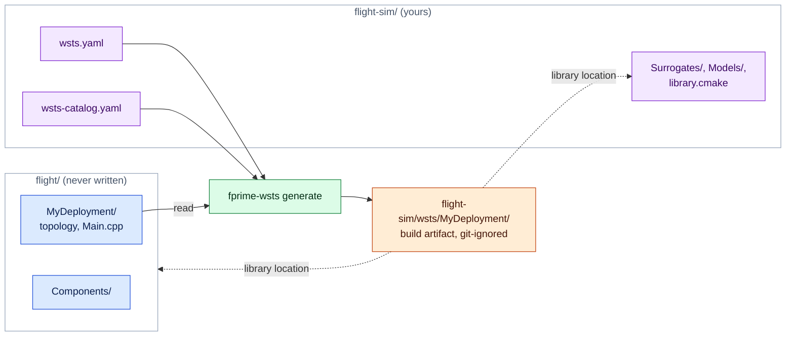

# Writing surrogates and device models

There are two things you might write, and most projects need only the second.

- A **surrogate** is an F´ component that takes the place of a flight component in the
  simulated topology. The toolkit ships surrogates for the standard driver interfaces.
  Write one when a project driver has its own port interface, when you want to replace a
  whole device manager, or when you need a flight-identical dictionary (a mirror).
- A **device model** is a plain C++ class that sits on the simulation bus behind a
  surrogate and behaves like the hardware. Models can also live in another process.

## Where simulation code lives

The generated deployment (`wsts/<Deployment>/`) is a build artifact. What you write (the
manifest, project surrogates, device models, catalogs, scenarios) is source code, and it
can live in its own **simulation project** next to the flight project rather than in it:

```
flight/                       # the flight project, never written by fprime-wsts
  settings.ini
  Components/ ...
  MyDeployment/
flight-sim/                   # the simulation project: its own repository or directory
  wsts.yaml                   # project: ../flight
  wsts-catalog.yaml           # project surrogates
  library.cmake               # builds the modules below
  Surrogates/SimFpga/         # project surrogates (F´ components)
  Models/                     # device models (plain C++)
  .gitignore                  # /wsts/
```

```bash
fprime-wsts generate flight-sim/wsts.yaml       # writes flight-sim/wsts/MyDeployment
```



Colours as in [design.md](design.md#reading-the-diagrams): 🟦 flight software, 🟩
fprime-wsts, 🟧 generated, 🟪 yours.

`project` in the manifest names the flight project, relative to the manifest. The
simulation project is then an F´ library of its own:

- The generated deployment lists it under `library_locations`. F´ includes its
  `library.cmake`, which calls `add_fprime_subdirectory()` for each of its modules.
- Its modules are named, and its headers included, relative to its root:
  `Surrogates/SimFpga` is the module `Surrogates_SimFpga` with header
  `Surrogates/SimFpga/SimFpga.hpp`.
- `catalogs` and `output` are relative to the manifest; flight paths (`deployment`,
  `sources`, ...) stay relative to the flight project.

[`examples/linux-demo-sim`](../examples/linux-demo-sim) is a complete one for the LinuxDemo
flight project: a mirror surrogate for the GPIO driver and a device model for the IMU.
Simulation code can also live inside the flight project, as in `examples/linux-demo`; then
it is built like any other project module.

## Device models

Implement one of the interfaces in `Wsts/Core/Bus.hpp`. Derive from `Wsts::Model` as well if
the model takes parameters or needs to act on every tick.

```cpp
#include <Wsts/Core/Bus.hpp>
#include <Wsts/Core/Control.hpp>

class Thermometer : public Wsts::Model, public Wsts::I2cDevice {
  public:
    // Return 0, or a Drv::I2cStatus value. `read` arrives sized to the requested length.
    int transact(std::uint32_t addr, const Wsts::Bytes& write, Wsts::Bytes& read) override {
        for (auto& byte : read) byte = m_raw;
        return 0;
    }
    // Reached by the manifest's `params`, by model_set and by the MODEL_SET command
    bool set(const std::string& key, const std::string& value) override {
        if (key != "raw") return false;
        m_raw = static_cast<std::uint8_t>(std::stoi(value, nullptr, 0));
        return true;
    }
    void onTick(std::uint64_t tick) override {}  // once per simulation tick
  private:
    std::uint8_t m_raw = 0;
};
```

Put it in a module that is built (in a simulation project, one its `library.cmake` adds),
and name it in the manifest:

```yaml
models:
  - {name: thermo, class: Thermometer, header: Models/Thermometer.hpp, endpoint: thermoBus, kind: i2c, address: 0x48}
cmake:
  depends: [Models]
```

A model module inside the flight project that nothing in the flight build references also
needs `cmake.extra_subdirectories: [Models]`.

Notes:

- Model methods are called from flight threads (inside the port call), from the tick thread
  and from bridge threads. Guard shared state.
- A byte stream model replies through the `ByteSink` it is handed, or at any time with
  `Wsts::Bus::get().byteStreamInject(endpoint, bytes)`. It is told its endpoint through
  `set("endpoint", …)` at start-up.
- Do not block in a model for long: the flight thread that made the port call is waiting.

### Models in Python

```python
from fprime_wsts.bridge import WstsBridge

sim = WstsBridge("tcp:50100")
sim.serve_i2c("thermoBus", 0x48, lambda write, length: (0, bytes([42] * length)))
```

The handler runs for each transaction; if it does not answer within two seconds flight
software gets an error status. When the client disconnects the device disappears from the
bus (I2C then reports an address error).

## Surrogates

A surrogate is a normal F´ component with three conventions.

1. **Same ports as what it replaces.** For every port the topology connects on the flight
   instance, the surrogate must have a port with the same name, port type and direction.
   Implementing the same FPP interface (`import Drv.I2c`) gives you that. The generator
   checks it and reports the ports that do not match.
2. **A binding hook**, called by generated code during `configComponents`:

   ```cpp
   void wstsBind(const char* endpoint, const char* options = "");
   ```

3. **The methods flight topology code calls** on the flight class, if that code is to
   compile unchanged. The generator aliases the flight class name to the surrogate, so
   `uart.open("/dev/ttyS1", Drv::PosixUartDriver::BAUD_115K, …)` resolves against your
   class: provide `open` and the enumerators. A variadic template is enough when the
   arguments do not matter:

   ```cpp
   template <typename... Args> bool open(Args&&...) { return true; }
   ```

   Flight code can also use `#ifdef WSTS_SIM`, which is defined in every simulated build.

Port handlers forward to the bus:

```cpp
Drv::I2cStatus SimI2c::writeRead_handler(FwIndexType, U32 addr, Fw::Buffer& w, Fw::Buffer& r) {
    Wsts::Bytes write(w.getData(), w.getData() + w.getSize());
    Wsts::Bytes read(r.getSize(), 0);
    const int status = Wsts::Bus::get().i2cTransact(m_endpoint, addr, write, read);
    std::memcpy(r.getData(), read.data(), read.size());
    return static_cast<Drv::I2cStatus::T>(status);
}
```

`Wsts/Drv/SimByteStream` is the fullest example (receive path, buffer ownership, the ready
signal). Going through the bus is what gives a surrogate fault injection, recording and
bridge access for free. A surrogate for a device manager may skip the bus and produce its
outputs directly; it then has none of those.

Register the surrogate in a catalog so it is chosen automatically:

```yaml
# wsts-catalog.yaml, named under `catalogs:` in the manifest
surrogates:
  - surrogate: Proj.SimFpga
    replaces: [Proj.FpgaDriver]
```

A surrogate may declare its own commands, events and telemetry. They appear in the
simulated dictionary under the replaced instance's base ID, and the report lists the
difference from flight.

### Mirror surrogates

```bash
fprime-wsts scaffold Drv.LinuxGpioDriver --project examples/linux-demo --output examples/linux-demo-sim/Surrogates/SimLinuxGpio --name Sim.SimLinuxGpio
```

This copies the component's model, with its included event and telemetry definitions,
under a new name, and writes the build file, a catalog entry and a README with the
remaining steps (`fprime-util impl` for the implementation templates, then the binding
hook and bus calls). The scaffold does not write the C++ implementation. A model copied
into a different module keeps its names as written, so names relative to the old module
must be qualified (`import Gpio` becomes `import Drv.Gpio`); fpp-check reports them.
`examples/linux-demo-sim/Surrogates/SimLinuxGpio` is the finished result of the command
above.
