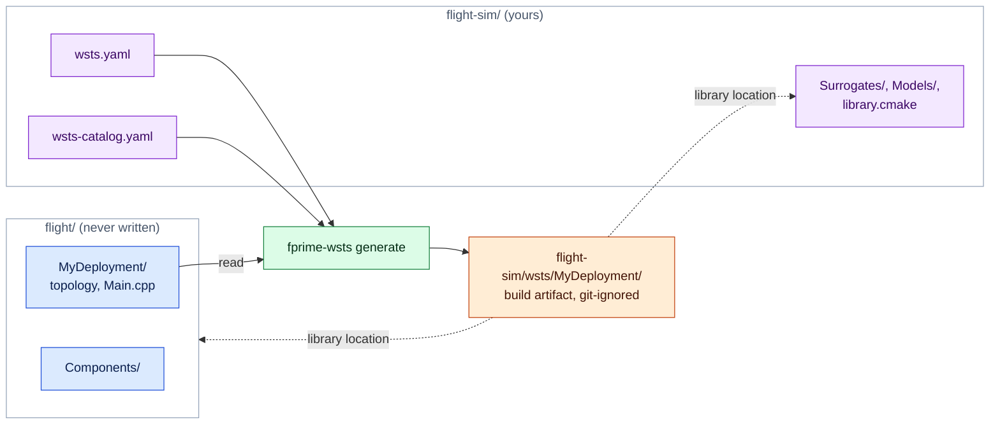
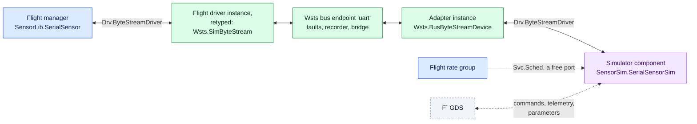

# Writing surrogates and device models

There are two things you might write, and most projects need only the second.

- A **surrogate** is an F´ component that takes the place of a flight component in the
  simulated topology. The toolkit ships surrogates for the standard driver interfaces.
  Write one when a project driver has its own port interface, when you want to replace a
  whole device manager, or when you need a flight-identical dictionary (a mirror).
- A **device model** is a plain C++ class that sits on the simulation bus behind a
  surrogate and behaves like the hardware. Models can also live in another process.

## Where simulation code lives

The generated deployment (`wsts/<Deployment>/`) is a build artifact. What you write (the
manifest, project surrogates, device models, catalogs, scenarios) is source code, and it
can live in its own **simulation project** next to the flight project rather than in it:

```
flight/                       # the flight project, never written by fprime-wsts
  settings.ini
  Components/ ...
  MyDeployment/
flight-sim/                   # the simulation project: its own repository or directory
  wsts.yaml                   # project: ../flight
  wsts-catalog.yaml           # project surrogates
  library.cmake               # builds the modules below
  Surrogates/SimFpga/         # project surrogates (F´ components)
  Models/                     # device models (plain C++)
  .gitignore                  # /wsts/
```

```bash
fprime-wsts generate flight-sim/wsts.yaml       # writes flight-sim/wsts/MyDeployment
```



Colours as in [design.md](design.md#reading-the-diagrams): 🟦 flight software, 🟩
fprime-wsts, 🟧 generated, 🟪 yours.

`project` in the manifest names the flight project, relative to the manifest. The
simulation project is then an F´ library of its own:

- The generated deployment lists it under `library_locations`. F´ includes its
  `library.cmake`, which calls `add_fprime_subdirectory()` for each of its modules.
- Its modules are named, and its headers included, relative to its root:
  `Surrogates/SimFpga` is the module `Surrogates_SimFpga` with header
  `Surrogates/SimFpga/SimFpga.hpp`.
- `catalogs` and `output` are relative to the manifest; flight paths (`deployment`,
  `sources`, ...) stay relative to the flight project.

[`examples/linux-demo-sim`](../examples/linux-demo-sim) is a complete one for the LinuxDemo
flight project: a mirror surrogate for the GPIO driver and a device model for the IMU.
Simulation code can also live inside the flight project, as in `examples/linux-demo`; then
it is built like any other project module.

## Device models

Implement one of the interfaces in `Wsts/Core/Bus.hpp`. Derive from `Wsts::Model` as well if
the model takes parameters or needs to act on every tick.

```cpp
#include <Wsts/Core/Bus.hpp>
#include <Wsts/Core/Control.hpp>

class Thermometer : public Wsts::Model, public Wsts::I2cDevice {
  public:
    // Return 0, or a Drv::I2cStatus value. `read` arrives sized to the requested length.
    int transact(std::uint32_t addr, const Wsts::Bytes& write, Wsts::Bytes& read) override {
        for (auto& byte : read) byte = m_raw;
        return 0;
    }
    // Reached by the manifest's `params`, by model_set and by the MODEL_SET command
    bool set(const std::string& key, const std::string& value) override {
        if (key != "raw") return false;
        m_raw = static_cast<std::uint8_t>(std::stoi(value, nullptr, 0));
        return true;
    }
    void onTick(std::uint64_t tick) override {}  // once per simulation tick
  private:
    std::uint8_t m_raw = 0;
};
```

Put it in a module that is built (in a simulation project, one its `library.cmake` adds),
and name it in the manifest:

```yaml
models:
  - {name: thermo, class: Thermometer, header: Models/Thermometer.hpp, endpoint: thermoBus, kind: i2c, address: 0x48}
cmake:
  depends: [Models]
```

A model module inside the flight project that nothing in the flight build references also
needs `cmake.extra_subdirectories: [Models]`.

Notes:

- Model methods are called from flight threads (inside the port call), from the tick thread
  and from bridge threads. Guard shared state.
- A byte stream model replies through the `ByteSink` it is handed, or at any time with
  `Wsts::Bus::get().byteStreamInject(endpoint, bytes)`. It is told its endpoint through
  `set("endpoint", …)` at start-up.
- Do not block in a model for long: the flight thread that made the port call is waiting.

### Models in Python

```python
from fprime_wsts.bridge import WstsBridge

sim = WstsBridge("tcp:50100")
sim.serve_i2c("thermoBus", 0x48, lambda write, length: (0, bytes([42] * length)))
```

The handler runs for each transaction; if it does not answer within two seconds flight
software gets an error status. When the client disconnects the device disappears from the
bus (I2C then reports an address error).

## Device simulators as F´ components

A device simulator can also be an ordinary F´ component: active or queued, scheduled by
a rate group, with commands, events, telemetry and parameters of its own. Many projects
have such simulators already, written for hand-built test deployments where a loopback
component stood in for the driver. They go into a generated deployment unchanged, behind
the stock surrogate:



**When to use one rather than a C++ model.** Use a component when the simulator exists
already as one, when operators should command and observe it through the ground system
with its own dictionary entries, when it needs parameters, or when it is several
components wired together. Use a C++ model ([Device models](#device-models)) when the
device is simple and nothing but tests talks to it: a model costs no IDs, no command
dispatcher or rate group capacity, and no topology changes. Both sit behind the same bus
endpoint, so faults, recording, replay and the bridge work the same either way.

**What you write.** In the simulation project:

1. The simulator component, a client of the driver interface. For a serial device that
   is the four ports of `Drv.ByteStreamDriverClient` (`drvConnected`, `drvReceiveIn`,
   `drvReceiveReturnOut`, `drvSendOut`), under any names.
2. FPP with the instances: the simulator, whatever it needs (a `Svc.BufferManager` for
   its transmit buffers), and one `Wsts.BusByteStreamDevice` adapter per bus endpoint.
   Phase code configures them, as in any topology. A subtopology keeps it together and
   keeps flight names out of it:

   ```fpp
   module SensorSim {
     instance sensorSim: SensorSim.SerialSensorSim base id 0x70000000 queue size 10
     instance sensorPort: Wsts.BusByteStreamDevice base id 0x70002000

     topology Simulator {
       instance sensorSim
       instance sensorPort
       connections Device {
         sensorPort.ready              -> sensorSim.drvConnected
         sensorPort.$recv              -> sensorSim.drvReceiveIn
         sensorSim.drvReceiveReturnOut -> sensorPort.recvReturnIn
         sensorSim.drvSendOut          -> sensorPort.$send
       }
       port schedIn = sensorSim.schedIn
     }
   }
   ```

3. In the manifest, what joins it to this deployment:

   ```yaml
   simulators:
     topologies: [SensorSim.Simulator]
     headers: [SensorSim/Top/SubtopologyTopologyDefs.hpp]    # for the phase code
     connections:
       - rateGroup1Hz.RateGroupMemberOut -> SensorSim.Simulator.schedIn
   devices:
     - {instance: SensorSim.sensorPort, endpoint: uart}
   ```

[`examples/subtop-demo-sim`](../examples/subtop-demo-sim) is a complete one, for the
`subtop-demo` flight project. The keys are described in
[reference.md](reference.md#simulator-components).

**Base IDs.** Give the simulator instances a block of IDs that the flight software does
not use and is unlikely to grow into. Flight IDs never move; a collision is an error.

**Threading.** The adapter delivers what flight software sent from inside the flight
driver's `send` call, on the thread of the flight component that sent it.

- If the simulator's receive port is `async` (a queued or active simulator), delivery
  only queues the data. The simulator handles it on its own thread, or for a queued
  component when its rate group calls it. This is the arrangement to prefer.
- If the receive port is `sync`, the simulator's handler runs on the flight thread, inside
  the flight component's send. It may reply at once: the adapter holds no lock while it
  calls the simulator. Keep such handlers short, and do not have the simulator and the
  flight manager both reply synchronously to each other without end.
- `ready` reaches the simulator on the simulation's tick thread, on the first tick after
  the flight side of the endpoint is bound.
- The simulator's sends go to flight software on the simulator's own thread, through the
  fault table, and are recorded as `model` traffic, like a C++ model's replies.

**Buffer ownership.** As with a real byte stream driver:

- Data to the simulator arrives in a buffer the adapter obtained from its `allocate` port
  (or allocated itself when that port is unconnected). The simulator must return it on
  the adapter's `recvReturnIn`, as it would to a UART driver. Connect `allocate` and
  `deallocate` to a buffer manager when you want exhaustion to behave as on the target:
  with no buffer left the data is dropped.
- For a send, the simulator keeps its buffer: `send` is synchronous and copies. Return
  the buffer to its own manager after the call.

**Scheduling and pause.** A simulator connected to a flight rate group runs at that
group's rate and stops with it when the simulation is paused, since the same tick drives
both. A simulator that needs a rate of its own (higher than any flight rate group) is not
catered for yet: the tick surrogate's cycle output is already connected to the flight rate
group driver, and an output port drives one input. Schedule such a simulator from the
fastest flight rate group and let it step several times per call.
While paused, `inject_bytes` from the bridge still reaches flight software.

**Parameters and health.** If the flight topology has a parameter database, the
simulator's parameters are loaded from it. If it has none, add a `Svc.PrmDb` to the
simulator's subtopology and connect the parameter ports to it there. Simulator instances
are not pinged by the flight health component.

**Other buses.** Only the byte stream adapter exists. For I2C, SPI and GPIO endpoints
use a C++ model, which can forward to whatever you need.

## Surrogates

A surrogate is a normal F´ component with three conventions.

1. **Same ports as what it replaces.** For every port the topology connects on the flight
   instance, the surrogate must have a port with the same name, port type and direction.
   Implementing the same FPP interface (`import Drv.I2c`) gives you that. The generator
   checks it and reports the ports that do not match.
2. **A binding hook**, called by generated code during `configComponents`:

   ```cpp
   void wstsBind(const char* endpoint, const char* options = "");
   ```

3. **The methods flight topology code calls** on the flight class, if that code is to
   compile unchanged. The generator aliases the flight class name to the surrogate, so
   `uart.open("/dev/ttyS1", Drv::PosixUartDriver::BAUD_115K, …)` resolves against your
   class: provide `open` and the enumerators. A variadic template is enough when the
   arguments do not matter:

   ```cpp
   template <typename... Args> bool open(Args&&...) { return true; }
   ```

   Flight code can also use `#ifdef WSTS_SIM`, which is defined in every simulated build.

   The same holds for **phase code in a flight subtopology**. A subtopology that defines
   the driver instance usually configures it there
   (`phase Fpp.ToCpp.Phases.configComponents """ Lib::driver.setup(regBase, irq); """`).
   That code is emitted into the deployment's topology module and compiled against your
   surrogate, so the surrogate needs a `setup` that accepts those arguments. Type names
   used in it resolve through the alias as well.

Port handlers forward to the bus:

```cpp
Drv::I2cStatus SimI2c::writeRead_handler(FwIndexType, U32 addr, Fw::Buffer& w, Fw::Buffer& r) {
    Wsts::Bytes write(w.getData(), w.getData() + w.getSize());
    Wsts::Bytes read(r.getSize(), 0);
    const int status = Wsts::Bus::get().i2cTransact(m_endpoint, addr, write, read);
    std::memcpy(r.getData(), read.data(), read.size());
    return static_cast<Drv::I2cStatus::T>(status);
}
```

`Wsts/Drv/SimByteStream` is the fullest example (receive path, buffer ownership, the ready
signal). Going through the bus is what gives a surrogate fault injection, recording and
bridge access for free. A surrogate for a device manager may skip the bus and produce its
outputs directly; it then has none of those.

Register the surrogate in a catalog so it is chosen automatically:

```yaml
# wsts-catalog.yaml, named under `catalogs:` in the manifest
surrogates:
  - surrogate: Proj.SimFpga
    replaces: [Proj.FpgaDriver]
```

A surrogate may declare its own commands, events and telemetry. They appear in the
simulated dictionary under the replaced instance's base ID, and the report lists the
difference from flight.

### A surrogate that is not shaped like the driver

A simulator's replacement for a driver is often not a drop-in: it is queued where the
driver is passive, its ports have other names, and it lacks ports the driver has (a
register interface to hardware that is not there). The manifest, or a catalog entry, can
say so:

```yaml
substitute:
  - instance: Payload.fpgaDriver
    with: PayloadSim.FpgaSim
    queue_size: 20                 # the flight definition has none: the driver is passive
    ports:
      runIn: schedIn               # same port type, another name
      resetIn: deviceResetIn
      regReadOut:                  # no counterpart: these flight connections are dropped
      regWriteOut:
```

Renamed ports are renamed wherever the flight model connects them, including inside
subtopologies and where a subtopology exports them. Dropped connections are commented out
and listed in the report. If that leaves a flight instance with no connections (the
register component the driver talked to), the generator says so; it is still built.
Further simulator components behind the replacement are added with `simulators`, and
connect to the replacement's own ports by its instance name.

The alternative needs no mapping: a thin wrapper component in the simulation project
with exactly the flight driver's port names and kind, which forwards each port to the
simulator.

```fpp
passive component FpgaDriverShim {
  sync input port runIn: Svc.Sched          # the flight names
  output port schedOut: Svc.Sched           # to the simulator's schedIn
  output port regReadOut: Proj.RegRead      # left unconnected, or answered by the shim
  ...
}
```

Substitute the driver with the shim, add the simulator with `simulators`, and connect
shim to simulator in the simulation's FPP. Use this when the mapping is not one port to
one port.

### A project timer

On many flight computers one project component is both the clock and the tick: a "time
unit" driver whose interrupt cycles `Svc.RateGroupDriver` and which is also the
`time connections` instance. Such a component usually builds on Linux (it talks to a
register interface that has a stub), so nothing forces a substitution, and the simulated
deployment starts and then does nothing: no interrupt, no cycle, no telemetry.
`fprime-wsts generate` warns when the source of the rate group cycles, or the time source,
is a project component it is keeping.

`Wsts.SimTick` replaces timers whose ports are those of `Drv.Tick`. A project timer has
its own port names, so it needs its own surrogate. Give it the ports the topology
connects, with the flight names and types, and drive the cycle output from the WSTS tick:

```fpp
module Fc {
  @ Stands in for Fc.TimeUnit in simulation
  passive component SimTimeUnit {
    @ Same name and type as the flight component's cycle output
    output port tickOut: Svc.Cycle
    @ Time for the rest of the topology, if the flight component supplies it
    sync input port timeGetPort: Fw.Time
  }
}
```

```cpp
SimTimeUnit::SimTimeUnit(const char* name) : SimTimeUnitComponentBase(name) {
    // Before the runtime starts: no internal ticker is needed
    Wsts::Control::get().registerTickSource();
}

void SimTimeUnit::wstsBind(const char* endpoint, const char* options) { /* read tick_hz=... */ }

// What flight code calls to enable the interrupt
void SimTimeUnit::enable() {
    m_thread = std::thread([this]() {
        Wsts::Control& control = Wsts::Control::get();
        while (!m_quit) {
            std::this_thread::sleep_for(period / control.rate());
            if (control.paused()) {
                control.onIdle();      // bridge and scenario listeners keep running
                continue;
            }
            control.onTick();          // simulation time first: models, scenarios, faults
            Os::RawTime start;
            (void)start.now();
            this->tickOut_out(0, start);  // then one flight cycle
        }
    });
}

void SimTimeUnit::timeGetPort_handler(FwIndexType, Fw::Time& time) { /* host clock, or tick count */ }
```

`Wsts/Svc/SimTick/SimTick.cpp` is the complete version of that loop, including the rate
scaling that does not burst after a pause. Calling `Control::onTick()` from the surrogate
makes it the simulation's tick source, so pause, resume and the time scale act on the
flight rate groups. Then map it:

```yaml
substitute:
  - {instance: timeUnit, with: Fc.SimTimeUnit}
```

If only the interrupt is missing, a narrower cut also works: substitute the register
interface component the interrupt arrives on, and raise its interrupt output from the
tick in the same way. The time unit driver then runs as in flight.

### Mirror surrogates

```bash
fprime-wsts scaffold Drv.LinuxGpioDriver --project examples/linux-demo --output examples/linux-demo-sim/Surrogates/SimLinuxGpio --name Sim.SimLinuxGpio
```

This copies the component's model, with its included event and telemetry definitions,
under a new name, and writes the build file, a catalog entry and a README with the
remaining steps (`fprime-util impl` for the implementation templates, then the binding
hook and bus calls). The scaffold does not write the C++ implementation. A model copied
into a different module keeps its names as written, so names relative to the old module
must be qualified (`import Gpio` becomes `import Drv.Gpio`); fpp-check reports them.
`examples/linux-demo-sim/Surrogates/SimLinuxGpio` is the finished result of the command
above.
