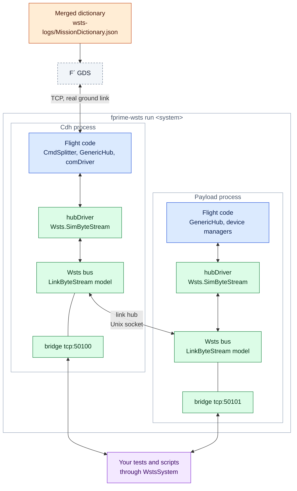
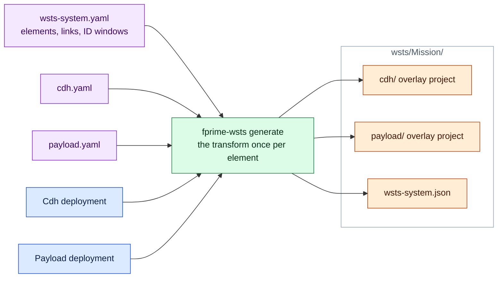

# Systems of several compute elements

A flight system with two or three computers is simulated as one **system**: every
computer's deployment is converted as usual, each runs as its own process, and WSTS
carries the links between them. One command starts the whole system, one GDS operates
it, and one client controls it.



Colours as in [design.md](design.md#reading-the-diagrams): 🟦 flight software, 🟩
fprime-wsts, 🟧 generated, 🟪 yours. In flight the two `hubDriver` instances are a
`Drv.TcpServer` (Cdh) and a `Drv.TcpClient` (Payload).

The repository's [example](../examples/README.md) is such a system: a ground-facing `Cdh`
deployment (VxWorks) and a `Payload` deployment (Linux) of the flight project
`examples/mission`, joined by an F´ `Svc.GenericHub` over Ethernet, with a
`Svc.CmdSplitter` routing commands by opcode. Its system manifest and the manifests of
both elements are in the simulation project `examples/mission-sim`.

## What is simulated, and what is not

The cut is below the hub. The hubs, the command splitter, any framing and the buffer
handling are flight code and run unchanged; only the byte stream driver at each end of
the physical link (a UART, `Drv.TcpClient`, `Drv.TcpServer`, `Drv.Udp`) is replaced. So a
fault on the link exercises the flight software's real handling of a bad link.

## The system manifest

Each element keeps an ordinary [deployment manifest](reference.md#manifest-wstsyaml). The
system manifest adds what makes them one system:

```yaml
system: Mission
ground: cdh                              # the GDS connects to this element (default: the first)
output: wsts/Mission                     # default: wsts/<system>, next to this file

elements:
  cdh:
    manifest: cdh.yaml                   # relative to this file; may be in another project
    ids: [0x00000000, 0x1FFFFFFF]        # IDs that reach this element (optional)
    bridge: tcp:50100                    # default: the manifest's, else tcp:50100, 50101, ...
  payload:
    manifest: payload.yaml
    ids: [0x20000000, 0x2FFFFFFF]

links:
  - name: hub
    kind: bytestream                     # the default, and the only kind so far
    a: cdh.hubDriver                     # <element>.<instance>
    b: payload.hubDriver
```

```bash
fprime-wsts generate examples/mission-sim/wsts-system.yaml
```

writes one overlay project per element under the output directory (`cdh/`, `payload/`),
each with its own fidelity report, and `wsts-system.json`, which describes the system to
the runner and the client. Elements may come from different flight projects and target
different platforms.



### Links

A link joins a byte stream driver instance of one element to one of another. Naming an
instance in a link is enough to have it simulated:

- if the catalog or the element's manifest already replaces it (a UART driver, say), that
  surrogate is used;
- otherwise it is replaced by `Wsts.SimByteStream` (reported as chosen by `link`). This is
  how the socket drivers are handled: they are not in the catalog, because a deployment's
  ground link normally stays a real socket (`keep: [comDriver]`).

A `Wsts::LinkByteStream` model is attached to the endpoint at each end. Whatever flight
software sends on one side is delivered on the other. Because the link is a model behind
the bus:

- **faults** on either endpoint act on the traffic (`drop`, `corrupt`, `delay`,
  `duplicate`, per direction);
- each element's **recorder** sees the traffic (`src` is `link`). When a recording is
  replayed in `responses` mode, what the other element sent comes from the recording and
  live link traffic is ignored, as for any other model.

An endpoint has either a device model or a link, not both.

The surrogate accepts the set-up calls topology code makes on the socket drivers
(`configure`, `configureSend`, `configureRecv`, `start`, `stop`, `join`), so that code
compiles unchanged. It reports ready when `start` (or a UART's `open`) is called.

### ID windows

`ids` is the range of IDs that the flight software routes to an element, for example the
opcode ranges either side of a command splitter. It matters for the WSTS instances that
are added to each element:

- each element's `wstsControl` is placed inside its window (above the element's flight
  IDs, or at the top of the window), so its commands are routed to it like any others;
- windows must not overlap, so the `wstsControl` instances stay distinct in the merged
  dictionary, where an ID identifies an item.

Without `ids`, each `wstsControl` sits just above its own element's flight IDs, which is
right whenever the elements' flight IDs already follow the routing. Two elements whose
`wstsControl` instances would share IDs are an error. `control.base_id` in an element's
manifest overrides the placement; `control: none` leaves the instance out.

## Running a system

Build each element once (they are separate F´ builds), then run the system directory:

```bash
for e in cdh payload; do (cd examples/mission-sim/wsts/Mission/$e && fprime-util generate && fprime-util build); done
```

```bash
fprime-wsts run examples/mission-sim/wsts/Mission --gds --duration 30 --json
```

`run` starts every element with its own bridge and log directory
(`wsts-logs/<element>/sim.log`), waits until every link is connected, and exits non-zero
if any element exits on its own. With `--gds` it merges the elements' dictionaries with
`fprime-merge-dictionary` (the ground element's first), writes the result to
`wsts-logs/<System>Dictionary.json`, and starts one GDS against the ground element with
it. Events, telemetry and commands of every element are then available under their usual
names (`Payload.instrument.TAKE_SAMPLE`, `Cdh.wstsControl.SIM_PAUSE`,
`Payload.wstsControl.FAULT_SET`, ...).

`--scenario`, `--record`, `--bridge` and `--files-dir` apply to a single deployment and
are rejected for a system.

An element can still be run by itself with `fprime-wsts run <system>/<element>`: its links
then stay down, as with the other computer switched off.

## Controlling a system

```python
from fprime_wsts.bridge import WstsSystem

with WstsSystem("examples/mission-sim/wsts/Mission") as system:
    system["payload"].inject_text("sensorUart", "$TEMP,48.0\n")  # one element's WstsBridge
    system.fault_set("hub", "drop", direction="a_to_b")          # a link, by name
    system.fault_set("payload.hubDriver", "corrupt", arg=0xFF)   # or <element>.<endpoint>
    system.fault_clear("hub")
    system.pause(); system.resume(); system.set_rate(2.0)        # every element
    print(system.links_up(), system.status())
```

A link is faulted at its `a` end: `a_to_b` is what that element sends, `b_to_a` what it
receives, `both` cuts the link.

For tests, `-p fprime_wsts.pytest_plugin --wsts-system <dir> --wsts-gds` starts the system
for the session; the `wsts_system` fixture is a `WstsSystem`, and fprime-gds's
`fprime_test_api` works against the merged dictionary. See
[`tests/e2e/`](../tests/e2e), whose fixtures `cdh` and `payload` are the elements' bridges.

## Things to know

- **Time is per element.** Each element has its own tick source and tick count (in the
  example `Cdh` ticks at 10 Hz and `Payload` at 20 Hz). `pause`, `resume` and `set_rate` on
  the system reach the elements one after another, not at the same instant. Runs are not
  repeatable across elements to tick granularity. Lockstep waits on stepped time
  ([roadmap](design.md#roadmap)).
- **Pausing one element** stops its rate groups while the others keep running, so
  whatever it sends periodically (telemetry, heartbeats) stops arriving. That is a useful
  test of how the rest of the system reacts to a computer that has gone quiet. What it
  sends from other threads still arrives: in the example, Payload's events go straight to
  the hub, so a paused Payload still reports that it was paused.
- **Message boundaries are kept.** Each send by flight software is delivered whole to the
  other side (in pieces of at most the surrogate's `chunk`, 1024 bytes by default). A real
  UART or TCP stream gives no such guarantee, so missing framing does not show up here.
- **No link timing.** Bytes arrive as fast as the host delivers them; add latency with a
  `delay` fault. Bytes sent while the peer is not connected are lost.
- **Not built yet:** GPIO links (discretes between computers), datagram semantics and
  connection state for socket links, system-wide scenarios and merged recordings.
