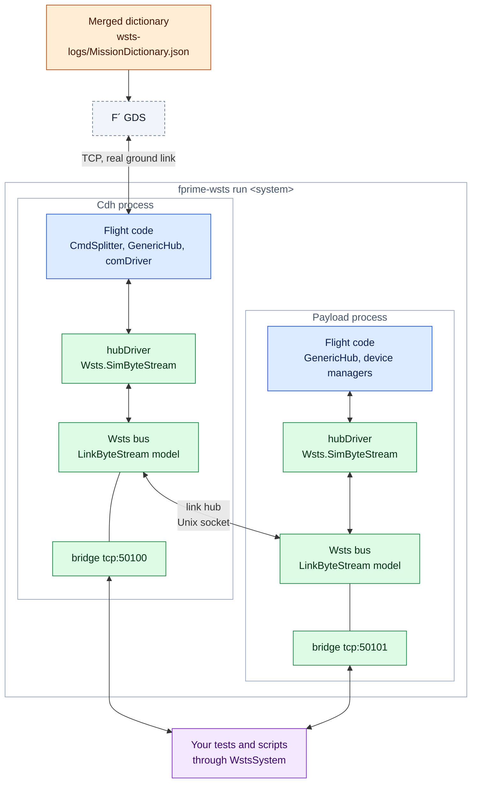
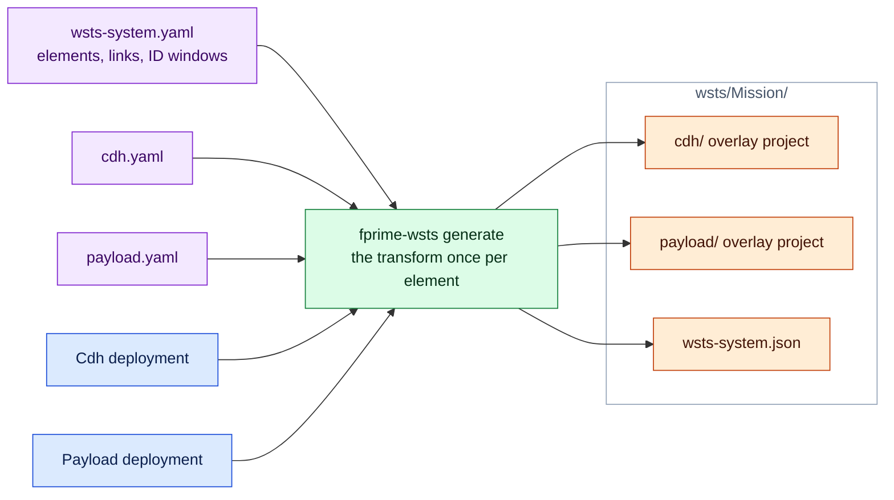

# Systems of several compute elements

A flight system with two or three computers is simulated as one **system**: every
computer's deployment is converted as usual, each runs as its own process, and WSTS
carries the links between them. One command starts the whole system, one GDS operates
it, and one client controls it.



Colours as in [design.md](design.md#reading-the-diagrams): 🟦 flight software, 🟩
fprime-wsts, 🟧 generated, 🟪 yours. In flight the two `hubDriver` instances are a
`Drv.TcpServer` (Cdh) and a `Drv.TcpClient` (Payload).

The repository's [example](../examples/README.md) is such a system: a ground-facing `Cdh`
deployment (VxWorks) and a `Payload` deployment (Linux) of the flight project
`examples/mission`, joined by an F´ `Svc.GenericHub` over Ethernet, with a
`Svc.CmdSplitter` routing commands by opcode. Its system manifest and the manifests of
both elements are in the simulation project `examples/mission-sim`.

## What is simulated, and what is not

The cut is below the hub. The hubs, the command splitter, any framing and the buffer
handling are flight code and run unchanged; only the byte stream driver at each end of
the physical link (a UART, `Drv.TcpClient`, `Drv.TcpServer`, `Drv.Udp`) is replaced. So a
fault on the link exercises the flight software's real handling of a bad link.

## The system manifest

Each element keeps an ordinary [deployment manifest](reference.md#manifest-wstsyaml). The
system manifest adds what makes them one system:

```yaml
system: Mission
ground: cdh                              # the GDS connects to this element (default: the first)
output: wsts/Mission                     # default: wsts/<system>, next to this file

elements:
  cdh:
    manifest: cdh.yaml                   # relative to this file; may be in another project
    ids: [0x00000000, 0x1FFFFFFF]        # IDs that reach this element (optional)
    bridge: tcp:50100                    # default: the manifest's, else tcp:50100, 50101, ...
  payload:
    manifest: payload.yaml
    ids: [0x20000000, 0x2FFFFFFF]

links:
  - name: hub
    kind: bytestream                     # the default; datagram is the connectionless kind
    a: cdh.hubDriver                     # <element>.<instance>
    b: payload.hubDriver
```

```bash
fprime-wsts generate examples/mission-sim/wsts-system.yaml
```

writes one overlay project per element under the output directory (`cdh/`, `payload/`),
each with its own fidelity report, and `wsts-system.json`, which describes the system to
the runner and the client. Elements may come from different flight projects and target
different platforms.



### Links

A link joins a driver instance of one element to one of another. `kind` says what it
carries: `bytestream` (the default), a UART or socket connection, or `gpio`, a discrete wire
between two pins. Naming an instance in a link is enough to have it simulated:

- if the catalog or the element's manifest already replaces it (a UART or GPIO driver, say),
  that surrogate is used;
- otherwise a bytestream link is replaced by `Wsts.SimByteStream` and a gpio link by
  `Wsts.SimGpio` (reported as chosen by `link`). This is how the socket drivers are
  handled: they are not in the catalog, because a deployment's ground link normally stays a
  real socket (`keep: [comDriver]`).

A `Wsts::LinkByteStream` model is attached to the endpoint at each end of a bytestream
link; a `Wsts::LinkGpio` model does the same for a gpio link. What flight software sends on
one side is delivered on the other: bytes for a bytestream link, a level for a gpio link
(what flight software at `a` writes arrives as an input level at `b`, where it fires the
pin's interrupt as a device-driven edge would). A gpio link is one direction: the reverse is
a second link with `a` and `b` swapped. Because the link is a model behind the bus:

- **faults** on either endpoint act on the traffic (`drop`, `corrupt`, `delay`,
  `duplicate`, per direction);
- each element's **recorder** sees the traffic (`src` is `link`). When a recording is
  replayed in `responses` mode, what the other element sent comes from the recording and
  live link traffic is ignored, as for any other model. What flight software sends still
  goes to the other element, which is running live, so a replaying element keeps its
  downlink through the link.

An endpoint has either a device model or a link, not both.

#### Datagram links

`kind: datagram` puts a connectionless transport under the same endpoints: a
`Wsts::LinkDatagram` model is attached instead, and there is no listen/connect handshake
and no connection state. Each end binds a Unix datagram socket of its own,
`<WSTS_LINK_DIR>/<link>.a.sock` at end `a` (the `a:` instance) and `<link>.b.sock` at end
`b`, and sends to the other's with `sendto()`; `fprime-wsts run` sets `WSTS_LINK_DIR` for
every element, as for stream links. Both files are created at start-up: nothing waits for
the peer and nothing reconnects.

- **One message is one datagram.** The length, the sending element's simulated time and
  the bytes travel in a single `sendto()`; the receiver reads it whole, so there is no
  `readFully` resynchronisation.
- **A send with no peer's socket goes nowhere and is not retried.** In real time it counts
  in the link's dropped messages, as on a cable with nothing at the far end.
- **In lockstep it is held instead.** A send made before the peer has bound its socket
  waits in the outbox and is flushed as soon as the socket appears, and what arrives waits
  for the receiving element's next tick — exactly as for a stream link, so two lockstep
  runs record the same bytes.
- **It is never "up".** A datagram link counts in `links` and contributes
  `link.<name>.sent` / `.received`, but `links_up` only counts links with a connection:
  the system runner and `WstsSystem.links_up()` therefore wait for stream links only.

Both ends may send, as with a stream link; `a`/`b` only decide which path is `.a.sock` and
which is `.b.sock`. Faults and recording apply as on any byte stream endpoint.

Links join byte streams, GPIO discretes and datagrams. A register block is not linked
between elements: a register interface component is replaced inside its own element, and the
model behind it lives there (in-process, or attached through that element's bridge). Two
computers that share a dual-port memory or an FPGA need one external model attached to both
elements' bridges.

The surrogate accepts the set-up calls topology code makes on the socket drivers
(`configure`, `configureSend`, `configureRecv`, `start`, `stop`, `join`), so that code
compiles unchanged. It reports ready when `start` (or a UART's `open`) is called.

### ID windows

`ids` is the range of IDs that the flight software routes to an element, for example the
opcode ranges either side of a command splitter. It matters for the WSTS instances that
are added to each element:

- each element's `wstsControl` is placed inside its window (above the element's flight
  IDs, or at the top of the window), so its commands are routed to it like any others;
- windows must not overlap, so the `wstsControl` instances stay distinct in the merged
  dictionary, where an ID identifies an item.

Without `ids`, each `wstsControl` sits just above its own element's flight IDs, which is
right whenever the elements' flight IDs already follow the routing. Two elements whose
`wstsControl` instances would share IDs are an error. `control.base_id` in an element's
manifest overrides the placement; `control: none` leaves the instance out.

## Running a system

Build each element once (they are separate F´ builds), then run the system directory:

```bash
fprime-wsts build examples/mission-sim/wsts/Mission
```

```bash
fprime-wsts run examples/mission-sim/wsts/Mission --gds --duration 30 --json
```

`run` starts every element with its own bridge and log directory
(`wsts-logs/<element>/sim.log`), waits until every link is connected, and exits non-zero
if any element exits on its own. With `--gds` it merges the elements' dictionaries with
`fprime-merge-dictionary` (the ground element's first), writes the result to
`wsts-logs/<System>Dictionary.json`, and starts one GDS against the ground element with
it. Events, telemetry and commands of every element are then available under their usual
names (`Payload.instrument.TAKE_SAMPLE`, `Cdh.wstsControl.SIM_PAUSE`,
`Payload.wstsControl.FAULT_SET`, ...).

Add `--gds-gui` to serve that GDS's browser GUI on the ground element and print its URL
(`--gds-gui-port`, default 5000; `--gds-gui-addr`, default `127.0.0.1`).

Scenarios and recordings are per element, since each element has its own ticks:

```bash
fprime-wsts run examples/mission-sim/wsts/Mission --scenario payload=overtemp.jsonl --record run1.jsonl
```

`--scenario <element>=<file>` plays a scenario on one element from start-up (once per
element; `--scenario-mode` is for all of them). `--record <element>=<file>` records one
element; a plain `--record run1.jsonl` records every element, to `run1.cdh.jsonl` and
`run1.payload.jsonl`. `--bridge` and `--files-dir` apply to a single deployment and are
rejected for a system.

An element can still be run by itself with `fprime-wsts run <system>/<element>`: its links
then stay down, as with the other computer switched off.

### In lockstep

```bash
fprime-wsts run examples/mission-sim/wsts/Mission --stepped --duration 600 --record run.jsonl
```

runs the system in [lockstep](stepped-time.md#phase-4-what-is-built) (experimental): every
element in stepped time, stepped together on one time base by a conductor in `run`. Cdh's
ticks at 10 Hz and Payload's at 20 Hz are taken in the order of their simulated times, each
when the ones before it have finished, as fast as the host computes. What the hub carries
is delivered at the receiving element's first tick after the time it was sent at. Two runs
record the same, byte for byte, on every element. `--duration` counts simulated seconds;
without it the system runs until interrupted, and a pause of any element (from the GDS,
`Cdh.wstsControl.SIM_PAUSE`, or a client) holds the whole system at the end of an instant,
until it is resumed. A plain `--scenario <file>` is then a
[system scenario](reference.md#system-scenarios): actions at simulated times, each for an
element or a link. A manifest of an element with `time: {mode: stepped}` runs its system in
lockstep by default; `--realtime` overrides it.

## Controlling a system

```python
from fprime_wsts.bridge import WstsSystem

with WstsSystem("examples/mission-sim/wsts/Mission") as system:
    system["payload"].inject_text("sensorUart", "$TEMP,48.0\n")  # one element's WstsBridge
    system.fault_set("hub", "drop", direction="a_to_b")          # a link, by name
    system.fault_set("payload.hubDriver", "corrupt", arg=0xFF)   # or <element>.<endpoint>
    system.fault_clear("hub")
    system.pause(); system.resume(); system.set_rate(2.0)        # every element
    print(system.links_up(), system.status())

    system.set_stepped(True)                    # lockstep, from here
    system.step(seconds=2.0)                    # both elements, to the same simulated time
    system.run_scenario("system.jsonl")         # actions on that time base
    system.set_stepped(False); system.resume()  # and back to real time
```

In lockstep `step` returns when every tick it took is finished on every element. A running
system switched to lockstep first brings the element that is behind (its clock started
later) to the other's time.

A link is faulted at its `a` end: `a_to_b` is what that element sends, `b_to_a` what it
receives, `both` cuts the link.

For tests, `-p fprime_wsts.pytest_plugin --wsts-system <dir> --wsts-gds` starts the system
for the session; the `wsts_system` fixture is a `WstsSystem`, and fprime-gds's
`fprime_test_api` works against the merged dictionary. See
[`tests/e2e/`](../tests/e2e), whose fixtures `cdh` and `payload` are the elements' bridges.

## Things to know

- **Time is per element, unless in lockstep.** Each element has its own tick source and
  tick count (in the example `Cdh` ticks at 10 Hz and `Payload` at 20 Hz). In real time
  `pause`, `resume` and `set_rate` on the system reach the elements one after another, not
  at the same instant, and runs are not repeatable across elements to tick granularity. In
  lockstep the system has one time base and is repeatable end to end.
- **Pausing one element** stops its rate groups while the others keep running, so
  whatever it sends periodically (telemetry, heartbeats) stops arriving. That is a useful
  test of how the rest of the system reacts to a computer that has gone quiet. What it
  sends from other threads still arrives: in the example, Payload's events go straight to
  the hub, so a paused Payload still reports that it was paused.
- **Message boundaries are kept.** Each send by flight software is delivered whole to the
  other side (in pieces of at most the surrogate's `chunk`, 1024 bytes by default). A real
  UART or TCP stream gives no such guarantee, so missing framing does not show up here.
- **No link timing.** Bytes arrive as fast as the host delivers them; add latency with a
  `delay` fault. Bytes sent while the peer is not connected are lost (in lockstep they wait
  for it). In lockstep what a link brings arrives at the receiver's next tick, a latency of
  up to one of its tick periods that the wire does not have.
- **Not built yet:** one recording for the whole system (recordings are per element; a
  scenario for the whole system needs lockstep).
