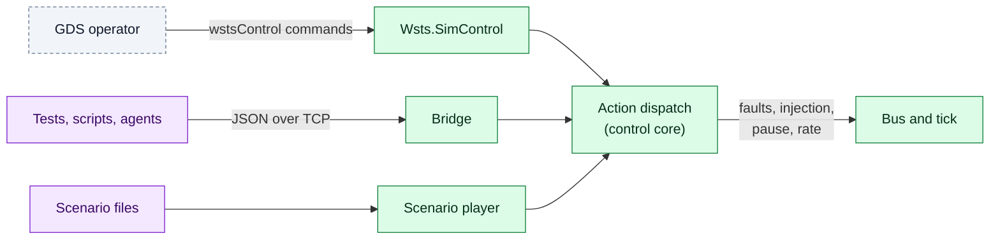

# Control and Fault Injection

Everything you can do to a running simulation is an **action**, and every action is
available three ways: as an F´ command on `wstsControl` from the GDS, as a call on the
Python bridge, and as a line in a scenario file. From a shell, `fprime-wsts ctl <dir> <action>
field=value …` sends one through the bridge ([Run](run.md#looking-in-from-another-terminal)).



## The actions

| Action | `wstsControl` command | Python (`WstsBridge`) | Effect |
|---|---|---|---|
| `pause`, `resume` | `SIM_PAUSE`, `SIM_RESUME` | `pause()`, `resume()` | Stop / restart the simulation tick, and with it the flight rate groups |
| `step` | `SIM_STEP` | `step(5)` | Run for that many ticks, then pause again |
| `set_stepped` | `SIM_SET_STEPPED` | `set_stepped(True)` | Stepped time: ticks are taken when the last one is finished |
| `set_rate` | `SIM_SET_RATE` | `set_rate(2.0)` | Simulated time per wall-clock time (0.01–1000) |
| `fault_set` | `FAULT_SET` | `fault_set(endpoint, kind, …)` | Arm a fault on an endpoint |
| `fault_clear` | `FAULT_CLEAR` | `fault_clear("*")` | Remove faults |
| `inject_bytes` | `INJECT_BYTES`, `INJECT_TEXT` | `inject_bytes()`, `inject_text()` | Bytes to flight software as if from the device |
| `gpio_force` | `GPIO_FORCE` | `gpio_force(endpoint, level)` | Drive a GPIO input |
| `i2c_reg_set` | `I2C_REG_SET` | `i2c_reg_set(endpoint, addr, reg, value)` | Set a register of a register-addressed I2C model |
| `reg_set` | `REG_SET` | `reg_set(endpoint, offset, value)` | Set a register of a register block |
| `irq_raise` | `IRQ_RAISE` | `raise_irq(endpoint, number)` | Raise an interrupt of a register block |
| `model_set` | `MODEL_SET` | `model_set(model, key, value)` | Set a model parameter |
| `record_start`, `record_stop` | `RECORD_START`, `RECORD_STOP` | `record_start(path)`, `record_stop()` | Record bus traffic and actions |
| `scenario_load`, `_start`, `_stop` | `SCENARIO_LOAD`, … | `scenario_load()`, `run_scenario()` | Play a scenario or recording |
| `log` | | | A marker event (`SimLog`) |

The bridge also answers queries: `status()` (tick, run state, faults, bus counters,
endpoints), `bus_stats()` (the traffic of each endpoint and each I2C address or register
offset on it, below), `gpio_get(endpoint)` (the level flight last wrote), `bytes_sent(endpoint)`,
`register_accesses(endpoint)`, and with `subscribe()` a stream of every bus transaction
and action (`events()`, `wait_for(predicate)`).

## Stepping

Pause the simulation, set up what flight software should meet, and let it run for exactly
as many ticks as the test needs:

```python
sim.pause()
sim.i2c_reg_set("i2cBus", 0x40, 0x02, 0x10)     # while nothing runs
sim.step(5)                                      # five ticks of the flight rate groups, then paused again
assert sim.gpio_get("heaterPin") is False
```

`step()` returns when the simulation has paused again and flight software has finished
what those ticks caused (every message handled, no handler running), with the tick it
stopped at. An assertion right after it needs no timeout. The
ticks are still paced by the wall clock and the time scale (`set_rate(100)` makes a step
quick), and within a tick the flight threads run as the host schedules them: this is
control over how far time goes. For a deterministic order within a tick, use stepped time
(below).

## Stepped time (experimental)

By default ticks follow the wall clock. In **stepped time** a tick is taken as soon as
flight software has finished the last one, so a run goes as fast as the host computes and
no tick overlaps the next:

```bash
fprime-wsts run my-mission-sim/wsts/MyDeployment --stepped --duration 600 --json
```

runs ten minutes of flight time, to the tick, usually in seconds; the summary has
`sim_seconds`, `speed` and `tick_times`: the slowest ticks in host time, and how many took
longer than the tick period. Stepped time removes overruns (a tick waits for the last one
however long it takes), so these are where to look for a rate group that could overrun on
the target; the host is not the target, so they are a hint, never a failure
(`sim.tick_times()` asks a running simulation). `time: {mode: stepped}` in the manifest makes it the default,
and `sim.set_stepped(True)` switches a running simulation. Paused and stepped, a test
gets exact control:

```python
sim.pause(); sim.set_stepped(True)
sim.inject_text("sensorUart", "$TEMP,95.5\n")   # applied between two ticks
sim.step(1)                                      # the tick that reads it, finished
sim.step(1200)                                   # a minute at 20 Hz, in a moment
```

What to know:

- **Check the report first.** The Time section of `wsts-report.md` lists the code in the
  deployment's components that waits on the host (sleeps, reads the host's clock, starts
  threads of its own, waits for another thread, blocks on a device), and says for each
  whether it only makes stepped runs slower, keeps two of them from recording the same
  bytes, or may keep a tick from finishing. `fprime-wsts survey` says the same before
  there is a manifest.
- If a component never finishes its work (a handler that blocks, a task that sleeps or
  polls by itself), the tick cannot finish. After ten seconds the simulation pauses, and
  `status()["stuck"]` and the log name the queues that hold work. Such a component needs
  a surrogate, or the run real time.
- `set_rate(1)` paces stepped time for someone watching a GDS; `set_rate(0)` removes the
  limit.
- **Two runs are the same, byte for byte.** Flight software is given simulated time
  (2000-01-01T00:00:00Z plus the ticks taken; `time: {epoch: …}` in the manifest moves
  it), and its tasks run one at a time in a fixed order, so `--record` gives the same file
  every time. That makes a recording something to compare against after a change.
- The fixed order is not the flight scheduler's: tasks run in the order of their queues,
  whatever their priorities, and none preempts another.
- A project's own time component still gives the host's clock unless its surrogate asks
  the simulation (`Wsts::Control::flightTime`, as the example's
  `SensorSim/SimTime/SimTime.cpp` does); `Svc.PosixTime`, `Svc.ChronoTime` and
  `Svc.OsTime` are replaced for you. The report flags a surrogate that reads the host's clock.
- A whole system is not stepped yet (`run --stepped` refuses one): step one element
  through its bridge.

The design, and what is still to come, is in [Stepped time](../stepped-time.md).

## Faults

```python
sim.fault_set("i2cBus", "error", arg=3, count=5)              # next five transactions fail
sim.fault_set("sensorUart", "drop", direction="to_flight", ticks=40)   # 40 ticks of silence
sim.fault_set("i2cBus", "stuck", arg=0x7F, direction="to_flight")      # every byte read is 0x7F
sim.fault_clear("*")
```

`count` and `ticks` bound a fault (0 means unbounded); `direction` is `both`, `to_device`
(flight software → device) or `to_flight`.

| `kind` | Byte stream | I2C / SPI | GPIO | Register | `arg` |
|---|---|---|---|---|---|
| `drop` | Data discarded | Transaction fails | Write or input change ignored | Write lost; read all ones | |
| `corrupt` | Bytes XOR `arg` | Bytes XOR `arg` | | Value XOR `arg` | Mask |
| `delay` | Held `arg` ms | Held `arg` ms | Held `arg` ms | Held `arg` ms | ms |
| `duplicate` | Delivered twice | | | | |
| `error` | Send returns an error | Returns status `arg` | Returns status `arg` | Read all ones | Status |
| `stuck` | Data discarded | Read bytes all `arg` | Reads return `arg` | Reads return `arg` | Value |

I2C status values are those of `Drv.I2cStatus` (1 address, 2 write, 3 read, 5 other). A
register block's interrupts are a fault target of their own, `<endpoint>:irq`. A fault's
first application raises `FaultTriggered`, and its end `FaultExpired`, so a test can see
exactly when the fault was felt.

## From the GDS

`wstsControl` is an ordinary F´ component, so operators use it like any other: send
`FAULT_SET` with `i2cBus`, `ERROR`, `BOTH`, `3`, `5`, `0`, and watch the flight events.
Its telemetry, once a second, includes `SimTicks`, `SimRunState`, `SimTimeScale`,
`ActiveFaults`, `FaultHits`, `BusTransactions`, `BusBytes` and `BusErrors`.

!!! note "Command string length"

    Command string arguments are limited by `FW_CMD_STRING_MAX_SIZE` (40 characters by
    default). Name scenario files relative to the run's files directory, and send long
    payloads through the bridge or a scenario.

## Things that surprise

- **While paused, downlink stops too.** Pausing stops the flight rate groups, which also
  run the downlink, so the response to `SIM_PAUSE` arrives after the resume. Uplink does not
  depend on the rate groups, so `SIM_RESUME` gets through.
- **Telemetry is downlinked about once a second, latest value only.** A free-running model
  can overwrite an injected value before it is seen: silence it first
  (`model_set("tempSensor", "period", 0)`).
- **Injection works while paused.** `inject_bytes` from the bridge reaches flight software
  even when the tick is stopped.

## Python bridge basics

```python
from fprime_wsts.bridge import WstsBridge

with WstsBridge("tcp:50100") as sim:      # the manifest's bridge address
    sim.subscribe()
    sim.advance(20)                       # wait for 20 simulation ticks
    print(sim.status())
```

The wire protocol is newline-delimited JSON (`{"id": 1, "op": "status"}`), so any
language can drive it. See [Bridge protocol](../reference.md#bridge-protocol).
