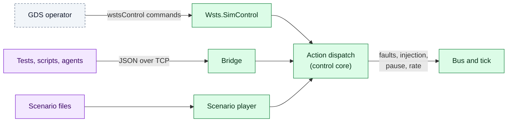

# Control and Fault Injection

Everything you can do to a running simulation is an **action**, and every action is
available three ways: as an F´ command on `wstsControl` from the GDS, as a call on the
Python bridge, and as a line in a scenario file.



## The actions

| Action | `wstsControl` command | Python (`WstsBridge`) | Effect |
|---|---|---|---|
| `pause`, `resume` | `SIM_PAUSE`, `SIM_RESUME` | `pause()`, `resume()` | Stop / restart the simulation tick, and with it the flight rate groups |
| `set_rate` | `SIM_SET_RATE` | `set_rate(2.0)` | Simulated time per wall-clock time (0.01–1000) |
| `fault_set` | `FAULT_SET` | `fault_set(endpoint, kind, …)` | Arm a fault on an endpoint |
| `fault_clear` | `FAULT_CLEAR` | `fault_clear("*")` | Remove faults |
| `inject_bytes` | `INJECT_BYTES`, `INJECT_TEXT` | `inject_bytes()`, `inject_text()` | Bytes to flight software as if from the device |
| `gpio_force` | `GPIO_FORCE` | `gpio_force(endpoint, level)` | Drive a GPIO input |
| `i2c_reg_set` | `I2C_REG_SET` | `i2c_reg_set(endpoint, addr, reg, value)` | Set a register of a register-addressed I2C model |
| `reg_set` | `REG_SET` | `reg_set(endpoint, offset, value)` | Set a register of a register block |
| `irq_raise` | `IRQ_RAISE` | `raise_irq(endpoint, number)` | Raise an interrupt of a register block |
| `model_set` | `MODEL_SET` | `model_set(model, key, value)` | Set a model parameter |
| `record_start`, `record_stop` | `RECORD_START`, `RECORD_STOP` | `record_start(path)`, `record_stop()` | Record bus traffic and actions |
| `scenario_load`, `_start`, `_stop` | `SCENARIO_LOAD`, … | `scenario_load()`, `run_scenario()` | Play a scenario or recording |
| `log` | | | A marker event (`SimLog`) |

The bridge also answers queries: `status()` (tick, run state, faults, bus counters,
endpoints), `gpio_get(endpoint)` (the level flight last wrote), `bytes_sent(endpoint)`,
`register_accesses(endpoint)`, and with `subscribe()` a stream of every bus transaction
and action (`events()`, `wait_for(predicate)`).

## Faults

```python
sim.fault_set("i2cBus", "error", arg=3, count=5)              # next five transactions fail
sim.fault_set("sensorUart", "drop", direction="to_flight", ticks=40)   # 40 ticks of silence
sim.fault_set("i2cBus", "stuck", arg=0x7F, direction="to_flight")      # every byte read is 0x7F
sim.fault_clear("*")
```

`count` and `ticks` bound a fault (0 means unbounded); `direction` is `both`, `to_device`
(flight software → device) or `to_flight`.

| `kind` | Byte stream | I2C / SPI | GPIO | Register | `arg` |
|---|---|---|---|---|---|
| `drop` | Data discarded | Transaction fails | Write or input change ignored | Write lost; read all ones | |
| `corrupt` | Bytes XOR `arg` | Bytes XOR `arg` | | Value XOR `arg` | Mask |
| `delay` | Held `arg` ms | Held `arg` ms | Held `arg` ms | Held `arg` ms | ms |
| `duplicate` | Delivered twice | | | | |
| `error` | Send returns an error | Returns status `arg` | Returns status `arg` | Read all ones | Status |
| `stuck` | Data discarded | Read bytes all `arg` | Reads return `arg` | Reads return `arg` | Value |

I2C status values are those of `Drv.I2cStatus` (1 address, 2 write, 3 read, 5 other). A
register block's interrupts are a fault target of their own, `<endpoint>:irq`. A fault's
first application raises `FaultTriggered`, and its end `FaultExpired`, so a test can see
exactly when the fault was felt.

## From the GDS

`wstsControl` is an ordinary F´ component, so operators use it like any other: send
`FAULT_SET` with `i2cBus`, `ERROR`, `BOTH`, `3`, `5`, `0`, and watch the flight events.
Its telemetry, once a second, includes `SimTicks`, `SimRunState`, `SimTimeScale`,
`ActiveFaults`, `FaultHits`, `BusTransactions`, `BusBytes` and `BusErrors`.

!!! note "Command string length"

    Command string arguments are limited by `FW_CMD_STRING_MAX_SIZE` (40 characters by
    default). Name scenario files relative to the run's files directory, and send long
    payloads through the bridge or a scenario.

## Things that surprise

- **While paused, downlink stops too.** Pausing stops the flight rate groups, which also
  run the downlink, so the response to `SIM_PAUSE` arrives after the resume. Uplink does not
  depend on the rate groups, so `SIM_RESUME` gets through.
- **Telemetry is downlinked about once a second, latest value only.** A free-running model
  can overwrite an injected value before it is seen: silence it first
  (`model_set("tempSensor", "period", 0)`).
- **Injection works while paused.** `inject_bytes` from the bridge reaches flight software
  even when the tick is stopped.

## Python bridge basics

```python
from fprime_wsts.bridge import WstsBridge

with WstsBridge("tcp:50100") as sim:      # the manifest's bridge address
    sim.subscribe()
    sim.advance(20)                       # wait for 20 simulation ticks
    print(sim.status())
```

The wire protocol is newline-delimited JSON (`{"id": 1, "op": "status"}`), so any
language can drive it. See [Bridge protocol](../reference.md#bridge-protocol).
