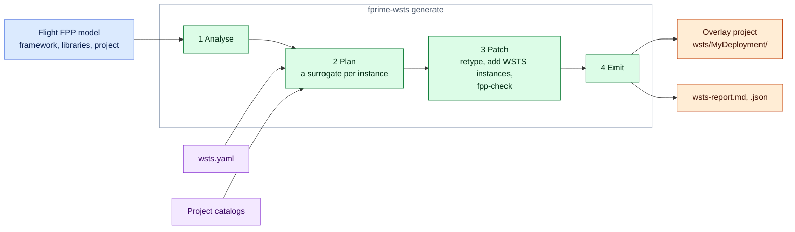

# 4. Generate and Read the Report

```bash
fprime-wsts generate my-mission-sim/wsts.yaml
```

`generate` reads the flight model with the FPP tools (nothing of the flight project is
built, so a deployment that cannot even be configured on Linux is read like any other),
chooses a surrogate for every hardware instance, patches a copy of the topology, checks
it with `fpp-check`, and writes the overlay project and its fidelity report.



For each instance the plan takes, in order: a `substitute` entry of the manifest; else the
catalog entry that `replaces` its component (your catalogs first, then the built-in one);
else, if the component cannot build on Linux, the one catalog surrogate whose ports cover
every connected port. `keep` exempts an instance. A surrogate must serve every port the
topology connects, with the same port type and direction.

## Useful options

| Option | Use |
|---|---|
| `--output DIR` | Write the overlay somewhere other than `wsts/<Deployment>` |
| `--project DIR` | The flight project, when the manifest has no `project:` |
| `--check` | Write nothing; exit 1 if the output is out of date (for CI) |
| `--json` | Machine-readable summary |

## What it writes

```
my-mission-sim/wsts/MyDeployment/
  settings.ini            # framework, libraries: the flight project's, plus the toolkit and yours
  CMakeLists.txt          # the overlay's root: cache values, includes, module order
  MyDeployment/
    Top/
      topology.fpp        # patched copy: substituted instances retyped
      instances.fpp
      wsts_instances.fpp  # wstsControl and other WSTS instances
      WstsSetup.cpp       # binds surrogates to endpoints, attaches models, starts the runtime
      WstsCompat.hpp      # aliases so topology code naming driver classes compiles
    WstsMain.cpp          # only with main.generate
  wsts-include/           # stand-in headers for replaced drivers
  WstsAdapted/            # Wsts.SimRegister written for your register interface components
  <Lib>/<Module>/         # patched copies of library subtopologies, when an instance there is replaced
  wsts-report.md
  wsts-report.json
```

Your hand-written topology `.cpp` and `Main.cpp` are not copied: the overlay compiles the
flight files in place.

!!! danger "Never edit generated files"

    Everything under `wsts/` is rewritten by the next `generate`. Change the manifest (or
    your own surrogates and models) and regenerate.

## Read the report

`wsts-report.md` is the record of what the simulated deployment changes relative to flight.
Read it after every generate, and check it in if you check in the overlay. Its main
sections:

| Section | Tells you |
|---|---|
| Header lines | Flight and simulation toolchains, the tick source, the bridge, **whether flight IDs are unchanged** (they always should be) |
| Substituted instances | Each replaced instance, its flight component, the surrogate, *chosen by* (`catalog`, `manifest`, `link`), and its endpoint |
| Register blocks, Device models, Simulator components, Links | What answers on each endpoint |
| Dictionary changes | Flight commands, events and channels that disappear with replaced drivers, and the WSTS entries added |
| Fidelity notes | What this deployment does not reproduce, specifically |
| Flight root CMakeLists.txt | Statements carried over, and those not carried over with the manifest key that reproduces each |
| Modules that change under BUILD_TESTING | Modules with a stub variant, and what the stub lacks |
| What the build takes from the host | System headers, libraries, packages and SDK files, read from text |

A short excerpt from the example's Payload report:

```markdown
- Dictionary identical to flight: **no**; flight IDs unchanged: **yes**

| Instance | Flight component | Surrogate | Chosen by | Endpoint |
|---|---|---|---|---|
| `Payload.linuxTimer` | `Svc.LinuxTimer` | `Wsts.SimTick` | catalog | `linuxTimer` |
| `Payload.hubDriver` | `Drv.TcpClient` | `Wsts.SimByteStream` | link | `hubDriver` |
| `Payload.i2cBus` | `Drv.LinuxI2cDriver` | `Wsts.SimI2c` | catalog | `i2cBus` |
| `Payload.fpgaRegs` | `SensorLib.RegisterInterface` | `WstsAdapted.SensorLib_RegisterInterface` | manifest | `fpgaRegs` |
```

`fprime-wsts report <dir>` prints the report of a generated deployment again, with the
host check of this machine if one was made.

## Warnings worth acting on

Warnings do not stop generation, but several stop the build or the run later:

| Warning (gist) | What to do |
|---|---|
| `X cycles the flight rate groups … and is kept` | A project timer: nothing scheduled will run. Write a [project tick surrogate](surrogates.md#a-project-timer), or model its registers |
| `time comes from X, a project component that is kept` | Substitute it if it reads a hardware clock |
| `module M links '${SDK}/…'` | Use the module's stub variant, or another option the warning lists ([step 5](build.md)) |
| `flight root CMakeLists.txt: … not carried over (key: …)` | Put the statement under the key named, if the build needs it |
| `BUILD_TESTING …` | Do not set it for the whole build; use `cmake.stub_variants` |
| A platform library adds modules that may not configure on Linux | `cmake.exclude_subdirectories` for those that fail |

Errors print as `fprime-wsts: error: …` with exit code 2, and nearly all of them say which
key to add. [Troubleshooting](troubleshooting.md#generate) has the common ones.

## Next

[5. Check the host and build](build.md).
