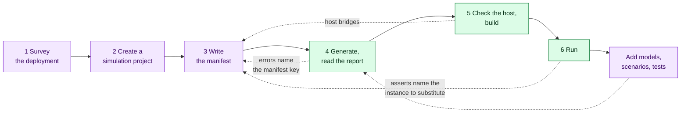

# User Guide

This guide takes you from an F´ flight project that has never seen `fprime-wsts` to a
simulated deployment you can run in CI, operate from the GDS and drive from tests. It
assumes you have [installed the toolkit](../getting-started/installation.md) and
[run the example](../getting-started/first-simulation.md).

## The workflow

Getting a deployment to run is a loop. Each tool says what it found and, where it stops,
which manifest key settles it: `generate` names ambiguous instances and unmatched ports,
`check-host` names missing headers and libraries with the module that needs them, and
`run` names the kept instance behind an F´ assert.

## Sections

-   :material-map-marker-path:{ .lg .middle } **Simulating your deployment**

    ---

    The six steps above, in order.

    [:octicons-arrow-right-24: 1. Survey the deployment](survey.md)

-   :material-chip:{ .lg .middle } **Simulating hardware**

    ---

    What answers behind the surrogates: [device models](device-models.md),
    [register blocks and interrupts](registers.md),
    [simulators as F´ components](simulators.md), and
    [your own surrogates](surrogates.md).

-   :material-gamepad-variant-outline:{ .lg .middle } **Operating a simulation**

    ---

    [Control and fault injection](control.md),
    [scenarios, recording and replay](scenarios.md), and
    [testing with pytest](testing.md).

-   :material-sitemap-outline:{ .lg .middle } **Larger projects**

    ---

    [Multi-computer systems](systems.md),
    [VxWorks and other targets](other-targets.md), and
    [configuring with an agent](agents.md).

When something goes wrong, see [Troubleshooting](troubleshooting.md).
