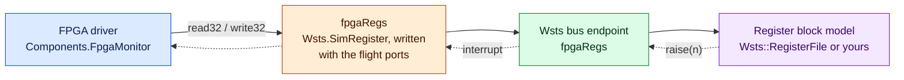

# Register Blocks and Interrupts

On many flight computers the devices are FPGA blocks or SoC peripherals. Their drivers are
project components that read and write 32-bit registers through one **register interface
component**, which also delivers the hardware's interrupts. Off the target that component
is usually a stub: its registers are an array nobody fills, no interrupt arrives, and the
drivers above it read zeros and do nothing, or assert.

**Do not replace those drivers.** Replace the register interface component, and put a
model of the register block behind it. The drivers then run exactly as in flight, with
their register sequences, interrupt handling and events.



## Replace the register interface

The component is your project's (or one of its libraries'), so no catalog knows it. Name
it in the manifest:

```yaml
substitute:
  - component: Board.RegisterInterface   # every instance; or `instance: fpgaRegs` for one
    with: Wsts.SimRegister
models:
  - name: fpga
    class: Wsts::RegisterFile
    endpoint: fpgaRegs                   # the instance's base name
    kind: register
    params: {"reg.0x00": "0xF00D0001", "irq.period": "20", "irq.status": "0x04"}
```

FPP connects a port only to one of the same type, and your component's ports have your
project's types. So the generator writes `Wsts.SimRegister` again for your component, with
its port names and types, into `WstsAdapted/` of the overlay. **No port mapping is
needed.** Ports are recognised by their signatures:

| Role | Shape |
|---|---|
| read32, read64 | Input port, one unsigned integer argument (the offset), returning `U32` or `U64` |
| write32, write64 | Input port, two unsigned integer arguments (offset, value), returning nothing |
| interrupt | Output port with one unsigned integer argument (the number) or none |

The surrogate accepts the `configure(...)` and `open(...)` calls topology code usually
makes. A connected port of any other shape (a command port, say) is an error that names
it: drop it with `ports: {<port>: }`, or write a [mirror](#keeping-the-components-commands).

## The stock model: `Wsts::RegisterFile`

32-bit registers at offsets that are multiples of 4, configured entirely from `params`:

| Parameter | Meaning |
|---|---|
| `reg.<offset>` | Value of a register. The first use defines it, with this as its reset value |
| `reset.<offset>` | Reset value |
| `mask.<offset>` | Bits flight software can write (default all; `0` makes it read-only) |
| `w1c.<offset>` | `1`: writing a 1 clears the bit |
| `rc.<offset>` | `1`: a read returns the value and clears the register |
| `strict` | `1` (default): an undefined offset fails. `0`: undefined offsets are plain memory |
| `irq.period`, `irq.number` | Raise interrupt `irq.number` every `irq.period` ticks |
| `irq.status`, `irq.bits` | Before raising it, set `irq.bits` in the register at `irq.status` |

The example's FPGA housekeeping block, with an identity register, a write-1-to-clear
status and a frame interrupt once a second:

```yaml
params:
  "reg.0x00": "0xF00D0001"   # identity, read only
  "mask.0x00": "0"
  "reg.0x04": "0"            # interrupt status, write 1 to clear
  "w1c.0x04": "1"
  "reg.0x08": "0"            # frame count
  "reg.0x0C": "215"          # temperature: 21.5 °C
  "irq.number": "1"
  "irq.period": "20"         # 20 ticks at 20 Hz
  "irq.status": "0x04"
  "irq.bits": "0x1"          # frame ready
```

## A model with behaviour

Derive from `RegisterFile` and add what the block does:

```cpp
#include <Wsts/Core/Models.hpp>

class FpgaModel : public Wsts::RegisterFile {
  public:
    enum : std::uint64_t { ID = 0x00, STATUS = 0x04, CONTROL = 0x08, COUNT = 0x0C };

    FpgaModel() {
        this->define(ID, 0xF00D0001, 0);                          // read only
        this->define(STATUS, 0, 0xFFFFFFFF, WRITE_1_TO_CLEAR);
        this->define(CONTROL, 0);
        this->define(COUNT, 0, 0);
        // Runs after flight software wrote the register
        this->onWrite(CONTROL, [this](std::uint64_t, std::uint32_t value) {
            if (value & 0x1) {                                    // "start"
                this->setBits(STATUS, 0x1);                       // "done"
                this->raise(3);                                   // interrupt 3, towards flight
            }
        });
    }
    void onTick(std::uint64_t tick) override { this->poke(COUNT, tick); }
};
```

## Behaviour to know

- **A read that fails returns all ones.** The read ports have no status, so a fault, an
  undefined offset or a missing model gives flight `0xFFFFFFFF`, and counts in
  `BusErrors`. A write that fails is lost.
- **Interrupts arrive on another thread**: the tick thread for a model's `onTick`, the
  flight thread for a write hook. One is delivered at a time, so a handler is never
  re-entered. A handler that posts to its component's queue and returns, which is what an
  interrupt handler must do in flight too, needs nothing more.
- **64-bit accesses** reach the model as one access of width 8; `RegisterFile` serves them
  as two registers, low half at the offset.

## Faults, injection and observation

| Target | Faults | Effect |
|---|---|---|
| `fpgaRegs` | `drop`, `error`, `stuck`, `corrupt`, `delay`, per direction | A write travels `to_device`, a read `to_flight` |
| `fpgaRegs:irq` | `drop`, `duplicate`, `delay`, `corrupt` | Lose, double, hold or renumber interrupts |

From outside the simulation: `reg_set` sets a register without a flight write, `irq_raise`
raises an interrupt, and `model_set fpga reg.0x0C 215` reaches the model's parameters. All
are also `wstsControl` commands (`REG_SET`, `IRQ_RAISE`, `MODEL_SET`).

```python
payload.fault_set("fpgaRegs:irq", "drop", count=1)      # lose the next frame interrupt
payload.reg_set("fpgaRegs", 0x0C, 400)                  # 40.0 °C, as the hardware would set it
print(payload.register_accesses("fpgaRegs"))            # what the driver read and wrote
```

### A register block in Python

```python
registers = {0x00: 0xF00D0001, 0x0C: 215}
sim.serve_register("fpgaRegs",
                   lambda offset, width: registers.get(offset, (1, 0)),   # a value, or (status, value)
                   lambda offset, width, value: registers.update({offset: value}))
sim.raise_irq("fpgaRegs", 1)
```

When this client disconnects, the model that was on the endpoint before answers again.

## Going further

- **A time unit.** A component that is both the tick and the clock, reached through a
  register interface, can be kept: model its registers and make the model the simulation's
  tick source. See [A time unit](../surrogate-guide.md#a-time-unit).
- **DMA.** A driver that writes a buffer's physical address into a register needs that
  address to mean something on the host. Register the translation with `Wsts::Dma` from the
  manifest's `setup`, and the model can reach the buffer. See
  [Memory shared with hardware](../surrogate-guide.md#memory-shared-with-hardware).

### Keeping the component's commands

`Wsts.SimRegister` has no commands or events, so the flight component's debug commands
(read or write a register by offset) leave the dictionary. To keep them, write a mirror on
`Wsts::RegisterSurrogate`; the example has one in
`examples/mission-sim/Surrogates/SimRegisterInterface`. See
[A mirror of the register interface](../surrogate-guide.md#a-mirror-of-the-register-interface).
