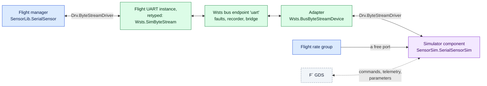

# Simulators as F´ Components

Many projects already have device simulators written as F´ components, for hand-built
test deployments where a loopback stood in for the driver. They go into a generated
deployment unchanged, behind the stock surrogate, with their own commands, events,
telemetry, parameters and scheduling.



!!! question "Component or C++ model?"

    Use a **component** when the simulator exists already, when operators should command
    and observe it from the ground system, when it needs parameters, or when it is several
    components wired together. Use a [C++ model](device-models.md) when the device is
    simple and only tests talk to it: a model costs no IDs, no command dispatcher or rate
    group capacity, and no topology changes.

## What you write

### 1. The simulator

A client of the driver interface. For a serial device, the four ports of
`Drv.ByteStreamDriverClient` (`drvConnected`, `drvReceiveIn`, `drvReceiveReturnOut`,
`drvSendOut`), under any names.

### 2. Its instances, in a subtopology

The simulator, whatever it needs (a buffer manager for its transmit buffers) and one
`Wsts.BusByteStreamDevice` adapter per endpoint. A subtopology keeps it together and keeps
flight names out:

```fpp title="my-mission-sim/SensorSim/Top/SensorSim.fpp"
module SensorSim {
  instance sensorSim: SensorSim.SerialSensorSim base id 0x70000000 queue size 10
  instance sensorPort: Wsts.BusByteStreamDevice base id 0x70002000

  topology Simulator {
    instance sensorSim
    instance sensorPort
    connections Device {
      sensorPort.ready              -> sensorSim.drvConnected
      sensorPort.$recv              -> sensorSim.drvReceiveIn
      sensorSim.drvReceiveReturnOut -> sensorPort.recvReturnIn
      sensorSim.drvSendOut          -> sensorPort.$send
    }
    port schedIn = sensorSim.schedIn
  }
}
```

Give simulator instances a block of IDs that flight does not use and is unlikely to grow
into. Flight IDs never move; a collision is an error.

### 3. The manifest entries

```yaml
simulators:
  topologies: [SensorSim.Simulator]                   # whole subtopologies
  instances: []                                       # or single instances
  headers: [SensorSim/Top/SubtopologyTopologyDefs.hpp]   # for their phase code
  connections:                                        # to flight instances
    - rateGroup1Hz.RateGroupMemberOut -> SensorSim.Simulator.schedIn
devices:
  - {instance: SensorSim.sensorPort, endpoint: uart}  # the adapter is the device on 'uart'
```

A connection to a rate group's output array without a port number gets the lowest free
port; flight connections keep theirs. When all are taken, generation stops and names the
constant to raise (`ActiveRateGroupOutputPorts`), which the simulation can override for
its own build (below).

What the generator checks for you: IDs do not overlap, health ping numbering of flight
instances does not move (simulator instances are not pinged), and the command dispatcher
has enough ports and opcode table entries.

## A rate of its own

A simulator that must run faster than any flight rate group, or at a rate that is not a
multiple of the flight tick, gets a clock from the simulation: a `Wsts.SimCycle` driving a
rate group that the simulation defines.

```fpp
instance simClock: Wsts.SimCycle base id 0x70004000
instance fastGroup: Svc.PassiveRateGroup base id 0x70005000

topology Simulator {
  instance simClock
  instance fastGroup
  instance gyroSim
  connections FastRateGroup {
    simClock.CycleOut -> fastGroup.CycleIn
    fastGroup.RateGroupMemberOut[0] -> gyroSim.schedIn
  }
}
```

```yaml
clocks:
  - {instance: SensorSim.simClock, hz: 125}
```

A clock follows **simulated** time: pause stops it with the flight rate groups, and
`set_rate` scales it. Its count does not drift, its cycles are spaced within a tick rather
than burst, and it runs on its own thread, so a slow handler delays that clock only.

## Run-time inputs

A simulator often needs a data file or a seed that the flight `main()` has no option for.
Read it from the environment in phase code, with a fallback:

```fpp
instance starSim: Sim.StarSim base id 0x70010000 {
  phase Fpp.ToCpp.Phases.configComponents """
  Sim::starSim.configure(std::getenv("SIM_STAR_CATALOGUE"));
  """
}
```

```yaml
run:
  env:
    SIM_STAR_CATALOGUE: ./data/stars.bin     # ./ or ../ : relative to the manifest
    SIM_SEED: 42
```

`fprime-wsts run` and the pytest plugin set these; `--env NAME=VALUE` (or `--wsts-env` in
pytest) overrides them for one run.

## Configuration for the simulated build

Adding instances can outgrow flight's configuration: rate group ports, command dispatcher
ports, the opcode table, parameter database entries. A configuration module in the
simulation project raises them for the simulated build only, and wins over flight's:

```cmake title="my-mission-sim/config/CMakeLists.txt"
register_fprime_config(
    CONFIGURATION_OVERRIDES
        "${CMAKE_CURRENT_LIST_DIR}/AcConstants.fpp"
        "${CMAKE_CURRENT_LIST_DIR}/CommandDispatcherImplCfg.hpp"
    INTERFACE
)
```

Add it from `library.cmake` with `add_fprime_subdirectory()`. The call must be in a
`CMakeLists.txt` of its own directory, and each file must replace one that something
earlier supplies.

## Notes

- **Threading.** What flight sends is delivered from inside the flight driver's `send`, on
  the sender's thread. Prefer an `async` receive port on the simulator, so delivery only
  queues. The simulator's sends reach flight on the simulator's thread, through the fault
  table.
- **Buffers.** Return received buffers on the adapter's `recvReturnIn`, as you would to a
  UART driver. A send copies, so the simulator keeps its buffer.
- **Pause.** A simulator on a flight rate group stops with it. Injection from the bridge
  still reaches flight software while paused.
- **Other buses.** Only the byte stream adapter exists. For I2C, SPI and GPIO, use a C++
  model, which can forward to whatever you need.

The example's Cdh computer has all of this: `examples/mission-sim/SensorSim/` and
`cdh.yaml`. The [simulator keys](../reference.md#simulator-components) and
[clocks](../reference.md#clocks) are in the reference.
