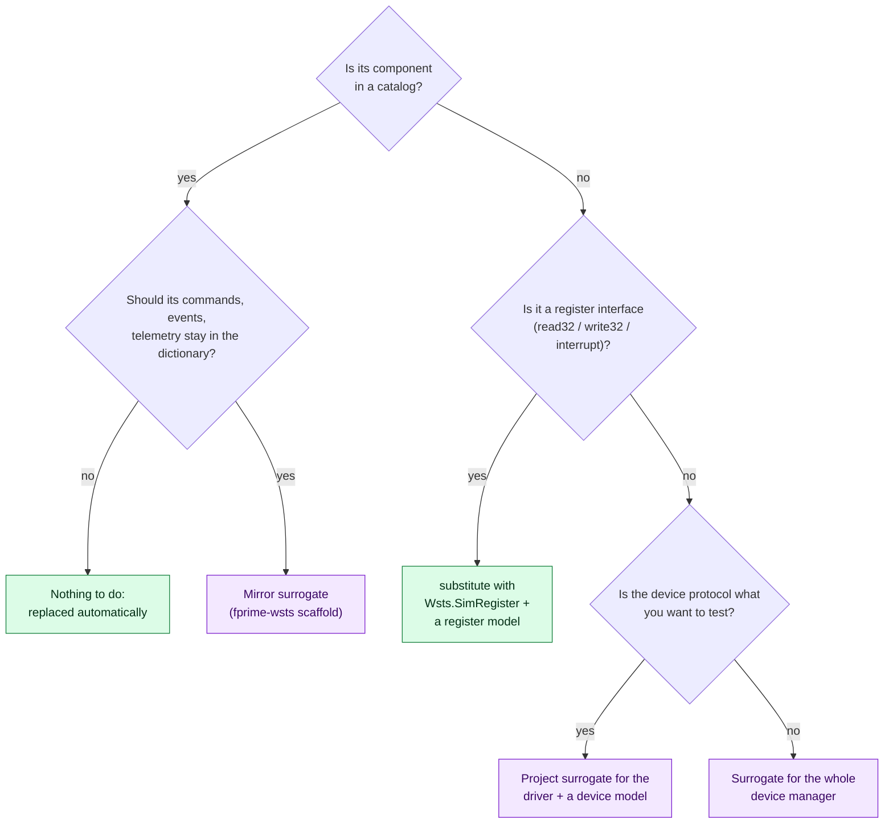

# 1. Survey the Deployment

Before writing anything, find out what in your deployment touches hardware, and how it
starts. Most of it `fprime-wsts` handles on its own; the survey tells you which few things
you will have to say in the manifest.

!!! tip "Let the generator survey for you"

    You can skip ahead and run `fprime-wsts generate` on a manifest that names only the
    deployment (steps [2](simulation-project.md) and [3](manifest.md)). It lists what it
    replaced, what it kept, and stops on anything it cannot decide. Come back to this page
    to understand its answers. The [`wsts-configure` agent skill](agents.md) does this
    survey and interview for you.

## What to look for

Work through your deployment's `Top/` directory (`topology.fpp`, `instances.fpp`, the
topology `.cpp`) and its `Main.cpp`:

- [ ] **The deployment and its topology.** The deployment directory is the one containing
      `Top/`. If `Top/` defines more than one topology, note the one to simulate.
- [ ] **Drivers of the standard F´ interfaces** (`Drv.LinuxI2cDriver`, `Drv.LinuxSpiDriver`,
      `Drv.LinuxGpioDriver`, `Drv.PosixUartDriver`, `Drv.LinuxUartDriver`,
      `VxWorksDrv.VxWorksUartDriver`). These are replaced automatically from the catalog.
      Note what device sits behind each, because that device needs a model.
- [ ] **The tick source.** `Svc.LinuxTimer` and `VxWorksSvc.VxWatchDogTimer` are replaced
      automatically. A project component that is both clock and tick (a "time unit"
      driver) is not, and the deployment would start and then do nothing.
- [ ] **The ground link.** Usually a `Drv.TcpClient` or `Drv.TcpServer` named `comDriver`.
      Keep it real, so the GDS connects as in flight.
- [ ] **Project drivers.** Components of your project that reach hardware through ports of
      their own. Decide per driver (see the chart below).
- [ ] **A register interface component.** A component that FPGA or SoC drivers read and
      write 32-bit registers through, and that delivers interrupts. Replace that, not the
      drivers above it.
- [ ] **How the deployment starts.** Is there a `main()`? A VxWorks kernel module has entry
      points called from a start-up script instead; the manifest will generate a `main()`.
- [ ] **Other computers.** Is there a hub, a UART or a socket to another flight computer?
      Then you are simulating a [system](systems.md).
- [ ] **Simulators you already have.** Loopback components or simulators written for
      hand-built test deployments can be [added to the topology unchanged](simulators.md).
- [ ] **Modules that will not build on a workstation.** Modules that link a vendor SDK,
      include the target's sysroot headers, or have a stub under `if (BUILD_TESTING)`. The
      [host check](build.md) finds these for you.

Configuration overrides (`register_fprime_config(CONFIGURATION_OVERRIDES …)`), instances
inside library subtopologies, and platform libraries are all found and handled without
anything in the manifest.

## Choosing what to do with each hardware instance

Replacing the driver is the default and usually right: everything above it runs as in
flight, and you write or reuse a device model. Replace the device manager only when its
protocol is complex and not what you are testing. [Fidelity](../fidelity.md#choosing-a-seam)
compares the options.

## The example's survey

For comparison, this is what the survey finds in the example's two computers:

=== "Payload (Linux)"

    | Found | Handled by |
    |---|---|
    | `Svc.LinuxTimer` at 20 Hz | Catalog: `Wsts.SimTick` |
    | I2C bus with an IMU (0x68) and a power monitor (0x40) | Catalog: `Wsts.SimI2c`; two models in `payload.yaml` |
    | SPI converter, serial sensor | Catalog; a loopback and a scripted model |
    | Heater pin, over-temperature switch | Project catalog: a mirror of `Drv.LinuxGpioDriver` |
    | `fpgaRegs`, a register interface of `lib/sensor-lib` | `substitute` with `Wsts.SimRegister`; a `Wsts::RegisterFile` model |
    | `Components/Imager` links a camera SDK, has a stub under `if (BUILD_TESTING)` | `cmake.stub_variants` |
    | `hubDriver` to Cdh | A system link |

=== "Cdh (VxWorks)"

    | Found | Handled by |
    |---|---|
    | No `main()`: entry points `cdhStart`, `cdhStop` | `main` in `cdh.yaml` |
    | `VxWorksSvc.VxWatchDogTimer` | Catalog: `Wsts.SimTick` |
    | `comDriver`, the ground link | `keep` |
    | A UART inside the `SensorLink` subtopology of a library | Catalog, by its qualified name `SensorLink.uart` |
    | A project time source | `substitute` with a simulation component, `endpoint: none` |
    | An existing serial sensor simulator component | `simulators`, `devices` |
    | `hubDriver` to Payload | A system link |

## Next

[2. Create a simulation project](simulation-project.md).
