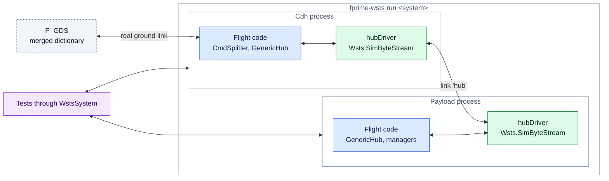

# Multi-Computer Systems

A flight system of two or three computers is simulated as one **system**: each computer's
deployment is converted as usual and runs as its own process, and WSTS carries the links
between them. One command starts the whole system, one GDS operates it, one client
controls it.



**The cut is below the hub.** Hubs, command splitters, framing and buffer handling are
flight code and run unchanged; only the byte stream driver at each end of the physical
link (a UART, `Drv.TcpClient`, `Drv.TcpServer`, `Drv.Udp`) is replaced. A fault on the
link therefore exercises the flight software's real handling of a bad link.

## The system manifest

Write a deployment manifest per computer as in the [walkthrough](manifest.md), then join
them:

```yaml title="my-mission-sim/wsts-system.yaml"
system: Mission
ground: cdh                              # the GDS connects to this element (default: the first)

elements:
  cdh:
    manifest: cdh.yaml                   # relative to this file; may be in another project
    ids: [0x00000000, 0x1FFFFFFF]        # IDs routed to this element (optional)
    bridge: tcp:50100                    # default: the manifest's, else 50100, 50101, ...
  payload:
    manifest: payload.yaml
    ids: [0x20000000, 0x2FFFFFFF]        # e.g. the opcodes the command splitter forwards

links:
  - name: hub                            # faults are addressed by this name
    a: cdh.hubDriver                     # <element>.<instance>
    b: payload.hubDriver
```

**Links.** Naming a byte stream driver instance in a link is enough to have it simulated:
the catalog's surrogate if it has one, otherwise `Wsts.SimByteStream` (the report says
"chosen by link"). What flight software sends on one end is delivered on the other. Link
ends cannot be under `keep`, and cannot also have a device model.

**ID windows.** `ids` is the range of IDs that flight software routes to an element. Each
element's `wstsControl` is placed inside its window, so its commands are routed to it
like any other, and stay distinct in the merged dictionary. Without `ids`, each sits just
above its element's flight IDs.

## Generate, build, run

```bash
fprime-wsts generate my-mission-sim/wsts-system.yaml
```

writes one overlay per element under `wsts/Mission/` (`cdh/`, `payload/`), each with its
own report, and `wsts-system.json`. Elements may come from different flight projects and
target different platforms. Build each element (they are separate F´ builds), then run the
system directory:

```bash
for e in cdh payload; do (cd my-mission-sim/wsts/Mission/$e && fprime-util generate && fprime-util build); done
```

```bash
fprime-wsts run my-mission-sim/wsts/Mission --gds-gui
```

`run` starts every element with its own bridge and logs (`wsts-logs/<element>/sim.log`),
waits until every link is connected, merges the dictionaries (ground element first) into
`wsts-logs/<System>Dictionary.json`, and starts one GDS on the ground element. Commands,
events and channels of every element are then available under their usual names:
`Payload.instrument.TAKE_SAMPLE`, `Cdh.wstsControl.SIM_PAUSE`,
`Payload.wstsControl.FAULT_SET`.

`--env NAME=VALUE` goes to every element and `--env payload.NAME=VALUE` to one.
`--scenario`, `--record` and `--bridge` apply to single deployments only. An element can
still run alone with `fprime-wsts run <system>/<element>`; its links then stay down, as if
the other computer were switched off.

## Control a system

```python
from fprime_wsts.bridge import WstsSystem

with WstsSystem("my-mission-sim/wsts/Mission") as system:
    system["payload"].inject_text("sensorUart", "$TEMP,48.0\n")  # one element's WstsBridge
    system.fault_set("hub", "drop", direction="a_to_b")          # a link, by name
    system.fault_set("payload.hubDriver", "corrupt", arg=0xFF)   # or <element>.<endpoint>
    system.fault_clear("hub")
    system.pause(); system.resume(); system.set_rate(2.0)        # every element
    print(system.links_up(), system.status())
```

A link is faulted at its `a` end: `a_to_b` is what that element sends, `b_to_a` what it
receives, `both` cuts the link.

In pytest, `--wsts-system <dir> --wsts-gds` starts the system for the session, and the
`wsts_system` fixture is a `WstsSystem`:

```bash
D=my-mission-sim/wsts/Mission; pytest tests -p fprime_wsts.pytest_plugin --wsts-system $D --wsts-gds --dictionary $D/wsts-logs/MissionDictionary.json
```

## Things to know

- **Time is per element.** Each has its own tick source, rate and tick count; `pause` and
  `set_rate` on the system reach the elements one after another.
- **Pausing one element** stops its rate groups while the others run: a good test of how
  the rest of the system reacts to a computer that has gone quiet. What it sends from
  other threads (events through a hub, for instance) still arrives.
- **Message boundaries are kept.** Each send is delivered whole to the other side, which a
  real UART or TCP stream does not guarantee; missing framing does not show up here.
- **No link timing.** Add latency with a `delay` fault. Bytes sent while the peer is not
  connected are lost.
- **Build both elements from the same checkout state.** The GDS refuses to merge
  dictionaries whose project versions differ (`-dirty` on one of them).
- **Not built yet:** GPIO links between computers, socket connection semantics,
  system-wide scenarios and lockstep time.

The full description is in the reference's [Systems](../systems.md) page.
